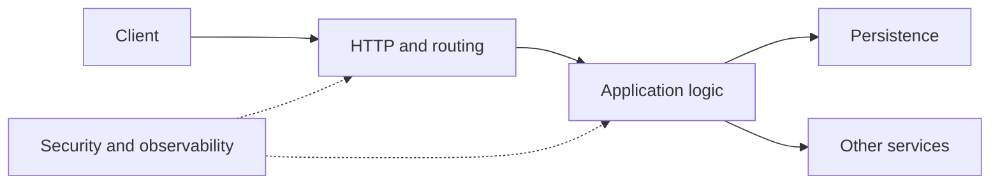

# Video 01 — Roadmap for backend from first principles

- Video: https://www.youtube.com/watch?v=0Rwb4Xmlcwc
- Playlist position: 1
- Notes prepared: 2026-11-16
- Learning: reference notes prepared; owner completion not confirmed.
- Implementation: no separate coding milestone.
- Source: creator's video description and chapter list; [transcript excerpt](https://youtube2text.diguardia.org/v/1-roadmap-for-backend-from-first-principles-0Rwb4Xmlcwc). Not a full transcript review.

## Learning objectives and lecture overview
Backend engineering goes beyond CRUD: a useful service must also remain reliable, maintainable, efficient, and capable of handling growth and failures. The roadmap organizes the course around the components that make this possible, from HTTP and routing through persistence, security, performance, and deployment.

## Supplementary engineering model
Think in terms of a request's journey rather than a collection of frameworks.

A working endpoint is only one outcome. A backend engineer must also reason about correctness, resource limits, failure recovery, security, and how to verify behavior. For instance, booking an event requires preventing duplicate bookings and overselling, not just persisting a row. These are future EventHub milestones, not current requirements.

## Practical connection — orientation only
Read [PROJECT_SPEC](../PROJECT_SPEC.md) and [LEARNING_ROADMAP](../LEARNING_ROADMAP.md). Describe EventHub's actors, request boundary, target workflow and two correctness invariants. Acceptance: distinguish the eventual product from the current milestone; explain why a successful HTTP response alone does not prove a system is reliable. No implementation, stack decision, or infrastructure is required.

## Revision
- Learn the problem and mechanism before selecting a tool.
- Study topics in sequence; introduce complexity only when justified.
- Measure operational claims rather than assuming scalability.

No learner discussion, test evidence or learning-completion confirmation has been recorded for this video.
