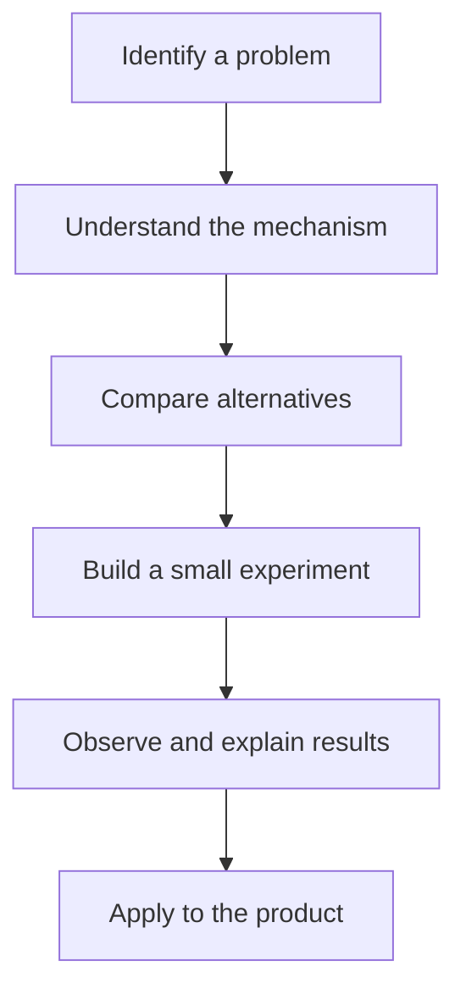

# Video 02 — Walk the path of a true backend engineer

- Video: https://www.youtube.com/watch?v=3qFjZbFRSAU
- Playlist position: 2
- Notes prepared: 2026-11-16
- Learning: reference notes prepared; owner completion not confirmed.
- Implementation: no separate coding milestone.
- Sources: creator's video description and [transcript excerpt](https://copyyoutubetranscript.com/transcript/3qFjZbFRSAU/). Not a full transcript review.

## Lecture overview
The series aims to explain the relationships, underlying ideas and mechanisms of backend components, rather than merely demonstrate language-specific implementations. The learner should build a mental picture of production systems before choosing tools.

## Supplementary learning method

A framework abstracts repeated mechanisms; the mechanism remains relevant when a framework is replaced. Knowing HTTP request semantics makes it easier to move between Go, Node.js and Laravel. A narrowly scoped experiment makes unexpected behavior visible without introducing unnecessary components.

## Practical connection — orientation only
For EventHub, start with a single local backend and inspect its HTTP behavior before adding frameworks and dependencies. For each future lesson, write the problem, expected result, a negative case and actual observations. Acceptance: explain the difference between understanding an abstraction and knowing its API; explain why a failed experiment can still teach something. Do not implement anything separately for this introduction.

No learner discussion, test evidence or learning-completion confirmation has been recorded for this video.
