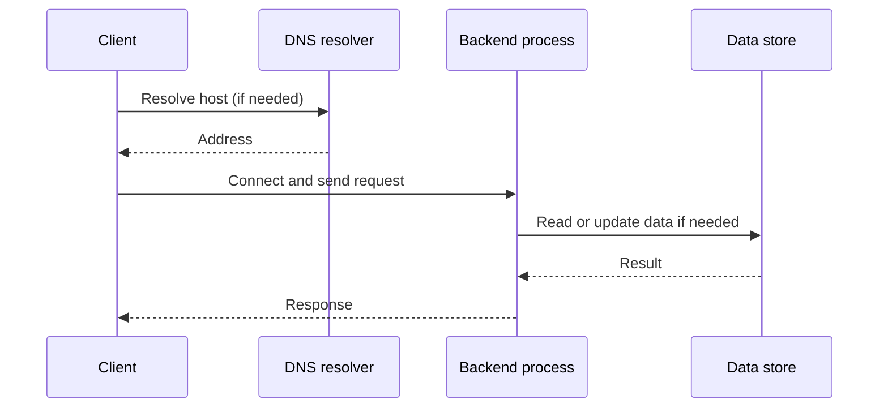

# Video 03 — What is a Backend, how do they work and why do we need them?

- Video: https://www.youtube.com/watch?v=6Ss4dJD9Kzg
- Playlist position: 3
- Notes prepared: 2026-11-16
- Learning: reference notes prepared; owner completion not confirmed.
- Implementation: conceptual orientation only.
- Source: [transcript excerpt](https://copyyoutubetranscript.com/transcript/6Ss4dJD9Kzg/). The available excerpt introduces a network-accessible server receiving requests and serving content; it uses a cloud-hosted backend example. Remaining material below is supplementary, not a claim about the full lecture.

## Learning objectives
Explain clients, servers, addresses, ports, network requests, and why server-side enforcement matters.

## Supplementary concepts and mechanisms
A backend is application functionality that runs behind the client interface. A server process can listen on a network socket, receive requests, execute logic, retrieve data and send a response. The process and its host machine are not synonymous; a machine can run several processes listening on different ports.

A host name is usually resolved to an IP address using DNS (possibly cached). IP routes packets; TCP can provide a reliable byte stream for HTTP/1.1 or HTTP/2. A port identifies a transport endpoint on the host. HTTP defines message semantics; the application decides what to do. HTTPS adds secure transport.

A database is not synonymous with a backend, and not every request needs a database. Centralized server-side logic is useful when many clients must share authoritative state and enforce the same rules. A frontend-only seat count cannot prevent concurrent buyers from claiming the same last seat. The future server-side reservation mechanism must enforce that invariant atomically.

## Production behavior
Connection refusal, DNS failure, transport timeout and an HTTP 500 are distinct failure points. Binding to localhost makes a local experiment accessible only locally; a publicly accessible host requires deliberate network configuration and security.

## Practical connection — orientation only
Draw the boundary between EventHub attendees, organizers, API process and future durable data store. Trace a hypothetical event-list request; identify where connection failure and application error differ. Acceptance: explain what the server owns and why client input cannot be trusted. No database, public deployment or frontend is needed.

## References
- https://developer.mozilla.org/en-US/docs/Web/HTTP/Guides/Overview
- https://www.rfc-editor.org/rfc/rfc9293

No learner discussion, test evidence or learning-completion confirmation has been recorded for this video.
