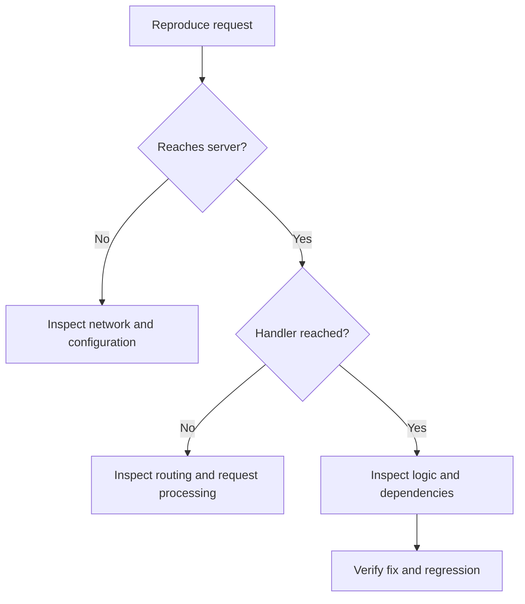

# Video 04 — Benefits of learning backend engineering from first principles

- Video: https://www.youtube.com/watch?v=6fqZs5Z3k9A
- Playlist position: 4
- Notes prepared: 2026-11-16
- Learning: reference notes prepared; owner completion not confirmed.
- Implementation: no separate coding milestone.
- Sources: [transcript excerpt](https://copyyoutubetranscript.com/transcript/6fqZs5Z3k9A/) and [section summary](https://www.usetranscribe.io/yt/6fqZs5Z3k9A/backend-engineering). Not a full transcript review.

## Lecture overview
Unfamiliar languages and codebases make debugging and feature development harder when developers lack a mental model of the request flow. Understanding common system concepts helps engineers orient themselves even when the implementation technology changes.

## Supplementary engineering example
When a booking API fails, first identify the observable symptom, then locate the failing boundary rather than editing random code. Determine whether the request reaches the backend, whether the route matches, what the handler receives, what dependency fails, and how a response is formed.

A shared vocabulary helps engineers look for equivalent mechanisms in unfamiliar frameworks. It does not remove the need to learn language-specific concurrency, libraries, runtime behavior, or tooling.

## Practical connection — orientation only
Given an imaginary EventHub error, write a debugging hypothesis and the observation that would confirm or reject it. Later, use the HTTP server from lesson 05 to practice. Acceptance: distinguish a symptom from a root cause, propose a reproducible request and a negative case, and identify evidence required before calling the problem resolved.

No learner discussion, test evidence or learning-completion confirmation has been recorded for this video.
