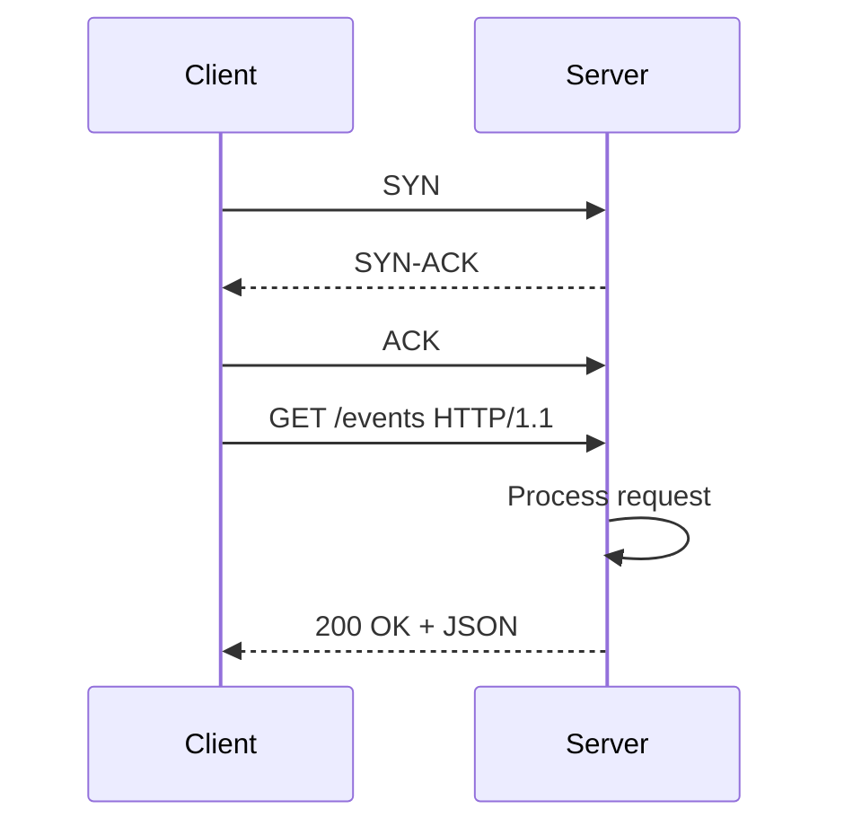
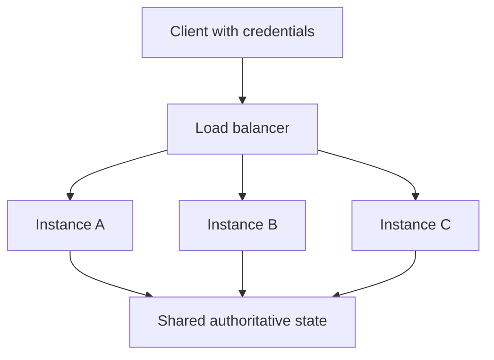
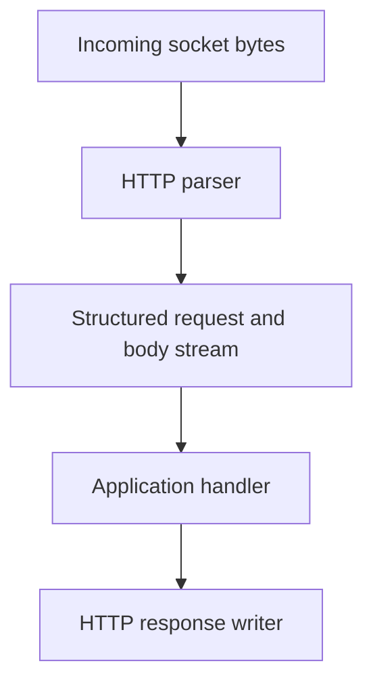
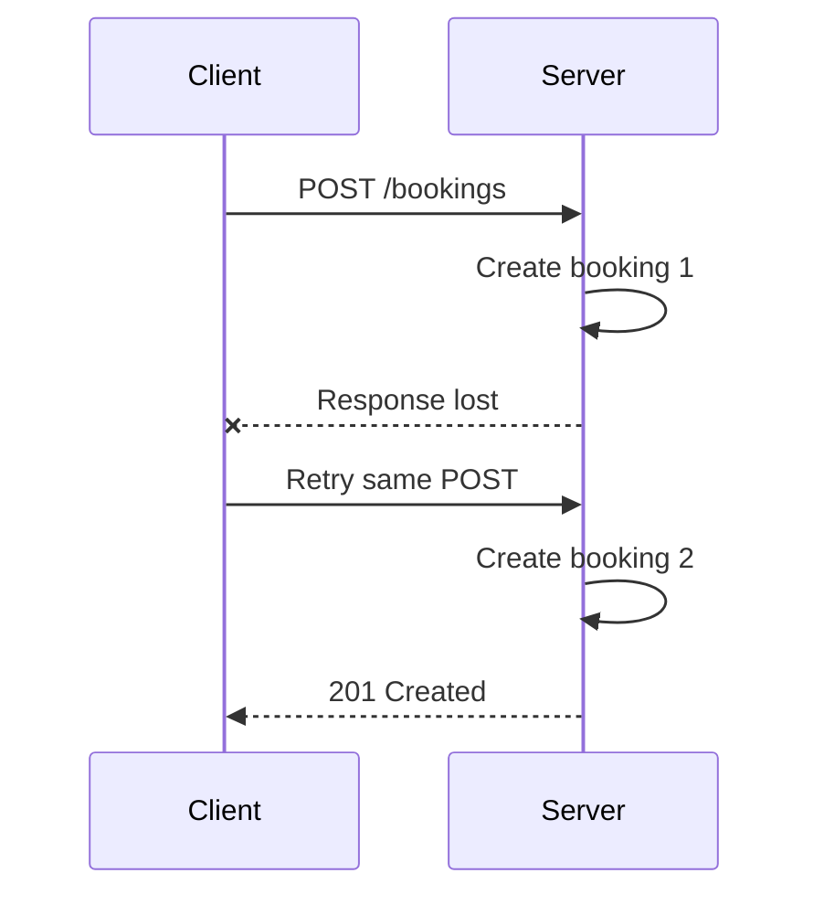
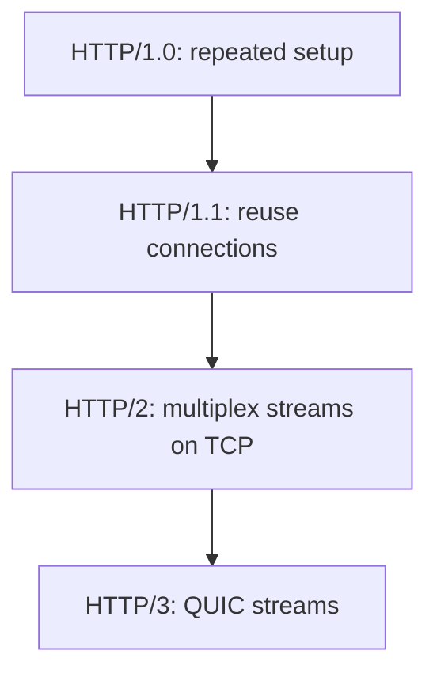
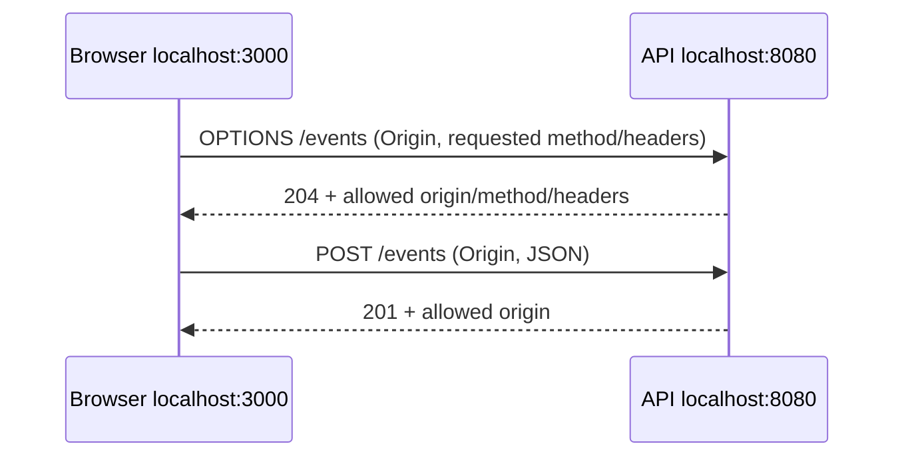
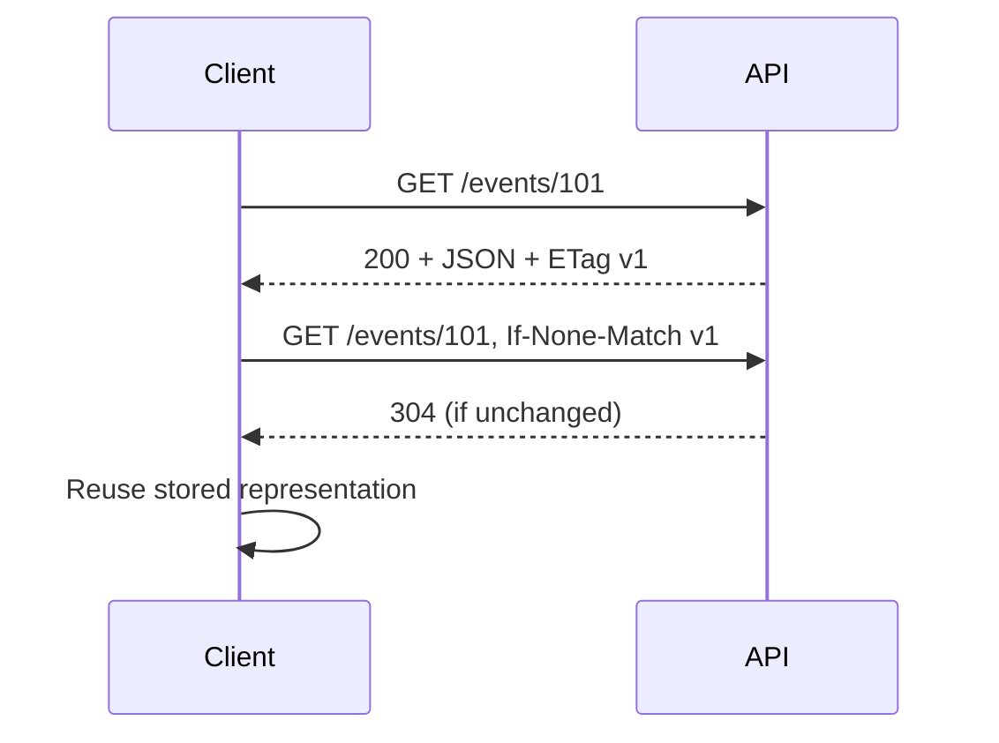

# Video 05 — Understanding HTTP for backend engineers, where it all starts

- Video: https://www.youtube.com/watch?v=a3C1DMswClQ
- Playlist position: 5 (video title/position corroborated by course indexes)
- Date: 2026-11-16
- Learning: **complete** — explicitly confirmed by the owner.
- Implementation: **not started**.
- Source availability: the original teaching session used partial lecture materials and independent technical references, not a full verified transcript. During documentation, a [third-party transcript and section summaries](https://www.usetranscribe.io/yt/a3C1DMswClQ/understanding-http) were located with excerpts on statelessness, headers/methods, CORS, status codes, content negotiation and compression. The full transcript could not be reopened. The following is a record of the actual mentoring session plus supplementary engineering explanations; it is not a verbatim or exhaustive video transcript.

## Learning objectives
Explain HTTP beyond framework calls; distinguish connection establishment from requests; interpret wire messages, headers, method semantics and status codes; reason about statelessness, retries, browser CORS, protocol versions, caching and compression; implement a small native HTTP server and inspect its actual behavior.

## 1. HTTP and network layers
HTTP is a shared application-layer protocol defining communication semantics. A React or Flutter client can call a Go or Node backend without knowing its internal programming language. HTTP does not execute business logic; application code does. A stable API contract allows implementations to evolve independently.

| Layer | Role |
| --- | --- |
| HTTP | Meaning and representation of requests/responses |
| TCP or QUIC | Transport of application data |
| IP | Packet addressing and routing |
| Ethernet/Wi-Fi | Delivery across a local link |

HTTP/1.1 and HTTP/2 use TCP; HTTP/3 uses QUIC over UDP. For a new plaintext HTTP/1.1 connection:



DNS resolution may precede connection setup. HTTPS adds TLS authentication/encryption (integrated with QUIC for HTTP/3). Existing connections can be reused; a request is not inherently a new TCP connection. These network details supplement the lecture.

## 2. Statelessness
HTTP does not automatically carry application identity or workflow state from one request to the next. After a successful login, a subsequent protected request without credentials can still receive 401. Cookies or Authorization headers can carry an identifier or credentials; application sessions may live in shared storage.



Stateless application instances are easier to distribute and replace, but HTTP statelessness does not guarantee that an application is stateless or scalable. A local-only session creates replica affinity unless another mechanism provides access to it. Databases and sessions are allowed; identity and authorization must still be verified. Real authentication is deferred.

## 3. Message anatomy
HTTP/1.1 messages have a start line, header fields, an empty line and an optional body. The following examples use compact ASCII JSON; lengths exclude any trailing newline.

```http
POST /events HTTP/1.1
Host: api.eventhub.example
Content-Type: application/json
Accept: application/json
Content-Length: 34

{"name":"Tech Summit","seats":100}
```

```http
HTTP/1.1 201 Created
Content-Type: application/json
Location: /events/101
Content-Length: 31

{"id":101,"name":"Tech Summit"}
```

Actual HTTP/1.1 lines use CRLF. Content-Length is a byte count rather than a character count; the native HTTP library should handle framing. HTTP/2/3 use different wire formats but retain HTTP semantics. The original display showed an inconsistent request length; 34 is correct for the exact body above.



The framework provides parsed methods, headers, paths and body streams. It is separate from JSON parsing and domain validation. A body may arrive incrementally, not as one TCP packet.

## 4. Headers and content negotiation
| Header | Purpose |
| --- | --- |
| Host | Target host/authority for HTTP/1.1 |
| Content-Type | Media type of the enclosed representation |
| Content-Length | Message content length in bytes when applicable |
| Accept | Preferred response media types |
| Accept-Language | Preferred response languages |
| Accept-Encoding | Supported/preferred content codings |
| Content-Encoding | Coding applied to the representation |
| Authorization | Credentials |
| Cookie / Set-Cookie | Send cookies / instruct the browser to store them |
| Cache-Control | Caching policy |
| ETag / If-None-Match | Representation validator / conditional request |
| Origin | Request origin information |
| Location | Created resource or redirect target as applicable |
| User-Agent | Client information |

Content-Type describes what is being sent; Accept indicates what is preferred in return. Sending JSON and requesting XML is possible if the server supports both. Negotiating format, language or coding can require Vary so caches do not serve the wrong variant. The first implementation only needs JSON; unsupported request media types should be rejected rather than silently parsed.

## 5. Methods, safety and idempotency
| Method | Intended EventHub use | Safe | Idempotent by semantics |
| --- | --- | --- | --- |
| GET | Read events | Yes | Yes |
| HEAD | GET-like metadata, no response body | Yes | Yes |
| POST | Create event or booking | No | No |
| PUT | Replace event representation at known ID | No | Yes |
| PATCH | Modify part of event | No | Not guaranteed |
| DELETE | Remove event | No | Yes |
| OPTIONS | Discover communication options | Yes | Yes |

Safe means the requested semantics are read-only, not that incidental logging is forbidden. Idempotent means repeating an identical request has the same intended effect as applying it once, not identical responses. An assignment-style PATCH can be idempotent; an increment operation need not be. HTTP does not automatically enforce these properties.



Timeout does not prove that the server failed to execute. An application-level idempotency key and atomic duplicate detection can prevent repeat effects; merely accepting a header cannot. Durable retry protection and actual booking transactions are future lessons. A DELETE returning 204 then 404 can still be idempotent. Repeated identical PUT of an existing event should leave it in the same state.

## 6. Status codes
- 1xx: informational; 2xx: successful; 3xx: redirection/conditional reuse; 4xx: client-side request errors; 5xx: server-side failures.
- 200 OK; 201 Created (Location when creating an addressable resource); 202 Accepted for work not yet complete; 204 No Content; 304 Not Modified for valid conditional retrieval.
- 400 malformed request; 401 missing/invalid authentication (with appropriate challenge); 403 forbidden; 404 not found; 405 method not allowed (include Allow); 409 state conflict; 415 unsupported media type; 422 syntactically valid content whose instructions cannot be processed; 429 too many requests.
- 500 unexpected internal error; 502 invalid upstream response; 503 temporarily unavailable; 504 gateway timeout.

Status codes convey machine-readable outcomes to clients, proxies and operational tooling. Returning 200 for every error hides meaningful outcomes. Error bodies may contain extra information; they do not replace status semantics.

## 7. Protocol evolution (supplementary)
| Version | Transport | Connection/message behavior |
| --- | --- | --- |
| HTTP/1.0 | TCP | Separate connections by default; extensions allowed reuse |
| HTTP/1.1 | TCP | Persistent connections by default; text messages; ordered responses on a pipelined connection |
| HTTP/2 | TCP | Binary framing, concurrent multiplexed streams |
| HTTP/3 | QUIC over UDP | Concurrent streams, independent ordered delivery per stream |



HTTP/2 multiplexing avoids HTTP/1.1 response ordering constraints, but a missing TCP segment can delay delivery across HTTP/2 streams because TCP exposes an ordered byte stream. QUIC reduces cross-stream transport head-of-line blocking, not all latency or congestion effects. These distinctions matter for high-latency networks; no advanced protocol implementation is required now.

## 8. Same-origin policy and CORS
A browser origin consists of scheme, host and effective port. http://localhost:3000 and http://localhost:8080 are different origins. The same-origin policy limits access to cross-origin resources; CORS allows the server to opt into browser-controlled sharing. It is not authentication, authorization or CSRF protection.

A cross-origin JSON POST normally requires preflight:



Example response fields:
```http
Access-Control-Allow-Origin: http://localhost:3000
Access-Control-Allow-Methods: GET, POST, PUT, DELETE, HEAD, OPTIONS
Access-Control-Allow-Headers: Content-Type
Vary: Origin
```

A failed preflight prevents the actual request. A safelisted/simple cross-origin request can reach the server and mutate state even if the browser refuses to expose its response. curl and Postman do not enforce browser CORS. Credentials require an explicit allowed origin and compatible credentials policy; never blindly reflect arbitrary origins. No login or permanent frontend is needed for the experiment.

## 9. HTTP caching, compression and security headers
The discussion included conditional requests as a supplementary experiment. An ETag identifies a representation version; the client can revalidate instead of downloading unchanged content.



Cache-Control determines freshness/revalidation behavior. A 304 carries no body; changed representations must get an updated validator and a 200 response. Public event descriptions may be cacheable; private tickets and rapidly changing inventory require deliberate policies. Do not treat cache as authoritative inventory.

Compression trades CPU and sometimes latency for less network traffic. A client can send Accept-Encoding: gzip, br and a server may return Content-Encoding: gzip plus Vary: Accept-Encoding. Compare actual bytes and decoded equivalent content if experimenting. The session's 1,000 KB vs 250 KB figures were illustrative, not measured results.

Security-header overview: HSTS instructs compatible browsers to use HTTPS for a host after policy is established; CSP restricts browser resource/script policies; nosniff limits MIME sniffing in applicable contexts. Full security hardening is deferred.

## Discussion and misconceptions
No substantive follow-up technical question was asked after the explanation. The owner requested a right-to-left presentation and then confirmed completion. The interactive checks covered whether HTTP allows sessions, why DELETE can be idempotent with different responses, why browsers enforce CORS, HTTP/2 TCP-level blocking, and whether an uncertain POST can safely be retried. No quiz score or answers were provided.

Key distinctions: connection vs request; HTTP statelessness vs application state; header metadata vs body; safe vs idempotent; client preference vs actual representation; CORS vs access control; cache validation vs freshness. No knowledge or performance claims beyond the confirmed session.

## References
- https://www.rfc-editor.org/rfc/rfc9110.html (semantics)
- https://www.rfc-editor.org/rfc/rfc9111.html (caching)
- https://www.rfc-editor.org/rfc/rfc9112.html (HTTP/1.1)
- https://www.rfc-editor.org/rfc/rfc9113.html (HTTP/2)
- https://www.rfc-editor.org/rfc/rfc9114.html (HTTP/3)
- https://developer.mozilla.org/en-US/docs/Web/HTTP/Guides/Overview
- https://developer.mozilla.org/en-US/docs/Web/HTTP/Guides/CORS

## EventHub practical assignment — coding agent handoff
**Problem:** build the first observable EventHub HTTP boundary to understand how clients interact with a backend independent of framework abstractions. Use a native HTTP server and in-memory event data. The repository does not yet lock a backend language; obtain owner approval before choosing Go net/http or Node HTTP/TypeScript. Use synthetic data only.

### Scope and expected behavior
| Method | Endpoint | Observable result |
| --- | --- | --- |
| GET | /health | 200 with simple health response |
| GET | /events | 200 JSON list |
| GET | /events/1 | 200 JSON or 404 |
| POST | /events | 201 JSON with unique ID and Location |
| PUT | /events/1 | 200 for replacing an existing event; 404 if absent in this exercise |
| DELETE | /events/1 | 204 without body; 404 if absent |
| HEAD | /events | GET-like metadata and no body (roadmap-aligned) |
| OPTIONS | /events | 204, Allow and applicable CORS headers |

Use a minimal event model (id, name, seats) and in-memory collection. Path/method dispatch only as necessary; no elaborate router. Document the chosen basic input rules, e.g. nonempty name and nonnegative integer seats, and reject invalid data before mutation. Method not supported on a known resource returns 405 with Allow; unknown resource/path returns 404. No real booking feature is required.

### Acceptance criteria and experiments
1. Local run command and port documented; inspect raw headers with `curl -v --http1.1 http://localhost:8080/events` and `curl -i http://localhost:8080/events`. Adjust port if needed. Record observed request line, response code, media type and body.
2. Demonstrate each endpoint above using valid synthetic requests. Creation returns distinct IDs; GET has no intended mutation; repeated identical PUT leaves the same state; DELETE returns no body and repeated deletion leaves resource absent. Deliberate repeated POST creates distinct events, illustrating non-idempotency.
3. Invalid JSON returns 400; unsupported Content-Type returns 415; valid JSON with invalid fields returns 422 (or document a consistent 400 choice); verify no mutation. Unknown paths and methods produce distinct errors, and HEAD has no body.
4. Use a disposable browser test page on a different local port. Allow only the stated test origin; observe successful simple GET and JSON POST preflight in DevTools; deny a different origin and verify browser behavior. Distinguish blocked preflight from blocked response access. curl alone does not prove browser enforcement.
5. Implement a simple ETag validator for one event GET. Capture the returned ETag, send If-None-Match with the same value and expect 304/no body; update the event, repeat conditional request and expect 200 with updated validator. No external cache required.
6. Compare multiple requests to the same origin in one curl invocation with separate curl invocations or forced Connection: close. Inspect verbose connection messages; explain whether reuse occurred. No performance claim without measurements.
7. Optional observation: negotiate gzip for a synthetic larger JSON body, using native tools, and compare measured sizes. If not implemented, record as deferred; not a completion gate.

### Edge cases and deliberately deferred work
- Empty collection, unknown IDs, malformed JSON, duplicate POST, repeated PUT/DELETE, rejected origin, changed ETag.
- In-memory state resets on restart. Do not claim persistence, production readiness or concurrent booking safety. Protect in-memory mutations appropriately for the chosen runtime; avoid shared mutable state races.
- Defer database, full routing abstraction, comprehensive serialization/validation framework, real authentication, reservations, durable idempotency, distributed cache, payments, deployment, full frontend and advanced protocol implementation.
- Before starting, confirm language choice and inspect actual repository state. Native library handles HTTP parsing; no custom transport or crypto required.

## Learning completion (ChatGPT)
- [x] Owner explicitly confirmed lecture finished.
- [x] Concepts, discussion and assignment documented.
- [x] Learning status updated independently in PROGRESS.md.

## Implementation evidence (coding agent; in progress)
No code, tests, experiments or benchmarks were executed during documentation.

### Step 1 — server and `/health` (2026-11-18)
Decisions: [ADR-001](../decisions/001-backend-language-and-tooling.md). Code: `backend/src/server.ts`, tests: `backend/test/health.test.ts`. Environment: Node v24.22.1, Linux.
- `cd backend && npm test`: 3 tests passed, 0 failed (GET /health 200 JSON; POST /health 405 with `Allow: GET`; unknown path 404).
- `PORT=8080 npm start`, then `curl -sv --http1.1 http://localhost:8080/health`: request line `GET /health HTTP/1.1`; response `HTTP/1.1 200 OK`, `Content-Type: application/json; charset=utf-8`, `Content-Length: 15`, `Connection: keep-alive`, `Keep-Alive: timeout=5`, body `{"status":"ok"}`.
- `curl -i -X POST /health`: `405 Method Not Allowed` with `Allow: GET`. `curl -i /nope`: `404 Not Found`.
- Limitations at that point: only `/health` existed; no type-check configured.

### Tooling — type-check and install-script policy (2026-11-18)
- Added `backend/tsconfig.json` (strict, `noEmit`) and `npm run typecheck` (`tsc --noEmit`): exit code 0.
- npm warned that `esbuild@0.28.2` has an unapproved postinstall script. Denied it (`allowScripts: { esbuild: false }` in `backend/package.json`). After deleting `node_modules` and reinstalling there was no warning and tests still passed, so `tsx` does not need the script here.

### Step 2 — `GET /events` (2026-11-18)
Code: `backend/src/server.ts` (in-memory `events` array of synthetic data), tests: `backend/test/events.test.ts`.
- `npm test`: 7 passed, 0 failed (3 health, 4 events: 200 JSON list, no mutation across repeated GETs, empty collection returns `[]`, `DELETE /events` returns 405 with `Allow: GET`).
- `curl -si --http1.1 http://localhost:8081/events` (port 8081 used for the run): `HTTP/1.1 200 OK`, `Content-Type: application/json; charset=utf-8`, `Content-Length: 103`, body `[{"id":1,"name":"Synthetic Jazz Night","seats":120},{"id":2,"name":"Synthetic Tech Meetup","seats":80}]`. `curl -X DELETE /events`: `405` with `Allow: GET`.
- Limitations: read-only; `Allow` will grow as POST/HEAD/OPTIONS are added. State resets on restart. Owner confirmation pending.

- [ ] Implementation or reproducible experiment.
- [ ] Acceptance criteria demonstrated.
- [ ] Negative cases and regression checks.
- [ ] Implementation progress updated and owner confirmed.

### Step 3 — `GET /events/:id` (2026-11-18)
Owner decisions: any non-canonical id or trailing slash returns 404 (no 400 split); ids must match `^[1-9][0-9]*$` so each event has one URL. Code: `backend/src/server.ts`, tests: `backend/test/event-by-id.test.ts`.
- `npm test`: 19 passed, 0 failed (includes 200 for `/events/1`, 404 for `/events/999`, 404 for `abc`, `0`, `-1`, `01`, `1.0`, `1e0`, `1/`, `1%20`, no mutation, `DELETE /events/1` returns 405 with `Allow: GET` and does not delete). `npm run typecheck`: exit 0.
- `curl` against a running server (port 8082): `/events/1` -> `200 application/json; charset=utf-8` with body `{"id":1,"name":"Synthetic Jazz Night","seats":120}`; `/events/999`, `/events/abc`, `/events/01` -> `404 application/json; charset=utf-8`.
- Limitations: read-only; 404 body does not distinguish a malformed id from a missing event. Owner confirmation pending.

### Step 4 — `POST /events` (2026-11-18)
Owner decisions recorded in [ADR-002](../decisions/002-event-creation-rules.md). Code: `backend/src/server.ts`, tests: `backend/test/create-event.test.ts`. `Allow` for `/events` is now `GET, POST`.
- `npm test`: 31 passed, 0 failed. `npm run typecheck`: exit 0.
- Positive: valid POST -> `201`, `Location: /events/3`, body `{"id":3,"name":"Synthetic Concert","seats":50}`; the same POST repeated -> a new event with id 4 (non-idempotent); the list then contained both.
- Negative (none mutate the store, checked in tests): `Content-Type: text/plain` -> 415; body `{` -> 400 `{"error":"Malformed JSON"}`; `{"name":"  ","seats":-1}` -> 422 with two `details`; 20 KB body -> 413. Tests also cover non-object JSON, missing/wrong-typed fields, 101-char name, fractional/string/null/oversized seats, and a streamed body without `Content-Length` (413).
- Not covered: concurrent POST races (Node runs handlers on one thread and the store update has no `await`, so it is atomic here; no stress test was run); no server timeouts configured for slow bodies.
- Limitations: in-memory only; no idempotency key; owner confirmation pending.

### Step 5 — `PUT` and `DELETE` on `/events/:id` (2026-11-18)
Owner decisions recorded in [ADR-003](../decisions/003-put-delete-semantics.md). Code: `backend/src/server.ts` (JSON body reading is now shared by POST and PUT), tests: `backend/test/modify-event.test.ts`. `Allow` for `/events/:id` is now `GET, PUT, DELETE`. The earlier test that expected `DELETE /events/1` to return 405 was replaced by a `PATCH` 405 test because DELETE is now implemented.
- `npm test`: 44 passed, 0 failed. `npm run typecheck`: exit 0.
- Positive (`curl` on a running server): `PUT /events/1` with `{"id":5,"name":"Renamed Night","seats":99}` -> `200`, body `{"id":1,"name":"Renamed Night","seats":99}`; the identical request again -> the same response and state (idempotent). `DELETE /events/2` -> `204 No Content` with no `Content-Type` and no body; the list afterwards contained only event 1.
- Negative: `PUT /events/999` with an invalid body -> `404` (existence checked first); `PUT /events/2` with `{"name":"A"}` -> `422`; repeated `DELETE /events/2` -> `404`; `GET /events/2` -> `404`; `PATCH /events/1` -> `405`, `Allow: GET, PUT, DELETE`. Tests additionally cover 415/400/413 on PUT, unchanged store after each failure, DELETE ignoring a request body, DELETE with non-canonical ids, and that a deleted id is not reused by a later POST.
- Not covered: concurrent PUT/DELETE races (no stress test), `If-Match`/lost-update protection.
- Limitations: in-memory only; owner confirmation pending.
