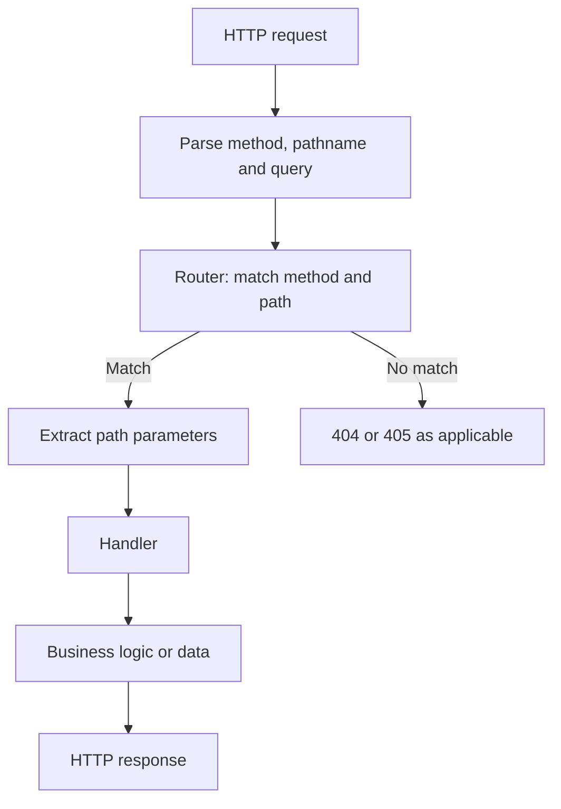
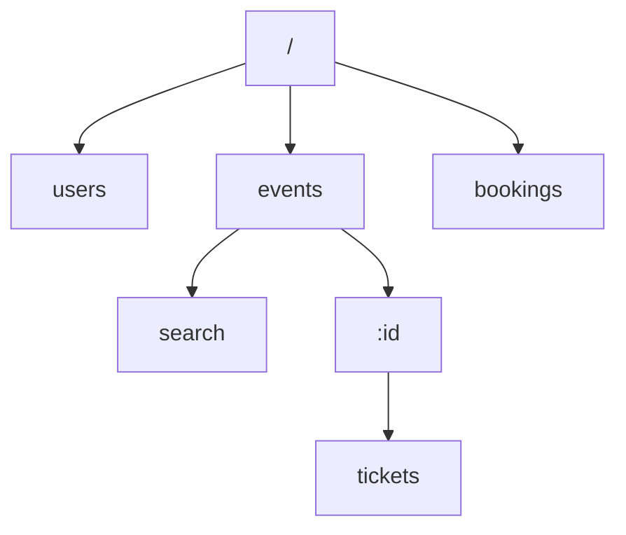
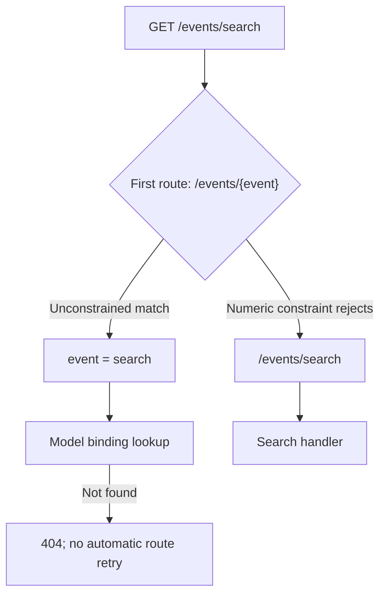

# Video 06 — What is Routing in Backend? How Requests Find Their Way Home

- Video URL: https://www.youtube.com/watch?v=SubuU1iOC2s
- Playlist position: 6 ([course playlist](https://www.youtube.com/playlist?list=PLui3EUkuMTPgZcV0QhQrOcwMPcBCcd_Q1)).
- Date: 2026-11-16
- Learning status: complete (owner requested upload after discussion).
- Implementation status: awaiting learner review (2026-11-18).
- Source availability: lecture identity and topic were identified in the learning session from available materials and transcript excerpts; full transcript was unavailable. The explanations below synthesize the session, with framework behavior, trees, HTTP status semantics and assignment design as supplementary engineering material, not a verbatim or exhaustive account of the video. No runtime experiments or benchmarks were performed during this learning session.

## Learning objectives
- Explain why routing exists and distinguish HTTP parsing, route selection and business logic.
- Predict matching based on method, path, parameters, ordering and constraints.
- Distinguish path parameters, query parameters, nested resources, versioning and wildcard routes.
- Explain route collisions in Express and Laravel, and distinguish routing failure from handler/model lookup failure.
- Build and test a minimal router before adopting an abstraction.

## Concepts and internal mechanisms

An HTTP server receives requests on the same listening address/port. It needs a dispatch mechanism to choose the handler responsible for each operation. A router associates an HTTP method and path pattern with a handler; it normally does not need a database to make that choice. A handler can then perform business operations, including database access.



### Method and path
GET /events and POST /events share a path but have different intended operations and handlers. GET /events/42, PATCH /events/42 and DELETE /events/42 demonstrate method-specific dispatch for a particular resource. HTTP defines the method semantics; routing is an application mapping, not a guarantee those semantics are implemented correctly. A simple native router can start with conditions and then replace them with registered route records containing method, pattern and handler.

### Static, dynamic and query parameters
A static route such as /events has a fixed path pattern but can return changing data. A dynamic pattern such as /events/:id (Express notation) or /events/{id} (Laravel notation) extracts one segment instead of requiring a declaration for each event. In GET /events/42?include=tickets, id is 42 and include is a query parameter. In GET /events?city=alexandria&sort=date&page=2, the query controls filtering, sorting and pagination. Usually query strings are not part of pathname matching. Query values and captured IDs are untrusted input, not typed or validated merely by extraction.

### Nested routes, versioning and wildcards
GET /events/42/tickets expresses the parent-child relationship. If ticket IDs are globally unique, /tickets/100 can be a simpler direct lookup. Nesting does not enforce ownership automatically. Keep nesting meaningful, not arbitrarily deep.

A breaking response change (e.g. name renamed to title) can break deployed clients. /api/v1 and /api/v2 allow deliberately maintained contracts in parallel, at the cost of additional compatibility testing and maintenance. Additive changes often do not require a new version if clients tolerate extra fields. Use only v1 for the current exercise.

A catch-all pattern such as /files/* conceptually matches many descendants; exact syntax varies by router/version. Useful for proxies, static-file handling and fallbacks, but overly broad matches can mask routes or expose unintended paths.

### Lookup strategies and trade-offs
An ordered list can be scanned until the first matching route; worst-case search can inspect all N routes. A trie/radix tree can share path prefixes to avoid examining unrelated routes. The following is a conceptual tree, not the actual data structure used by Express or Laravel:



Actual costs depend on pattern evaluation, path length and implementation. For a small learning project, an ordered table is simple and adequate; measure before optimizing. Frameworks may compile regexes, use caches or specialized matching structures.

## Production behavior and failure scenarios
- Unknown path: 404. Known resource/path but unsupported method: 405 with an Allow header listing supported methods, where applicable. Some frameworks default to 404 until explicitly configured. A matched handler may independently return 404 for a missing event.
- Path constraints prevent accidental matches before business logic and database access. Validation and authorization remain necessary even after a route matches.
- Define/document treatment of case, trailing slash, URL encoding, empty/multiple segments and malformed escape sequences. Decode carefully, once, and do not allow an encoded slash to silently change segmentation or authorization boundaries.
- HEAD/OPTIONS may have special handling or automatic registration; preserve the behavior established in lecture 05 and document the selected policy. Do not interpret a route match as permission to access the resource.
- Avoid logging credentials in URLs or request details; avoid exposing internal error information in fallback responses.

## Discussion and misconceptions — Express versus Laravel
The learner asked how both frameworks handle overlapping static and dynamic routes. For the ordinary overlapping GET routes below, registration order matters in both. Neither automatically guarantees a more specific static route wins in this example.

### Express
Express processes registered route/middleware layers in order. If the first matching route sends a response, later routes are not reached.

```js
app.get('/events/:id', (req, res) => {
  res.send('Event ID: ' + req.params.id);
});
app.get('/events/search', (req, res) => res.send('Search Events'));
```

GET /events/search is captured by the first pattern with id = search. Register /events/search first, or constrain the ID. For Express 5, a RegExp route works without relying on the older inline path syntax:

```js
app.get(/^\\/events\\/([0-9]+)$/, (req, res) => {
  res.send('Event ID: ' + req.params[0]);
});
app.get('/events/search', searchEvents);
```

Another alternative is explicitly skipping the current route using next('route') from an app.METHOD/router.METHOD callback before sending a response:

```js
app.get('/events/:id', (req, res, next) => {
  if (!/^\\d+$/.test(req.params.id)) return next('route');
  res.send('Event ID: ' + req.params.id);
});
app.get('/events/search', searchEvents);
```

This permits runtime conditional dispatch; prefer a constraint when the allowed syntax is known in advance. Express 4 and 5 differ in path-pattern syntax; confirm the installed version rather than copying older inline regex examples.

### Laravel
Laravel's uncached RouteCollection groups routes by method and ordinarily selects the first matching route, treating fallbacks specially. The compiled route cache uses Symfony's compiled matcher, which is not a general solution to overlapping patterns. Explicit constraints and ordering are safer.

```php
Route::get('/events/{id}', [EventController::class, 'show'])
    ->whereNumber('id');
Route::get('/events/search', [EventController::class, 'search']);
```

whereNumber, whereAlpha, whereAlphaNumeric, whereUuid, whereUlid and custom where constraints express matching rules. They are checked during matching, not inside the controller.

With implicit model binding, an unconstrained /events/{event} can match search before the search route. Laravel then tries to resolve an Event model; if none matches, it returns 404 rather than retrying the search route. A model with that route key could instead be returned. Register custom routes before apiResource('events', EventController::class), and constrain route keys when the domain permits.



| Property | Express | Laravel |
| --- | --- | --- |
| Ordinary overlapping routes | Ordered stack | Method collection; first match when uncached |
| Static priority guaranteed in example | No | No |
| Constraints | RegExp routes, version-specific patterns | Named helpers and regex |
| Skip selected route during execution | next('route') | No directly equivalent ordinary handler mechanism |
| Implicit model binding | Application middleware/logic | Built in |
| Compiled route cache | No equivalent built-in deployment command | route:cache |

Engineering takeaway: use both deliberate registration order and non-overlapping constraints where possible. If identifiers are arbitrary slugs, numeric constraints are inappropriate; reserve special keywords or choose separate paths. Framework behavior discussed is based on documentation/source reasoning, not a live test in the user's environment.

## Key takeaways and references
- HTTP provides the exchange; routing selects the handler; the handler performs work.
- Pattern matching is separate from model resolution, validation and authorization.
- A path parameter identifies a segment; query parameters usually control the selected handler's behavior.
- Distinguish 404 from 405 and define collision policy explicitly.
- [Express routing](https://expressjs.com/en/guide/routing.html)
- [Express 5 migration guide](https://expressjs.com/en/guide/migrating-5.html)
- [Laravel routing documentation](https://laravel.com/docs/12.x/routing)
- [Laravel resource controllers](https://laravel.com/docs/12.x/controllers)
- [Laravel RouteCollection source (12.x)](https://github.com/laravel/framework/blob/12.x/src/Illuminate/Routing/RouteCollection.php)
- [Laravel AbstractRouteCollection source (12.x)](https://github.com/laravel/framework/blob/12.x/src/Illuminate/Routing/AbstractRouteCollection.php)
- [RFC 9110 HTTP semantics](https://www.rfc-editor.org/rfc/rfc9110.html)
These references support supplementary study; framework examples are version-sensitive. No further conceptual question was left open in the discussion.

## EventHub practical assignment — coding agent handoff
**Prerequisite:** complete and verify lecture 05's HTTP milestone first; inspect existing implementation and get owner approval before advancing. The backend language is not yet locked. Use native primitives in the chosen stack initially; the Express/Laravel comparison is educational, not a stack decision.

**Problem and goal:** avoid a growing chain of hard-coded request conditions and demonstrate predictable dispatch independently of real persistence or ticket booking.

**Scope and expected behavior:** preserve existing HTTP behavior; register handlers by method and path, extract parameters, separate pathname from query, group event and booking routes and support a v1 API prefix. Use synthetic/in-memory data or clearly labeled stub handlers; no real booking operation is required.

| Method | Path | Expected handler responsibility |
| --- | --- | --- |
| GET | /health | Existing health behavior |
| GET | /api/v1/events | List/filter mock events |
| POST | /api/v1/events | Create event stub or existing in-memory behavior |
| GET | /api/v1/events/:id | Retrieve mock event |
| PATCH | /api/v1/events/:id | Update stub or existing behavior |
| DELETE | /api/v1/events/:id | Delete stub or existing behavior |
| GET | /api/v1/events/:id/tickets | List synthetic tickets |
| POST | /api/v1/bookings | Booking stub, no real reservation |
| GET | /api/v1/events/search | Static collision test; simple stub or mock search |

Use the path syntax appropriate to the chosen language. Preserve previous unversioned endpoints or an explicitly agreed compatibility policy rather than silently breaking lecture 05 clients. Use positive decimal IDs for this experiment if consistent with existing data.

### Suggested incremental exercise
1. Trace the existing HTTP server and write a minimal method/path dispatcher.
2. Move registered routes into a table, add parameter matching, query parsing and deterministic matching rules.
3. Reproduce the collision with the dynamic route declared first; demonstrate ordering and numeric constraints as distinct fixes.
4. Group the routes and separate handler implementations from matching code. Compare behavior conceptually (or via optional isolated local experiment) with a suitable framework router; do not introduce a framework dependency without owner approval.

### Acceptance criteria and experiments
- GET and POST on the same path dispatch to different handlers.
- GET /api/v1/events/42 yields id=42; missing mock event returns handler-level 404.
- Query parameters such as city, sort and page are accessible separately and do not alter route selection. Repeated and invalid values are handled according to a documented policy; no full validation framework needed.
- Static /api/v1/events/search reliably reaches its handler. Show the unconstrained conflict first in an isolated experiment; then show the corrected ordering and/or constraint. Test with numeric and nonnumeric IDs.
- Unknown path yields 404; unsupported method on a known path yields 405 with correct Allow header, taking relevant HEAD/OPTIONS behavior into account.
- Nested route extracts parent ID and dispatches separately. Document catch-all behavior or demonstrate an isolated mock wildcard with fallback ordered last; no file server needed.
- Demonstrate v1 grouping; unsupported version gets a predictable 404; v2 is not implemented.
- Include tests for trailing slashes, case, encoded path segments, malformed percent escapes, extra segments and empty IDs according to documented policy. Avoid crashes or unintended dispatch.
- Preserve earlier HTTP behavior, including health and applicable method/header experiments. Record curl or automated test commands, expected versus observed outputs and deliberate simplifications. Do not mark complete without actual evidence and owner confirmation.
- Explain why the route matcher does not need a database and why model lookup failure differs from a routing miss.

**Deferred:** real booking and ticket inventory, persistence, advanced request serialization/validation, authentication/authorization, production search, v2 compatibility work, advanced routing optimization, middleware architecture beyond current prerequisites, frontend and deployment.

## Learning completion (ChatGPT)
- [x] Owner confirmed completion by requesting upload after discussion.
- [x] Conceptual notes, discussion and assignment documented.
- [x] Learning status updated independently in docs/PROGRESS.md.

## Implementation evidence (coding agent; awaiting learner review)
Date: 2026-11-18. Environment: Linux, Node via `tsx`, native `node:http`, no new dependencies. Decisions: [ADR-005](../decisions/005-router-and-api-versioning.md). Code: `backend/src/router.ts`, route table and v1 handlers in `backend/src/server.ts`. Tests: `backend/test/router.test.ts` (pure router), `backend/test/routing-v1.test.ts` (HTTP).

Commands run: `cd backend && npm run typecheck` (clean) and `npm test`: 98 tests, 98 pass, 0 fail (64 earlier tests unchanged and passing, 34 new). No benchmarks.

### Steps 1-2 — dispatcher, route table, parameters
Route records (method, segments, constraints, handler) replace the if-chain. `:id` is extracted per segment. GET and POST on the same path dispatch to different handlers (tests: "same path, different methods…", "GET and POST on the same v1 path…"). `Allow` is derived from the table; lecture 05 `Allow` strings are unchanged and their tests pass.

### Step 3 — collision experiment (isolated, unit tests)
- Unconstrained `/events/:id` registered first: `GET /events/search` returns handler `show` with `id = "search"` (the bug, reproduced).
- Fix A, order: static route first, search and ids both correct.
- Fix B, constraint `^[1-9][0-9]*$`: correct in either registration order; `/events/abc` becomes 404.
The server uses both protections.

### Step 4 — groups and versions
`router.group("/api/v1")`. Observed with curl against a local server on port 8099:

| Request | Observed |
| --- | --- |
| `GET /health` | 200 `{"status":"ok"}` |
| `GET /api/v1/events/2` | 200 event 2 |
| `GET /api/v1/events/42` | 404 (handler-level: event missing) |
| `GET /api/v1/events/abc` | 404 (routing miss, constraint) |
| `GET /api/v1/events/search?q=tech` | 200, only "Synthetic Tech Meetup" |
| `GET /api/v1/events?sort=-seats&page=1` | 200, `data` + `meta` |
| `GET /api/v1/events?page=0` | 400, `page must be a positive integer` |
| `GET /api/v1/events/2/tickets` | 200, 3 synthetic tickets |
| `DELETE /api/v1/events` | 405, `Allow: GET, HEAD, POST, OPTIONS` |
| `POST /api/v1/bookings` | 501 stub |
| `GET /api/v2/events` | 404 |
| `GET /api/v1/events/%zz` | 400, server keeps running |

### Negative and edge cases (automated)
Trailing slash, empty id, extra segments, upper-case path, `//api/v1/events`, `%2F` in a segment: 404. Malformed `%`, `%zz`, truncated UTF-8 escape: 400. `%31` decodes to id 1 (200); double-encoded `%2534` is not decoded twice. Repeated `page`, `sort`, `city`, `q`: 400. Invalid PATCH (`seats: -1`, empty body) leaves the store unchanged. HEAD on v1 matches GET headers with an empty body. Wildcard: one or more segments, masks later routes if registered first (unit tests only).

### Why the router needs no database, and routing miss vs lookup miss
`match()` takes two strings and compares them with registered patterns; nothing about the event's existence is known there. `/api/v1/events/42` matches the route (`id = 42`), then the handler looks in the store and returns 404. `/api/v1/events/abc` never reaches a handler. Both are 404 here; they differ in where the decision is made.

### Deliberate simplifications
- Linear scan over routes, not measured; no trie. No middleware.
- `city` is accepted but not applied; tickets are derived on the fly; booking is a 501 stub; mock search is a substring match.
- `PATCH` is v1 only to keep the legacy `Allow` lists stable. Wildcard is not exposed by the server.
- Legacy `/events` kept alongside `/api/v1` instead of redirecting.

### Checklist
- [x] Implementation or reproducible experiment.
- [x] Acceptance criteria demonstrated (tests and curl above).
- [x] Negative cases and regression checks.
- [ ] Learner confirmed; implementation progress marked complete.
