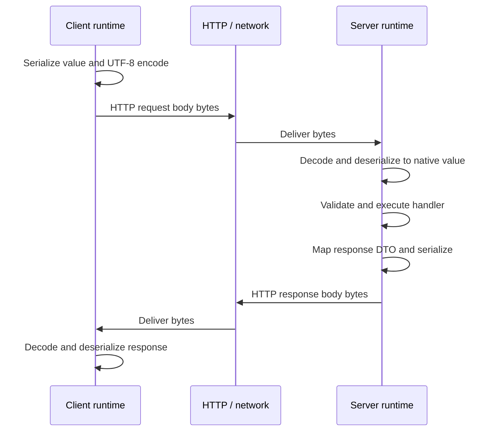
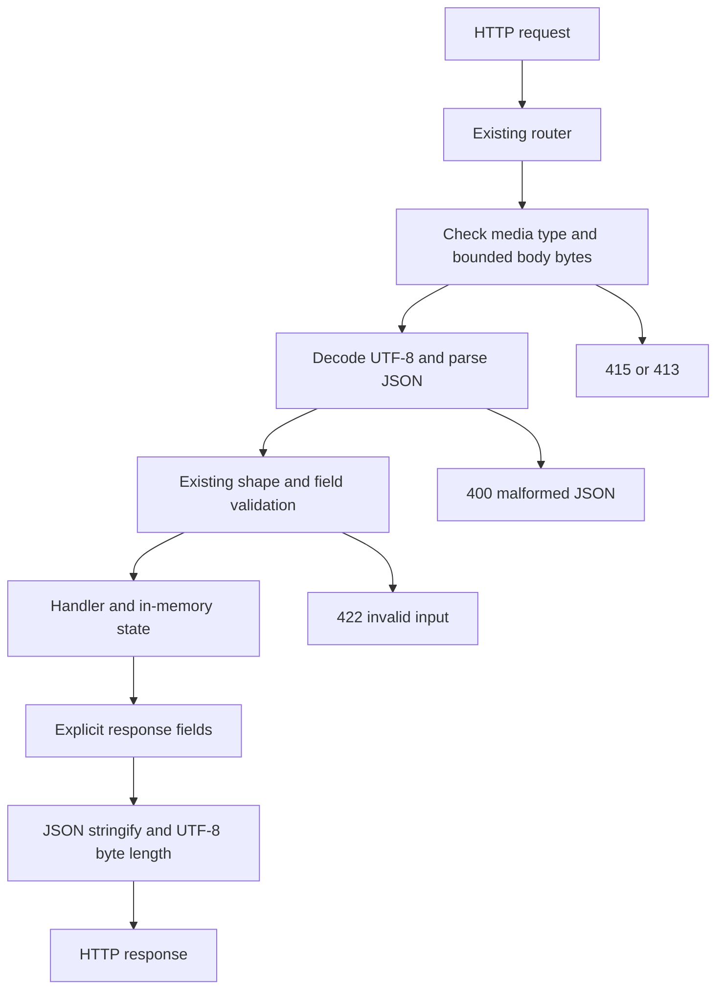

# Video 07 — Serialization and Deserialization for Backend Engineers

- Video URL: https://www.youtube.com/watch?v=vzg90tY3uM0
- Playlist: [Backend from first principles](https://www.youtube.com/playlist?list=PLui3EUkuMTPgZcV0QhQrOcwMPcBCcd_Q1), position 7 as identified during the learning session.
- Date: 2026-11-19 (owner confirmed completion).
- Learning status: complete.
- Implementation status: not started for this milestone; related JSON handling already exists from lessons 05–06.
- Source availability: the teaching session reported using an available transcript rather than directly watching the video. The full transcript was not independently retrieved again for this documentation commit. The notes summarize the actual learning discussion; the extended examples and assignment are supplementary, not claims about exact video wording.

## Learning objectives

Explain why native objects cannot normally cross process or network boundaries intact; distinguish serialization from character encoding, and parsing from validation; compare text and binary formats; identify lossy conversions and safe DTO boundaries; reason about performance using measured bottlenecks rather than format size alone.

## Concepts and internal mechanisms

### The problem: native data is not a wire contract

A JavaScript booking object and a Go struct can represent the same event ID and quantity with different runtime layouts, object metadata and references. Even two Node.js processes with the same TypeScript interface have separate virtual address spaces: an address such as 0x1000 in one process is not a valid reference to the corresponding object in the other. Sending a pointer does not send its referent. TypeScript interfaces are compile-time descriptions and are erased at runtime.

Serialization maps native data to a transferable or storable representation; deserialization interprets that representation into local values. A representation can be textual (JSON, XML, YAML) or binary (Protocol Buffers, MessagePack). Neither requires preserving every property of the original runtime object. Shared memory can avoid ordinary serialization in special cases, but requires a shared representation, synchronization and careful ownership. Function calls within a single runtime generally need no serialization. Even when data is already bytes, transmitting it does not require an additional object serialization stage.

A shared HTTP API contract decouples clients from backend implementation language. A React client may continue to work after migrating Express to Go provided the media types, field meanings, HTTP status codes, headers and behavior remain compatible. JSON alone does not guarantee backward compatibility.

### Representation versus encoding

For a booking:

```ts
const booking = { eventId: 42, quantity: 2 };
const text = JSON.stringify(booking); // {"eventId":42,"quantity":2}
const bytes = Buffer.from(text, "utf8");
const decoded = bytes.toString("utf8");
const value: unknown = JSON.parse(decoded);
```

Serialization creates JSON text; UTF-8 encoding turns it into bytes. Decoding returns text; deserialization interprets the text. Some libraries combine these steps. The example uses 27 UTF-8 bytes because it is ASCII-only. A non-ASCII event name can require more bytes than JavaScript string length (which counts UTF-16 code units); measure with Buffer.byteLength.



This is the usual four object conversion operations for a structured request and response, not a requirement for every HTTP message (GET may have no body, and HEAD/204/304 must not send a response body). The network stack handles segmentation and transport; the OSI presentation layer is a conceptual way to discuss representation, but real TCP/IP implementations do not map literally onto seven separate layers. HTTP uses the Content-Type header to declare the body's media type; the header does not convert the body by itself.

Browser example: JSON.stringify supplies a JSON request body to fetch; response.json reads and parses the response body. A Go receiver could use json.NewDecoder(r.Body).Decode(&booking) with JSON field tags. The production EventHub stack is Node/TypeScript, not Go; Go was a cross-language teaching example.

### JSON vs Protocol Buffers

JSON is human-readable and widely supported; a parser reads field names and literal values. JSON has a limited value model: objects, arrays, strings, numbers, booleans and null. It does not require a separately compiled schema to parse, though an API still needs a contract.

Protobuf uses field numbers, wire types and schema-defined interpretation. Example:

```proto
syntax = "proto3";
message Booking {
  int32 event_id = 1;
  int32 quantity = 2;
}
```

For event_id=42, quantity=2, the illustrative Protobuf bytes are 08 2A 10 02 (4 bytes), versus compact JSON 27 bytes. These are payload-only sizes, with no HTTP framing or compression. A binary message still needs compatible schema knowledge; field numbers must remain stable when schemas evolve. This example does not establish a universal size ratio.

JSON is a reasonable default for EventHub public HTTP APIs, straightforward debugging and interoperability. Protobuf may be useful for high-volume internal services and bandwidth-sensitive workloads; it adds schema/tooling coordination and is harder to inspect without a decoder. XML and MessagePack are additional alternatives. Binary formats are not inherently encrypted or secure.

### Lossy serialization: state is not behavior

```js
const event = {
  id: 1,
  name: "Tech Conference",
  date: new Date("2026-11-19"),
  calculatePrice: () => 500,
  description: undefined
};
const restored = JSON.parse(JSON.stringify(event));
```

The serialized object retains id/name; date becomes the ISO string "2026-11-19T00:00:00.000Z"; function and undefined-valued object properties are omitted. JSON has no undefined or function type. In arrays undefined/functions serialize as null rather than disappearing. Calling restored.date.getFullYear() fails because the value is a string. Reconstructing a Date explicitly can recover the intended type if the contract and value are valid, but omitted behavior cannot be recovered from that JSON alone. Circular references and BigInt fail with default JSON.stringify; nonfinite numbers become null. Missing and explicit null are not interchangeable when an API defines different meanings.

DTOs can deliberately expose just the required state and avoid relying on runtime methods, prototypes, persistence internals or sensitive fields. A type assertion after JSON.parse is not a runtime check.

### Performance: size is not the same as computational cost

End-to-end time includes serialization CPU time, allocations/GC, network transfer (payload bytes / usable throughput), propagation and protocol overhead, deserialization CPU time and other application work. Under equal hardware, smaller bytes may reduce transfer time but do not guarantee cheaper encoding or decoding. Protobuf often reduces field-name overhead and uses known field types, but workload, implementation, runtime, allocation behavior and compression matter.

The discussion used a hypothetical 200 ms request: database 180 ms, network 10 ms, business logic 6 ms, serialization/deserialization 4 ms. Eliminating all conversion saves at most 4 ms (2% of latency, assuming other stages unchanged); halving database time saves 90 ms (45%). This illustrates Amdahl's law: optimizing a small fraction cannot yield a large total speedup. It is an illustrative model, not a measurement of EventHub.

If warranted, measure representative workloads separately: serialized byte count, encode/decode time, throughput, allocations or GC, and end-to-end latency distribution. Warm up the runtime, use identical logical payloads, document environment and versions, repeat samples, and distinguish compressed and uncompressed transport. Do not switch architecture based on synthetic size alone.

## Production behavior and failure scenarios

- Malformed JSON (e.g. trailing comma) is a parsing failure: return 400.
- Well-formed JSON of wrong shape/type is an input contract failure: EventHub currently uses 422. For example {"name":"Meetup","seats":"80"} parses successfully but is not a valid event.
- Well-typed data may violate business constraints: a negative booking quantity is still an integer. Parsing cannot enforce inventory or eligibility.
- Unsupported request media type is 415; oversized request body is 413. Bound bytes while streaming, not just Content-Length. Do not trust a TypeScript cast to establish validity.
- Decode UTF-8 consistently. Decide explicitly how invalid UTF-8, unsupported content encodings and media-type parameters are handled; preserve existing supported behavior unless the owner agrees to a change.
- Return only intended response fields; do not serialize entire user/domain objects containing password hashes, reset tokens or private metadata.
- Limit memory and CPU exposure; malformed/aborted requests must not mutate state or trigger uncaught errors. Ensure errors are not double-written and internal exceptions are not exposed.
- Preserve HTTP semantics from earlier lessons: HEAD, 204 and 304 no body; correct byte Content-Length where applicable; ETag corresponds to actual response representation. Keep routing/CORS behavior unchanged.

## Discussion and misconceptions

1. **Can identical TypeScript frontend/backend interfaces eliminate serialization?** The learner identified runtime/layout differences and language coupling. Clarification: independent memory spaces alone prevent direct pointer sharing, even with identical runtime and layout. Contracts, not languages, define interoperability. Shared memory and same-process calls are exceptions to the ordinary network case.
2. **Does JSON round-trip restore a Date, function and undefined?** The learner recognized that runtime functions and special data may be lost and undefined differs across languages. Clarification: ISO date string survives but type does not; object function/undefined fields are omitted. State is different from behavior.
3. **Is Protobuf always faster if computing power is equal?** The learner initially expected the smaller binary representation to win. Clarification: compare CPU cost, network transfer and memory behavior independently; smaller output alone is not proof. Use benchmarks when the conversion cost warrants it.
4. **Should EventHub move to Protobuf now?** No. Retain JSON; optional benchmark is a learning exercise, not a migration requirement.

No unresolved conceptual question was explicitly left by the learner. The implementation details below remain to be decided/verified with the coding agent.

## Key takeaways and references

- Serialization is a process, JSON is one format, UTF-8 is a character encoding.
- Native runtime objects and API representations are distinct; valid syntax is not valid domain input.
- Prefer explicit DTO fields and predictable errors rather than exposing internals.
- Optimize measured bottlenecks, not assumptions about size.
- Primary video: https://www.youtube.com/watch?v=vzg90tY3uM0
- JSON standard: https://www.rfc-editor.org/rfc/rfc8259
- HTTP semantics: https://www.rfc-editor.org/rfc/rfc9110
- JSON.stringify reference: https://developer.mozilla.org/en-US/docs/Web/JavaScript/Reference/Global_Objects/JSON/stringify
- Protobuf encoding reference: https://protobuf.dev/programming-guides/encoding/
- Node HTTP reference: https://nodejs.org/api/http.html

## EventHub practical assignment — coding agent handoff

### Problem and learning goal

Inspect and improve the existing JSON serialization/deserialization boundary in the native Node HTTP server. The learning goal is to understand the byte stream, representation, parser, DTO and response lifecycle, not to recreate an already working feature.

Baseline inspected on main at 1154afd671bb00b02325063053e72b9edf00da05: backend/src/server.ts already has sendJson, readBody, readJson, isJsonContentType, 16 KiB body limit, validateNewEvent, POST/PUT/PATCH event handlers, and ETag generation. Existing legacy and v1 routes use these helpers. POST /api/v1/bookings remains a 501 stub. Prior progress records 101 passing tests and clean typecheck; those were not rerun for this documentation change.

### In scope / expected behavior

Reuse the existing event endpoints and helpers. Trace the request from IncomingMessage Buffer chunks to UTF-8 text to unknown parsed value, then through existing validation and storage to DTO, JSON serialization and response bytes. If helpful and approved, extract a small reusable JSON helper module without adding a framework. Preserve existing event contract, status codes, body limits and router behavior. Discuss strict encoding and response projection; avoid an unnecessary rewrite. Use existing event endpoints, not a real booking creation feature.



### Suggested incremental exercise

1. Read server.ts, the existing tests and ADRs. Explain what is already implemented and identify gaps before changing anything.
2. Demonstrate a successful create/replace with raw curl, including a non-ASCII event name. Inspect Content-Type, bytes and Content-Length. Compare raw JSON with the native parsed value and the returned event.
3. Reproduce malformed JSON, legitimate JSON null, arrays and wrong field types; compare 400 versus 422 and show no state mutation. Demonstrate 415 and 413 for rejected input.
4. Add focused regression tests for untested cases and improve only the identified serialization boundary. Preserve older routes and existing cache/CORS semantics.
5. Use a small local JSON round-trip script to demonstrate Date/function/undefined behavior. Optional: compare JSON vs Protobuf payloads and measured encode/decode timing in a disposable benchmark; request approval for an additional dependency and document conditions. No format migration.

Example commands (assuming default port 8080 and server started; run locally with synthetic data):

```sh
curl -i http://127.0.0.1:8080/api/v1/events \
  -H 'Content-Type: application/json' \
  --data '{"name":"Café Meetup","seats":30}'
curl -i http://127.0.0.1:8080/api/v1/events \
  -H 'Content-Type: application/json' --data '{"name":"Meetup",}'
curl -i http://127.0.0.1:8080/api/v1/events \
  -H 'Content-Type: application/json' --data '{"name":"Meetup","seats":"30"}'
curl -i http://127.0.0.1:8080/api/v1/events \
  -H 'Content-Type: text/plain' --data '{"name":"Meetup","seats":30}'
```

### Acceptance criteria (observable and testable)

- [ ] Explain the existing helper lifecycle and what was reused versus improved.
- [ ] Valid JSON produces the expected event response (201 for POST; existing PUT/PATCH behavior unchanged), correctly serialized with application/json and UTF-8; byte Content-Length matches actual transmitted body.
- [ ] Malformed JSON yields 400; valid JSON with invalid shape/type yields 422, without mutating state.
- [ ] Unsupported media type yields 415; body exceeding the current 16 KiB limit yields 413, including streamed input without a declared length.
- [ ] Unicode survives round-trip; demonstrate distinction between byte length and string length and document invalid UTF-8/content-encoding policy.
- [ ] Extra/internal fields are not returned or persisted through untrusted event input (use existing explicit field projection; synthetic examples only).
- [ ] JSON lossiness experiment is reproducible and explained; optional binary benchmark remains nonblocking.
- [ ] Existing npm test and npm run typecheck pass, including legacy/v1 routing, HEAD/OPTIONS, CORS and ETag behavior. Record actual commands and outcomes.

### Edge cases

Empty body; null vs parsing failure; arrays/primitives; numeric strings; malformed syntax; unknown fields; non-ASCII characters split across chunks; body exactly at/above byte limit; chunked request; aborted stream; unsupported media type/encoding; response serialization errors (e.g. circular or BigInt values in a controlled experiment). Do not introduce real secrets or artificial production fields simply for demonstration. If an edge requires a behavior change, record the intended policy and request owner approval.

### Out of scope / deliberately deferred

No new authentication, advanced validation architecture, database, real booking/inventory/payment behavior, frontend, gRPC migration, generic serialization framework or performance claims without measurement. Keep the current booking stub. Optional experiments must not become required production dependencies. Subsequent lecture topics remain provisional until verified.

### Prerequisites and unresolved decisions

Owner approval to begin implementation; inspect latest code at that time; decide whether extraction is worthwhile and how strict invalid UTF-8/content encodings should be handled. Existing EventHub validation policy remains authoritative until explicitly changed. No implementation work was performed in this documentation commit.

## Learning completion (ChatGPT)

- [x] Owner explicitly confirmed the lecture is finished.
- [x] Conceptual notes, discussion and assignment documented.
- [x] Learning status updated independently in docs/PROGRESS.md.

## Implementation evidence (coding agent; awaiting learner review)

Date: 2026-11-19. Environment: Linux, Node v24, `tsx`, native `node:http`, no new dependencies. Decision: [ADR-006](../decisions/006-json-boundary-policy.md). Code: `backend/src/json.ts` (extracted helpers), `backend/src/server.ts`. Tests: `backend/test/serialization.test.ts` (13 new). Experiment: `backend/experiments/json-lossiness.ts`.

Commands: `cd backend && npm run typecheck` (clean); `npm test`: 114 tests, 114 pass, 0 fail (101 earlier unchanged). Baseline before changes: 101/101. No benchmarks; Protobuf comparison skipped (optional, needs dependency approval).

### Reused versus improved
Reused: `sendJson`, `validateNewEvent`, 16 KiB limit, 415/413/400/422 mapping, explicit `{id,name,seats}` projection. Lifecycle: `IncomingMessage` chunks (Buffers) -> `Buffer.concat` -> strict UTF-8 decode -> `JSON.parse` (unknown) -> validation -> store -> projection -> `JSON.stringify` -> `Content-Length` = `Buffer.byteLength`.
Improved: invalid UTF-8 now 400 (was silently repaired); BOM rejected; non-utf-8 charset 415; `Content-Encoding` gzip 415; aborted upload no longer leaves a pending promise.

### Demonstrated (automated)
| Case | Result |
| --- | --- |
| "Café Meetup ☕" POST | 201, `application/json; charset=utf-8`, Content-Length equals body bytes (9 bytes vs 6 UTF-16 units for "Café ☕") |
| "é" split across two TCP chunks | 201, name intact |
| Invalid UTF-8 bytes / BOM | 400, no mutation |
| `charset=latin1` / `gzip` encoding | 415 |
| Empty body | 400 |
| `null`, `[]`, `42`, `"text"`, `true` | 422 |
| `seats:"30"` | 422; `{"name":"M",}` 400 |
| Exactly 16384 bytes / 16385 bytes | 201 / 413 |
| Chunked, no Content-Length, 20 KiB | 413 |
| Client aborts mid-body | no mutation, server still serves |
| `id`, `role`, `ownerId` in input | not persisted, not returned |

### Lossiness experiment
`npx tsx experiments/json-lossiness.ts`: Date becomes a string; `undefined` keys vanish; `undefined`/functions in arrays become `null`; `NaN`/`Infinity` become `null`; `Map` becomes `{}`; `-0` becomes `0`; integers above 2^53 lose precision (`12345678901234567890` parses as `12345678901234567000`); `BigInt` and circular structures throw at stringify.

### Open items
Request decompression and Protobuf are not implemented. Owner confirmation of implementation completion is pending.
