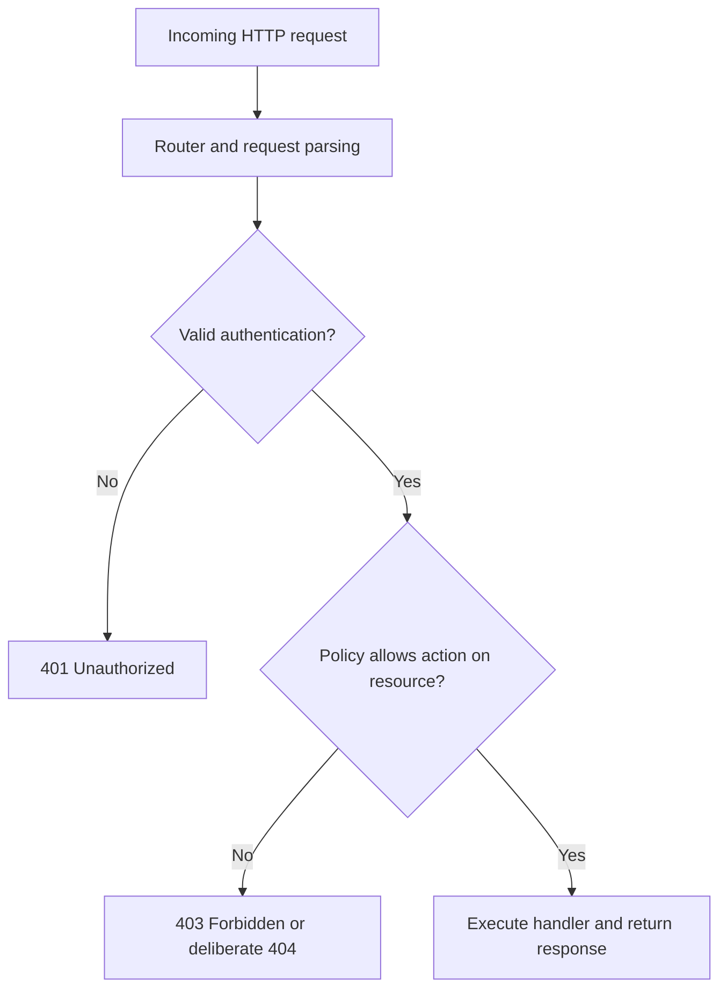
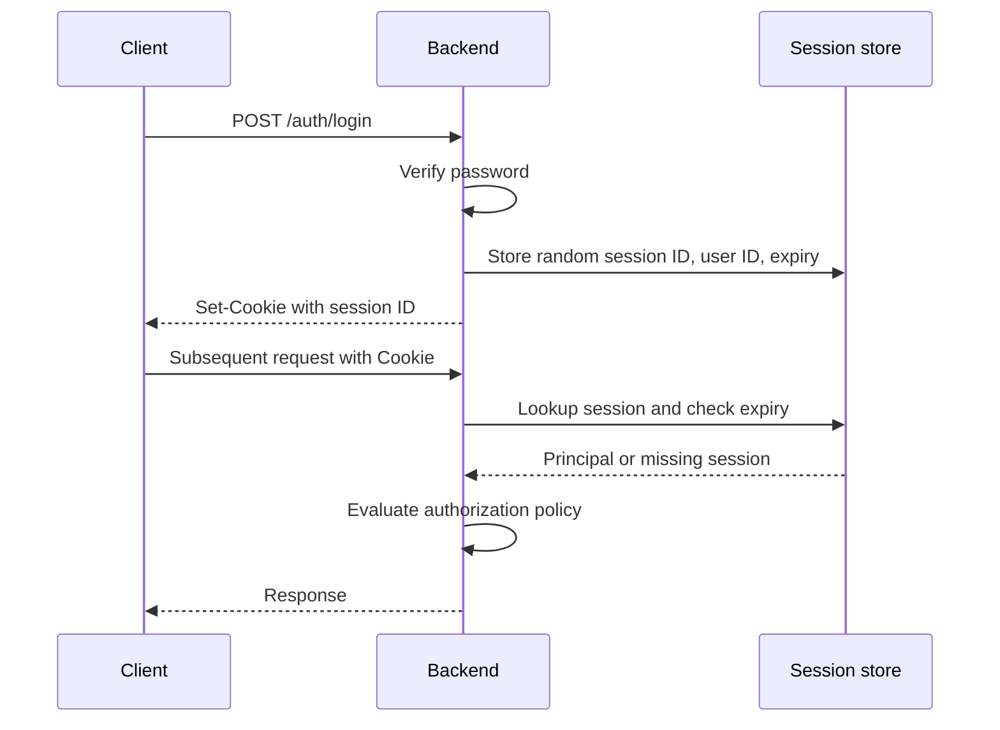
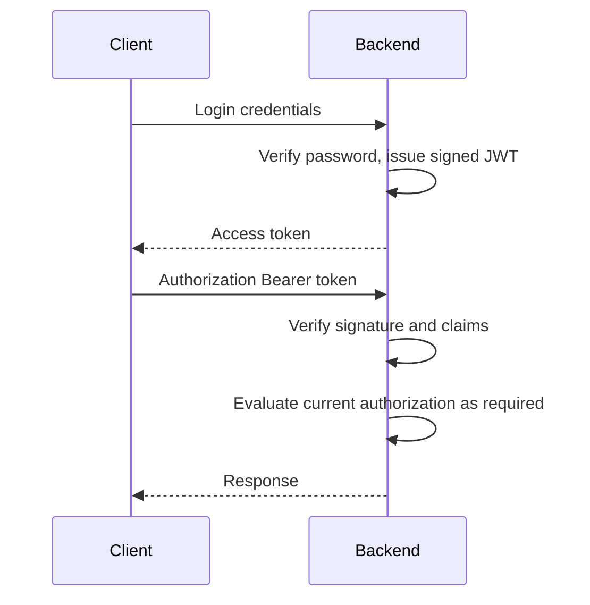
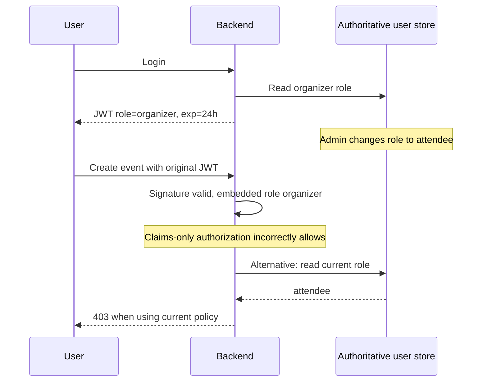

# Video 08 — Authentication and authorization for backend engineers

- Video URL: https://www.youtube.com/watch?v=A95rliroC8Q
- Playlist: https://www.youtube.com/playlist?list=PLui3EUkuMTPgZcV0QhQrOcwMPcBCcd_Q1
- Playlist position: 8 (number and title confirmed against the creator's YouTube listing).
- Date: 2026-11-19
- Learning status: Complete (owner approved uploading the completed discussion).
- Implementation status: Not started.
- Source availability: YouTube title and description verified; third-party summary and transcript excerpts corroborate the authentication/authorization distinction and stateful, stateless, OAuth and API-key approaches. The full transcript was not reviewed end to end. The detailed explanations, security recommendations, JWT role-change discussion and EventHub exercises below are mentor-produced teaching notes, not a verbatim or exhaustive representation of the video's contents.

## Learning objectives

- Distinguish identity verification from permission decisions and explain HTTP 401 vs 403.
- Explain password hashing, salts, authentication factors and why HTTP requires credentials on subsequent requests.
- Trace server-side sessions and signed JWTs through login, request verification, expiry, logout and scaling.
- Distinguish token format, server-side session state and cookie/header transport.
- Explain OAuth delegation, OpenID Connect identity, API keys and role/attribute/relationship-based access control.
- Reason about stale authorization claims, revocation and the cost of distributing current state.

## Concepts and internal mechanisms

### Authentication vs authorization

Authentication establishes who a caller is; authorization determines whether that principal may perform an action on a specific resource. HTTP routing and deserialization (lectures 06–07) do not establish identity or permissions. Changing a user ID in a URL must never grant access to that user's data.



401 indicates missing or invalid authentication credentials (include an appropriate WWW-Authenticate challenge when required); 403 indicates the server refuses the request, commonly because an authenticated caller lacks permission. A deliberate 404 can conceal resource existence under a documented policy. Public endpoints do not necessarily require authentication.

Authentication factors: knowledge (password/PIN), possession (device/security key), inherence (biometric trait). MFA combines different factor types; two passwords do not constitute two factors.

### Password storage and verification

A server need not recover a user's password. Reversible encryption therefore creates unnecessary exposure if the decryption key is compromised; plaintext storage is worse. Use an established password hashing implementation, preferably Argon2id, or an appropriate supported alternative such as scrypt. bcrypt is a legacy alternative with limitations including input length. Never use plain MD5/SHA-256 for password storage or write custom crypto.

At registration a library generates a unique random salt, runs its expensive password KDF and stores the encoded hash, salt and parameters. At login it verifies the submitted password against those stored parameters. Salt prevents precomputed tables and reuse of one hash computation across accounts; it is not secret and does not prevent all guessing. Cost parameters make each guess expensive; tune against the actual environment and bound abusive login traffic. Use HTTPS in production, generic invalid-credential messages, and never log password or hash material.

### HTTP is stateless; login needs continuing proof

A successful login does not make future HTTP requests implicitly authenticated. Re-sending a password on every request increases exposure and expensive password verification. Instead issue a credential that identifies or represents an authenticated session.

### Server-side sessions (stateful authentication)



A session ID is an opaque, cryptographically random bearer credential; the server stores its associated user/session state. Regenerate it after login or privilege elevation to mitigate session fixation. On logout, invalidate the server-side record and clear the client's cookie. Expired, missing or revoked records are rejected.

In-memory storage is easy for a learning exercise but disappears on restart and is not shared across processes. File storage is awkward across replicas; a database offers persistence; Redis can provide fast shared access and TTLs but introduces network and availability dependencies. With two independent servers, a session created on A will not be found on B unless state is shared or routing is constrained. Sticky sessions have failover limitations. Shared stores make horizontally scaled session-based applications possible.

### Signed JWT (typically compact JWS)

A signed JWT can carry claims that a verifier validates without a per-token session lookup. Its common representation is three Base64URL segments: header, payload and signature. For an HS256 example, a vetted library uses HMAC-SHA-256 over the encoded header and payload using a secret. Asymmetric signatures instead use a private signing key and public verification key. Base64URL is encoding, not encryption. A signed JWT payload is readable; JWE is a distinct encrypted representation. Never put secrets/passwords in claims.

Typical claims: sub (subject), iss (issuer), aud (audience), exp (expiry in seconds since Unix epoch), iat (issued at), nbf (not before if used), jti (token identifier if used). The verifier must enforce an allowed algorithm, trusted key, signature, required claims, audience/issuer and expiry, not just decode. A modified payload (e.g. role user -> admin) fails signature verification unless signed with a valid key. A valid token can also be stolen and replayed; signatures do not prevent replay.



Multiple instances can verify tokens using appropriately distributed keys, but application data still needs storage and current authorization may need a lookup. Plan key protection and rotation; do not assume JWT alone makes the entire service stateless.

### Access tokens, refresh tokens and logout

Deleting a JWT in the client does not invalidate a previously copied token. A 24-hour access token may still work 23 hours after logout one hour after issuance if the server checks only signature and expiry. Short-lived access tokens (e.g. 5–15 minutes, illustrative) limit exposure. A longer-lived refresh credential (e.g. 7 days, illustrative) obtains new access tokens; refresh must check current account status and permissions. Server-side refresh-session revocation prevents renewal, not use of an existing unexpired access token. Production refresh designs need secure storage, rotation/reuse handling and revocation. Immediate access-token revocation requires an additional mechanism, such as a denylist or version check; this reintroduces state.

### Sessions vs JWT vs cookies

| Aspect | Server-side session | Self-contained signed JWT |
| --- | --- | --- |
| Credential | Opaque random ID | Signed claims |
| Verification | Session lookup | Signature and claim checks |
| Revocation | Delete/invalidate server-side record | Expiry or additional state |
| Scale | Shared store or constrained routing | Distributed verification keys |
| Permission freshness | Depends on where policy data is read | Embedded claims may become stale |
| Overhead | Store lookup | Crypto and usually larger credential |

Cookie is an HTTP storage/transport mechanism, not an alternative to JWT or sessions. A cookie can carry an opaque ID or a JWT; a bearer token can also be sent in an Authorization header. Browsers automatically send matching cookies based on scope and policy.

Example production cookie attributes: HttpOnly (cannot be directly read by JavaScript), Secure (HTTPS), SameSite=Lax or Strict as appropriate, Path=/; explicit lifetime as needed. Prefer host-only scope where possible. HttpOnly does not prevent XSS from performing authenticated actions; cookie authentication also requires CSRF protections appropriate to the threat model. LocalStorage is accessible to same-origin JavaScript, so XSS can directly steal stored tokens; Authorization-header bearer credentials are not automatically attached cross-site like cookies. Never log credentials.

### API keys, OAuth 2.0 and OpenID Connect

API keys can identify an external application for machine-to-machine integration. Treat secret keys as credentials, scope their access, protect at rest, support rotation/revocation and rate limits; never embed a secret in a public frontend.

OAuth 2.0 delegates limited access to resources without sharing the user's password with the client. Example: EventHub requests permission to add an event to Google Calendar. The user authenticates with Google and authorizes a scope; the browser returns an authorization code to a registered callback; EventHub exchanges the code for an access token and calls the Calendar API with the permitted scope. Modern authorization-code flows use PKCE, secure redirects and applicable CSRF defenses. OpenID Connect adds authentication and an ID token that the client validates (issuer, audience, signature, expiry, nonce as applicable). Access tokens are for resource APIs, not substitutes for validated identity tokens. Do not implement external identity protocols from scratch.

### Authorization models

RBAC assigns permissions to roles (Attendee, Organizer, Admin); ABAC evaluates subject, resource, action and environmental attributes; ReBAC reasons over relationships such as ownership. They can be combined. An organizer role alone must not authorize editing another organizer's event. Example illustrative policy:

```ts
function canEditEvent(user: User, event: Event): boolean {
  return user.role === "admin" ||
    (user.role === "organizer" && event.organizerId === user.id);
}
```

The principal and resource ownership must originate from trusted server-side state, not client-supplied role/owner fields. Apply least privilege, deny by default and check authorization for every protected operation and object. Hiding a frontend button is not security.

## Production behavior and failure scenarios

- Reject missing, invalid, expired or tampered credentials; never accept decoded-but-unverified JWTs, unexpected algorithms, issuer or audience.
- Validate ownership for every relevant read/write to prevent broken object-level authorization. A role alone is insufficient.
- Reject client-selected privileged registration roles and identity/ownership overrides. Provision privileged users through explicitly trusted operations.
- Generic login responses, password hashing, rate limiting, bounded inputs and secret-safe logs reduce account enumeration, brute force and leakage.
- Fail closed if authoritative permission state is unavailable. Distinguish dependency failure from invalid credentials; a 503 may be appropriate for an unavailable store.
- Session records can expire or disappear on restart; replicas need consistent state. JWT key rotation, clock skew, stolen credentials, stale permissions and refresh replay require deliberate policies.
- Even current authorization checks can race with a privilege change: define which requests must observe a committed change, and use suitable transactional/consistency guarantees when introducing persistence for sensitive mutations.

## Discussion and misconceptions

### Question: can a demoted organizer still create events with a valid 24-hour JWT?

The learner requested clarification of the role-change scenario. Initially user 15 has role organizer and receives a JWT containing sub=15 and role=organizer. Two hours later an admin changes the authoritative role to attendee. The previously issued JWT does not change. If the server only verifies the signature and expiry and trusts the old embedded role, the caller can still create events for the remaining 22 hours, absent other safeguards.



The signature proves integrity/authenticity under the trusted key, not freshness of the business information. The token is a snapshot at issuance.

| Approach | Permission change behavior | Cost/trade-off |
| --- | --- | --- |
| Claims-only JWT | Old role accepted until expiration | No extra permission lookup |
| Short-lived JWT | Stale window bounded by remaining TTL | Refresh reads current permissions; no immediate revocation |
| Current user lookup | Subsequent requests reading new state deny immediately | Authoritative store lookup |
| Token versioning | Reject old version once new version is visible | Shared version state and consistency management |
| Server-side session | Revoke session or evaluate updated policy | Shared session/permission state |

Versioning: include a user authorization version in the JWT; increment it when relevant permissions change. Verify the token and compare against trusted current version, possibly cached in Redis. Old version 1 vs current version 2 is rejected. Updates and invalidation must be coordinated; a missing cache entry or stale value must not silently authorize. A changed role should be read from the authoritative user store when issuing a replacement credential. Decide whether version mismatch invalidates authentication (401) or is handled as a permission failure; document consistently.

There is no way for a server holding only an unchanged JWT and verification key to discover an external permission change instantaneously without receiving new state. Event-driven invalidation also distributes state and may have a propagation delay.

Proposed hybrid: JWT for establishing identity and current role/ownership checks on protected mutations and sensitive object reads, optionally rely on short-lived claims only for explicitly documented low-risk actions with tolerable stale access. This is not a final architecture choice. Server-side sessions may be simpler for the current EventHub; compare before adopting. Immediate revocation applies to subsequent decisions observing committed state, not automatically to already-running operations.

Other misconceptions: JWT is not inherently encrypted or superior to sessions; logout is not always revocation; cookies are a transport mechanism; authentication does not grant authorization; frontend checks do not replace server policy.

## Key takeaways and references

- Establish identity, then independently evaluate permissions and ownership.
- Store passwords with a purpose-built salted password KDF, never plaintext or custom crypto.
- HTTP credentials connect otherwise independent requests to an authenticated principal.
- A cryptographically valid JWT can hold outdated claims. Freshness and revocation have state/consistency trade-offs.
- Choose sessions, tokens and authorization policies based on required behavior and threat model, not fashion.
- The role-change clarification is resolved conceptually; choice of EventHub's actual authentication architecture remains open.

References (primary technical reading, supplementary to the discussion):
- [Course video](https://www.youtube.com/watch?v=A95rliroC8Q)
- [Third-party summary and transcript excerpts](https://www.usetranscribe.io/yt/A95rliroC8Q/auth-authorization)
- [HTTP semantics RFC 9110](https://www.rfc-editor.org/rfc/rfc9110)
- [JWT RFC 7519](https://www.rfc-editor.org/rfc/rfc7519), [JWT BCP RFC 8725](https://www.rfc-editor.org/rfc/rfc8725)
- [OAuth 2.0 Security BCP RFC 9700](https://www.rfc-editor.org/rfc/rfc9700), [OpenID Connect Core](https://openid.net/specs/openid-connect-core-1_0.html)
- [OWASP Password Storage](https://cheatsheetseries.owasp.org/cheatsheets/Password_Storage_Cheat_Sheet.html), [Session Management](https://cheatsheetseries.owasp.org/cheatsheets/Session_Management_Cheat_Sheet.html), [Authorization](https://cheatsheetseries.owasp.org/cheatsheets/Authorization_Cheat_Sheet.html)

## EventHub practical assignment — coding agent handoff

**Problem and learning goal:** protect event mutations and user-specific data. Learn password verification, authentication lifecycle, policy enforcement, credential expiry and stale-role failure behavior. Use the existing native Node/TypeScript HTTP router and JSON boundaries; do not build a separate application or prematurely introduce a full framework.

**Prerequisites:** lecture 07 implementation is still pending in the tracker; complete it and obtain owner approval before implementing lecture 08. Inspect current routes, code, tests and decisions. Use the existing API versioning conventions rather than introducing incompatible paths. Keep user/session storage in memory for now (synthetic data only); persistence is a later milestone. Confirm the preferred authentication method with the owner after the comparison.

**Suggested incremental scope:** add an in-memory user store and authentication/policy boundary; implement a small session-based exercise and a separate JWT experiment using a vetted signing/verifying library. Avoid two competing production authentication systems. Adopt one after demonstrating differences. Use established password hashing with unique salts, opaque random session IDs, server-controlled role and resource ownership. Test privileged roles with synthetic fixtures or a trusted test-only harness; do not add an insecure public role-changing endpoint. If cookie-based, implement applicable CSRF defenses and document localhost vs HTTPS settings.

Proposed routes (relative to existing API prefix, align with current router):

| Method | Path | Proposed access |
| --- | --- | --- |
| POST | /auth/register | Public; safe default attendee |
| POST | /auth/login | Public |
| POST | /auth/logout | Authenticated; semantics documented by auth type |
| GET | /auth/me | Authenticated |
| GET | /events | Public, preserve existing behavior |
| POST | /events | Organizer; admin behavior to confirm |
| PATCH | /events/:id | Owning organizer or admin |
| DELETE | /events/:id | Admin only (proposed teaching rule) |
| GET | /me/tickets | Authenticated, own tickets only; fixture or defer if tickets not yet implemented |

These policies are proposed teaching rules, not confirmed final product requirements. Do not implement a full booking/ticket module to satisfy this exercise; use a minimal synthetic ownership demonstration or explicitly defer the real route.

### Acceptance criteria and experiments

- [ ] Register with secure password hashing; two users with identical passwords receive distinct encoded hashes; no plaintext/hash in response or logs. Existing input/body limits remain.
- [ ] Valid login issues the expected credential; wrong password or unknown user yields a generic error. Add bounded login rate limiting or document a safe local-only limitation and production requirement.
- [ ] Public registration cannot set admin/organizer privileges; client-supplied owner or role cannot override trusted server values.
- [ ] Protected endpoints reject missing, malformed, tampered or expired credentials (401 with appropriate challenge); authenticated but disallowed operations return 403 or documented concealment behavior.
- [ ] Attendees cannot create/edit/delete events; organizer can edit own event but not another organizer's event. Test proposed admin behavior explicitly.
- [ ] A caller cannot read another user's tickets or equivalent synthetic private resource by modifying ID.
- [ ] Sessions: login, authenticated request, logout, replay old credential (reject), expiration; compare behavior before/after restart and across isolated instances. No shared infrastructure required for this experiment.
- [ ] JWT: inspect decoded claims without secrets; change role claim without resigning (reject); test expired token and valid signature with wrong issuer/audience or disallowed algorithm. Use real library verification, not a mock signature.
- [ ] Reproduce stale role using a test fixture: issue organizer JWT, demote to attendee, attempt create using claims-only lab policy (expected demonstration of failure), then apply trusted current-role lookup (deny). Keep unsafe variant isolated to tests/lab, never deployed.
- [ ] Demonstrate shortened expiry with controlled clock; show client-only logout does not revoke unexpired JWT. Compare revocation/state trade-offs; incremental refresh-token or versioning experiment only if owner approves, with production requirements documented.
- [ ] Run current HTTP/routing/serialization regression tests and typecheck. Record actual commands, environment, outputs and decisions; no invented performance metrics.

### Important edge cases and deferred work

Check duplicate registrations, malformed credentials, missing users, disabled accounts if modeled, invalid/expired session, token expiry boundaries, clock skew, session fixation, logout replay, unauthorized role/ownership changes, stale cached state and store unavailability. Avoid leaking secrets via errors or traces. Do not weaken earlier CORS, routing or JSON semantics.

Defer real database schema/migrations, Redis deployment, complete OAuth/OIDC provider integration, MFA, email verification/reset flows, sophisticated authorization engines, production refresh rotation infrastructure, full booking domain, frontend and deployment until owner approval/relevant milestones. Do not claim a lab authentication module is production ready.

## Learning completion (ChatGPT)

- [x] Owner confirmed completion by asking to upload the lecture discussion.
- [x] Conceptual notes, discussion and assignment documented.
- [x] Learning status updated independently in docs/PROGRESS.md in the same commit.

## Implementation evidence (coding agent; initially pending)

No implementation, experiments or tests were run as part of this learning-documentation work. Preserve the teaching notes; append actual environment, commands, results, edge cases and relevant decisions after implementation.

- [ ] Implementation or reproducible experiment.
- [ ] Acceptance criteria demonstrated.
- [ ] Negative cases and regression checks as applicable.
- [ ] Implementation progress updated and learner confirmed.
