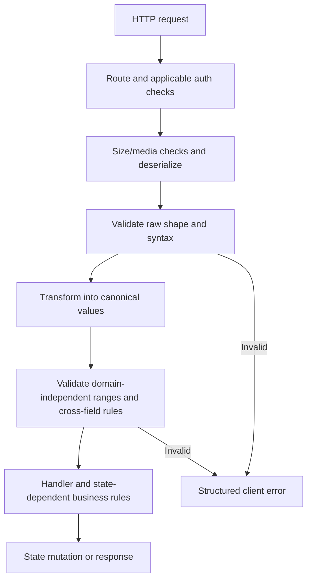
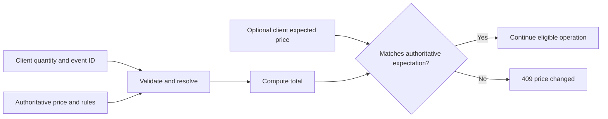

# Video 09 — Validation & Transformation

- Video URL: https://www.youtube.com/watch?v=qedj_JjjL-U
- Playlist: https://www.youtube.com/playlist?list=PLui3EUkuMTPgZcV0QhQrOcwMPcBCcd_Q1
- Playlist position: 9 (identified during the learning session).
- Date: 2026-11-20
- Learning status: Complete (owner approved the repository update).
- Implementation status: Not started.
- Source availability: the teaching session used available transcript excerpts and summaries, not the entire recording. The full transcript was not independently reverified during documentation. The core lecture topics were validation categories, transformation, pagination coercion, placement in the request lifecycle and frontend versus backend validation. The detailed EventHub examples, security guidance, error-policy choices and source-of-truth discussion below are mentor explanations, not claims of verbatim lecture coverage.

## Learning objectives

- Explain why external input is untrusted even after deserialization or authentication.
- Distinguish type, syntactic, semantic and cross-field validation from transformation and sanitization.
- Explain compile-time types versus runtime checks, safe conversion, defaults and normalization.
- Separate request-contract checks, authorization, business invariants and storage guarantees.
- Choose whether to accept and validate, derive internally, or accept and compare a value based on its authority.

## Concepts and internal mechanisms

An HTTP request carries external data. Successful JSON parsing only establishes that the bytes represent a JSON value; it does not establish that the value matches an endpoint's contract. For example, a booking quantity of -500 is valid JSON and a number, but is not a valid quantity. TypeScript interfaces are erased at runtime: assigning an unknown request body to an interface with a type assertion performs no validation.

Validation can check:
- **Type and shape:** object vs array or null, required fields, strings versus booleans or numbers.
- **Syntax:** identifier, email, decimal integer or date format. A syntactically valid email does not prove ownership; a date-shaped string is not necessarily a real calendar date.
- **Semantics:** positive integer booking quantity, name length after trimming, meaningful date ranges.
- **Cross-field/conditional rules:** end time after start time, meeting URL for online events and location for offline events. These are examples, not required new EventHub fields at this milestone.

Transformation prepares a canonical representation: trimming an event name, parsing a query integer, mapping accepted enum aliases when explicitly supported, or supplying a default for a missing optional field. It should never arbitrarily change passwords, opaque tokens or meaningful user text. Preserve the distinction between missing, null, empty and zero. Validate before and/or after conversion as appropriate.

Example: GET /api/v1/events?page=2 supplies the string "2". Validate the allowed decimal syntax before converting, require a safe integer within bounds, and then calculate the offset. Number("") is 0, Number("abc") is NaN, and parseInt("20abc") is 20; unchecked coercion can accept malformed input. Repeated scalar query keys should be rejected rather than silently taking one value.

This is an illustrative flow, not a universal ordering: routing constraints may validate before authentication, and some authorization requires a parsed identifier. Reject early at the appropriate boundary without doing unnecessary expensive work or exposing protected state.

### Error handling and enforcement layers

Use deterministic field paths, machine-readable codes and helpful messages; do not expose internal traces, raw secrets or credential values. Fail fast for malformed JSON, excessive bodies or security-sensitive checks; aggregate independent field errors when it improves client feedback. EventHub currently uses 400 for query errors, 422 for valid JSON that violates event constraints, 413 for oversized bodies and 415 for unsupported media types. Preserve 401/403 authentication and authorization behavior and distinguish 404 missing resources and 409 current-state conflicts. A 422 response is a contract decision, not the only possible status for every validation failure.

Frontend checks improve UX but are bypassable with curl or any direct API client. Backend checks enforce the request contract. State-dependent business checks (e.g. whether inventory is available) belong with business rules; storage constraints and transactions become important when persistence is introduced. Validating an available quantity independently of the write does not prevent concurrent overselling.

Validation is not sanitization. Sanitization changes or removes unsafe content according to a context-specific policy. Use parameterized queries for SQL injection prevention, context-appropriate output encoding for XSS, and an appropriate sanitizer if rich HTML is intentionally accepted; input validation is not a replacement for those controls.

### Source of truth — the follow-up discussion

Question: When should we validate a client-supplied value, and when should we calculate it ourselves?

| Kind of data | Example | Correct treatment |
| --- | --- | --- |
| Caller-owned choice | eventId, quantity, promo code | Receive and validate, then check permissions and business rules |
| Server-authoritative fact | ticket unit price, caller role, remaining inventory | Resolve from trusted server state; do not accept an override |
| Derived value | total, fees, discount amount | Compute from validated choices and authoritative rules |
| Client expectation | expectedPrice, quoteId or priceVersion | Receive and compare against an authoritative price/quote; never use it as the price authority |

For a conceptual booking, accepting only eventId and quantity prevents a client from setting the price or total. If the price shown is 100 EGP and it changes to 150 EGP before submission, comparing an optional expected price or server-issued quote/version can detect the stale expectation. A 409 response with a stable code such as PRICE_CHANGED can prompt the caller to review the new price. The server must define whether a quote locks a price or merely detects a change, and enforce that policy server-side; an arbitrary client quote is not authoritative. A future persisted pricing model must use integer minor units and a currency per PROJECT_SPEC. The current in-memory EventHub model has no price field or implemented booking, so this is a synthetic experiment, not a production payment requirement.

The same rule applies to transfer amounts versus system fees, public registration versus role assignment, and server-generated timestamps. Reducing writable fields reduces mass-assignment risk and keeps authority centralized.

## Production behavior and failure scenarios

- Never assume a valid shape means the caller has permission or that a state-dependent action is possible.
- Bound lengths and numeric ranges before expensive work; reject unsafe integers, malformed decimals, unexpected arrays/objects and abusive payloads.
- Use explicit allowlists/projections for writable fields. Reject unknown keys for new strict contracts, but document existing ignore behavior and avoid accidental compatibility breaks.
- Do not return password, bearer token or other sensitive input in diagnostics; preserve the existing generic login failure behavior and rate-limiting/auth protections.
- Validation logic may be native or schema-driven (e.g. Zod/Joi); understand checks and coercion first; do not add a dependency just for its own sake.
- A valid request can fail business rules, and a successful availability check alone does not make a later write atomic.

## Discussion and misconceptions

- TypeScript does not validate unknown JSON at runtime.
- Transformation need not always precede or follow validation; raw syntax and transformed range may each need checks.
- A frontend dropdown is not a security boundary.
- The server must not trust a client-computed total even when price times quantity equals that total; both factors must have the correct authority.
- Extra client data can be useful as a comparison or concurrency precondition, but not as an authoritative override.
- No outstanding conceptual question was recorded after the source-of-truth explanation.

## Key takeaways and references

Validate external data at boundaries; transform into explicit typed values; keep business rules and authorization separate; compute server-owned values from trusted state. Never equate validation with security or transaction guarantees.

- Course video and playlist above.
- OWASP Input Validation Cheat Sheet: https://cheatsheetseries.owasp.org/cheatsheets/Input_Validation_Cheat_Sheet.html
- RFC 9110 HTTP Semantics: https://www.rfc-editor.org/rfc/rfc9110.html
- TypeScript erased types: https://www.typescriptlang.org/docs/handbook/2/basic-types.html#erased-types

## EventHub practical assignment — coding agent handoff

**Problem and baseline:** On main at the start of this lesson, backend/src/server.ts already contains validateNewEvent, POST/PUT/PATCH event validation, v1 page/sort/query parsing, registration/login checks, path constraints and an unimplemented POST /api/v1/bookings stub (501). backend/src/json.ts handles decoding/body errors; backend/src/router.ts handles path/query parsing; backend/src/auth.ts owns auth state. Events currently have id, name and seats only. Improve these contracts incrementally, rather than rebuilding the application or introducing a database.

**Scope and expected behavior:**
1. Inspect existing tests and contracts. Extract small reusable native validators or a focused validation module with typed success/failure results and explicit normalized output. Compare a schema library only if helpful; obtain approval before adding a dependency.
2. Unify field-level error representation for event write and v1 query validation. Propose stable codes/paths; preserve existing status and legacy response compatibility (e.g. retain existing details or agree on a deliberate migration). Preserve JSON reader error handling.
3. Validate full POST/PUT input and partial PATCH input correctly: trim names, apply existing 1–100 character and integer 0–100000 seats limits, validate the merged PATCH result, distinguish absent/null/zero, never mutate invalid input. IDs and ownership remain server-controlled.
4. Extract safe v1 page/sort/scalar parsing with existing page default 1, size 10, positive decimal syntax and 9-digit page limit. Preserve city echo semantics and existing unknown query key policy. A bounded limit parameter may be added only after owner approval of the public API change; it is enough to demonstrate conversion with the current page.
5. Check safe positive integer path IDs before numeric use; preserve router's canonical syntax, collision rules and existing missing/invalid resource behavior unless a contract change is approved. Validate only headers consumed by the app and preserve bearer/auth/CORS behavior.
6. Make unexpected-field policy explicit. Existing write handlers ignore extra fields (including body id), and registration ignores injected role. Preserve externally tested legacy behavior or obtain approval for a strict contract change; in all cases project only approved fields and prove server-owned fields cannot be overridden. Demonstrate strict unknown-field rejection with a new standalone booking validation exercise.
7. Implement a pure, synthetic booking-input and pricing exercise (no booking persistence or real payment): accept eventId/quantity, reject malformed values, reject client ticketPrice/total/role as unknown, calculate a total from a server-defined mock price using safe integer minor units and optional expected price comparison. A stale expectation must yield a typed conflict result; an endpoint integration is optional only with explicit approval. Keep existing booking stub 501 otherwise. Illustrative quantity 1–10; the owner may confirm another rule.

**Acceptance criteria (observable):**
- Positive and negative tests for type, required fields, strings vs numbers, arrays/null, empty or whitespace-only names, boundaries, integer overflow, decimals and extraneous fields.
- Malformed JSON, body limits and unsupported media keep their existing responses.
- Invalid event POST/PUT/PATCH does not modify event state, ownership or ID counter; successful normalization is observable from the response.
- PATCH supports valid partial updates while rejecting invalid merged state or empty patch according to the current contract.
- Query page converts to a number with a safe offset; missing page defaults; repeated page/sort/city, invalid syntax and oversized numbers are rejected; existing sort/search behavior remains.
- Error results contain stable field paths/codes and messages; no secret values are leaked. No auth/ownership bypass or changed login disclosure.
- Synthetic pricing test: caller chooses quantity, trusted price determines total; forged total/price cannot lower the result; stale expected price yields conflict; absent expectation follows the documented policy.
- Unit tests of pure validators and HTTP integration/regression tests, including HEAD/OPTIONS, CORS, ETag, routing, serialization, authentication and authorization.
- Run `cd backend && npm test` and `npm run typecheck`; record actual output and any failures. Verify valid and invalid requests manually with curl or Postman; record before/after state and demonstrate early rejection with a spy or controlled counter where useful. No claims of results until executed.

**Edge cases:** integer precision beyond MAX_SAFE_INTEGER, leading zeros, scientific notation, repeated and empty queries, Unicode text length semantics, password normalization changes, distinction between missing and null, write-field injection and stale prices. Document chosen policies rather than coercing everything permissively.

**Deferred:** permanent booking workflow, ticket reservation, SQL constraints/transactions, concurrency correctness, pricing schema/quote persistence, new broad service/repository refactor, frontend, real payment, full date/location model and observability infrastructure. Date/cross-field validation may be a pure exercise only. Keep previous lessons runnable.

**Prerequisites / decisions:** Confirm any API-breaking strictness, new fields or dependency with the owner. Current Node/TypeScript native HTTP stack is established. This is learning completion only, not implementation approval or evidence.

## Learning completion (ChatGPT)
- [x] Owner approved closing the lecture by updating the repository.
- [x] Conceptual notes, discussion and assignment documented.
- [x] Learning status updated independently in docs/PROGRESS.md in the same commit.

## Implementation evidence (coding agent; initially pending)
No implementation, tests or benchmarks were performed for lecture 09 by the mentor.
- [ ] Implementation or reproducible experiment.
- [ ] Acceptance criteria demonstrated.
- [ ] Negative cases and regression checks as applicable.
- [ ] Implementation progress updated and learner confirmed.
