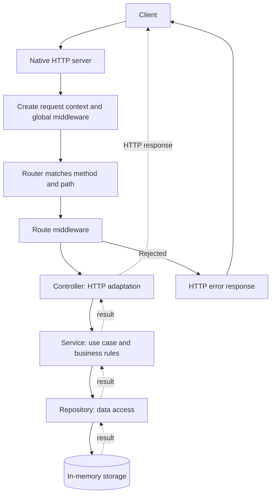
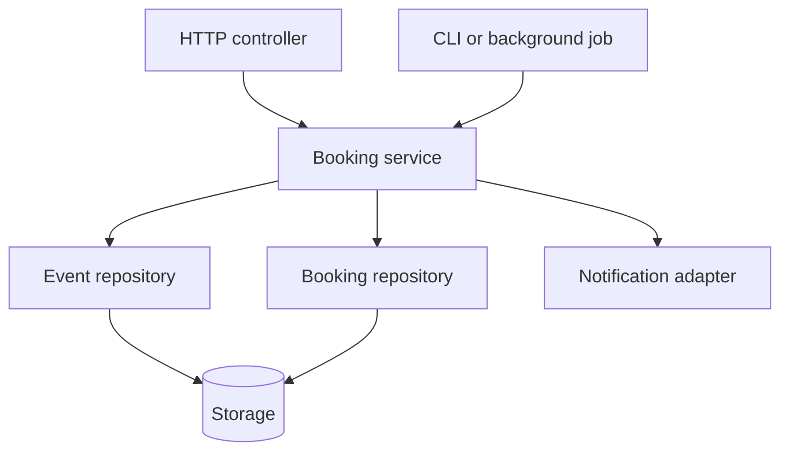
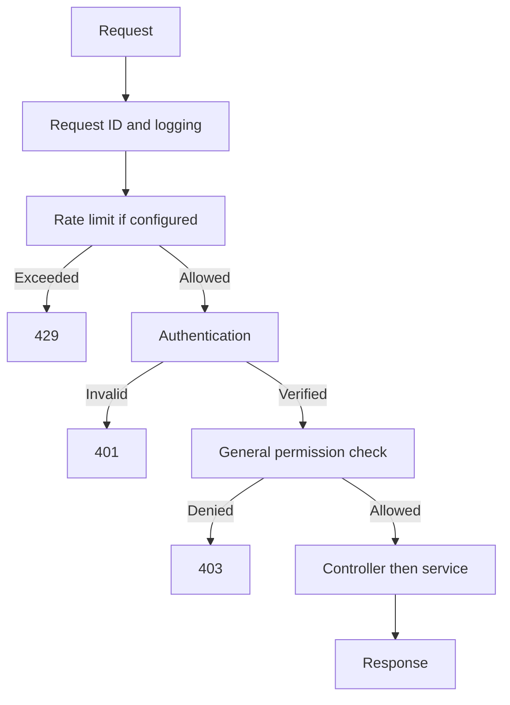

# Video 10 — What are controllers, services, repositories, middlewares and request context?

- Video URL: https://www.youtube.com/watch?v=hyc-7w3pee8
- Playlist: https://www.youtube.com/playlist?list=PLui3EUkuMTPgZcV0QhQrOcwMPcBCcd_Q1
- Playlist position: 10 (identified in the session via lecture-specific notes and the existing roadmap; live playlist listing not independently checked).
- Date: 2026-11-20
- Learning status: Complete (owner explicitly confirmed).
- Implementation status: Complete (owner confirmed 2026-11-20).
- Source availability: [lecture-specific third-party transcript-derived notes](https://github.com/shubhamscifi/backend_from_first_principles_notes/blob/main/10_controllers_services_repositories/NOTES.md) identify the title, URL and scope (59:57). The original recording/transcript was not directly reviewed. The core topics are the internal request lifecycle, controller/service/repository separation, middleware and request context. EventHub examples, dependency injection, testing advice, and production qualifications are supplemental mentor explanations, not a verbatim account.

## Learning objectives

- Trace how an HTTP request travels inside a backend process and returns a response.
- Explain why separate HTTP adaptation, application/business operations and data access.
- Explain middleware composition, short-circuiting, ordering and errors.
- Understand request-scoped state, verified identity, tracing and cancellation.
- Distinguish general authentication/authorization from context-dependent business policies.
- Know when extra abstractions are useful and when they are unnecessary.

## Concepts and internal mechanisms

### 1. Why layers exist

A single handler can parse JSON, authenticate, validate, calculate prices, query storage and return a response. The runtime does not require architectural layers. As operations grow, however, repeated HTTP checks, storage coupling and mixed responsibilities complicate maintenance, testing and debugging. Separating concerns makes changes local and allows a use case to be invoked without manufacturing an HTTP request. These layers normally run as functions/objects in the same process; they are not separate servers or microservices.



This is one illustrative ordering, not a universal framework pipeline. Application layers primarily enhance maintainability and testability; they do not automatically increase throughput. Extra interfaces and wrappers have complexity costs.

### 2. Controller / handler

The controller is the transport adapter: read route parameters and headers, deserialize and validate input (or rely on appropriate middleware), transform it into an application command, call the service, and choose the response status/body. It should not own pricing, lifecycle rules or storage queries for a nontrivial use case. A service may return a domain result or throw a domain error; an HTTP adapter maps that into an HTTP status. Preserve existing EventHub validation and response semantics.

Illustrative TypeScript (helper names are pseudocode, not a claim about existing APIs):

```ts
async function createBookingController(req, res, ctx) {
  const input = validateBooking(await parseJSON(req));
  const actor = requireAuthenticatedUser(ctx);
  const booking = await bookingService.create({
    userId: actor.id,
    eventId: input.eventId,
    quantity: input.quantity,
  });
  sendJSON(res, 201, booking);
}
```

### 3. Service layer

The service expresses a use case in terms of application data and dependencies rather than request/response objects. For example, creating a booking may load the event, check availability and publication status, calculate the authoritative price, and ask storage to persist the result. A service can coordinate multiple repositories or external services. It should not emit HTTP status codes itself; use typed results/errors and map them at the transport boundary.



The booking example is conceptual and not a production booking algorithm: checking inventory and then writing separately can oversell under concurrent access. Atomic allocation and transactions are later topics; do not add real booking/payment systems solely for this lesson.

### 4. Repository layer

A repository captures meaningful data access operations such as findById, list and create. It isolates the caller from query/storage details. Use clear contracts and return semantics; avoid methods that arbitrarily return either one object or a collection. A repository can wrap an existing in-memory store now and later be implemented using SQL. No database change is required in this lecture.

```ts
interface EventRepository {
  findById(id: number): Promise<Event | null>;
  findAll(): Promise<Event[]>;
}
class EventService {
  constructor(private readonly repository: EventRepository) {}
  getEvent(id: number) {
    return this.repository.findById(id);
  }
}
```

Dependency injection (supplement): supply the dependency at composition/startup rather than hard-coding a concrete store in the service. Tests can supply a fake. A DI container is not required. A repository is not universally necessary: simple CRUD or an ORM such as Eloquent may already supply a useful abstraction. Avoid one-for-one wrappers that add no value. Replacing SQL with another storage technology is not always transparent because transactional guarantees, models and query semantics differ.

### 5. Middleware

Middleware is a function executed at a boundary of request processing. It can inspect or enrich request/context, add response headers, invoke the next stage, or terminate processing. A runner/framework provides next; it is not a JavaScript keyword. Centralized middleware reduces repetition across endpoints. Examples discussed: CORS, security headers, authentication, coarse authorization, rate limiting, logging, compression, parsing and errors. Do not implement every example now.



This is an illustrative protected route, not a mandate for every endpoint. Public routes remain public. Valid CORS preflight may need special handling before auth; CORS is a browser response-access mechanism, not authentication or a server-side security boundary. Logging before auth can capture rejected requests without exposing secrets. A middleware must not call next after responding; async failures must propagate and a response must not be sent twice. Express-style error middleware is normally registered after routes so forwarded errors reach it. An onion-style await-next wrapper instead catches errors by surrounding downstream execution from the outside. The correct mechanism depends on the runner; do not copy ordering rules blindly.

### 6. Request context

A request context contains metadata scoped to one request, accessible to relevant stages. It can hold the verified actor, request ID, start time and an optional abort signal. It must not be mutable process-global user state.

```mermaid
sequenceDiagram
    participant A as Request A
    participant M as Shared process
    participant B as Request B
    A->>M: Authenticate Alice; set global currentUser
    Note over A,M: A awaits I/O
    B->>M: Authenticate Bob; overwrite currentUser
    M-->>A: A resumes with Bob (BUG)
    Note over A,B: Separate contexts prevent cross-request identity leakage
```

Even on a single JavaScript execution thread, concurrent async requests can interleave around await. Create a fresh object per request. Pass it explicitly to HTTP/middleware stages in EventHub; pass only required trusted actor data to business services. Node AsyncLocalStorage is an alternative for implicit async context, not needed for the first exercise. Express req, Go context.Context, and Laravel request/scoped facilities are related but have different lifecycle and cancellation specifics.

```ts
interface RequestContext {
  requestId: string;
  user?: { id: number; role: string };
  startedAt: number;
  signal?: AbortSignal;
}
```

Authentication populates verified identity; the client cannot set it by adding a userId or role to the JSON payload. Trust only appropriate authentication results and enforce current authorization rules when claim freshness matters (lecture 08). Context can also carry a generated request ID through logs and outbound calls. Correlation IDs do not substitute for authentication; validate external IDs if accepted. Do not log tokens, passwords, full raw request bodies or sensitive data.

Cancellation/deadlines: an abort signal can propagate to operations supporting cancellation; it cannot magically cancel unsupported work or roll back an already committed write. Cancellation policy should distinguish read-only work from operations that must complete safely; defer advanced deadline propagation.

## Production behavior and failure scenarios

- Missing or invalid credentials: 401; a verified actor lacking required permission: 403, subject to the existing API's resource-disclosure policy. Domain conflicts/missing records must preserve the API's prior status contract.
- Interleaved requests must not share actor, role or request ID. A request-scoped object is eligible for garbage collection after references are released, not necessarily exactly when response ends.
- Middleware failure must propagate appropriately; error mapping must avoid leaking internal stack traces or double-writing responses.
- Instrument request completion/failure consistently; if response headers are already sent, follow safe error handling instead of trying to send a second payload.
- Storage abstractions do not provide integrity by themselves: database constraints, transaction boundaries and concurrency control remain necessary in later lessons.
- Do not confuse improved structure with measured performance. No benchmarks or implementation tests were run by the mentor.

## Discussion and misconceptions

**Question discussed with the owner:** DELETE /api/v1/bookings/123 — an authenticated user may cancel their own booking only when at least 24 hours remain before the event, while an admin may override the ownership/time restriction. Where do the checks belong?

**Owner's answer:** in the service. Correct: this is business authorization involving actor identity, resource ownership and event time. Authentication middleware establishes identity; controller extracts the booking ID and passes the trusted actor; the service or an explicit policy used by it enforces the rule, then the repository persists the permitted state change. Coarse route-wide checks may live in middleware, but do not make domain authorization depend solely on an HTTP path. A CLI or job invoking the same service must not accidentally bypass the rule. The admin override is the exercise's assumed policy, not a universal permission or completed EventHub feature.

| Actor | Own booking? | Hours remaining | Decision in illustrative policy |
| --- | --- | --- | --- |
| User | Yes | 30 | Allow |
| User | Yes | 24 | Allow (chosen inclusive boundary) |
| User | Yes | 23 | Deny |
| User | No | 40 | Deny |
| Admin | No | 1 | Allow under stated override policy |

Whether an already canceled/completed booking may be changed is an independent business invariant, not implied by admin status. A fixed clock makes the 24-hour boundary deterministic. This is a learning scenario, not a requirement to implement booking cancellation early.

Common misconceptions: layers are not mandatory; a service can contain ordinary functions rather than a class; middleware is not the only place authorization can occur; request context is not global state; TypeScript interfaces do not verify untrusted runtime data; cancellation is not rollback; extra folders do not make architecture good.

## Key takeaways and references

| Component | Governing question |
| --- | --- |
| Controller | How does the application communicate via HTTP? |
| Service | What must the use case do and what rules apply? |
| Repository | How is relevant data accessed/persisted? |
| Middleware | What shared processing happens around request execution? |
| Request context | What metadata belongs only to this request? |

- [Lecture 10 video](https://www.youtube.com/watch?v=hyc-7w3pee8)
- [Transcript-derived lecture notes](https://github.com/shubhamscifi/backend_from_first_principles_notes/blob/main/10_controllers_services_repositories/NOTES.md)
- [Node async context documentation](https://nodejs.org/api/async_context.html) (supplementary reference)
- [Express middleware guide](https://expressjs.com/en/guide/using-middleware.html) (supplementary reference)
- Previous lessons: [routing](06-routing.md), [serialization](07-serialization.md), [auth](08-authentication-authorization.md), [validation](09-validation-transformation.md).

## EventHub practical assignment — coding agent handoff

**Problem and learning goal:** Refactor the existing native Node.js/TypeScript backend incrementally, preserving current behavior while making HTTP boundaries, business logic, data access, shared processing and request-local state explicit. Review actual branch/PR integration state first; do not assume prior implementation branch changes have landed on main. Reuse useful abstractions rather than rebuilding them. Start by reading AGENTS.md, PROJECT_SPEC, PROGRESS, prior lecture notes, decisions, code and tests.

**In scope / expected behavior:**
- Choose a small existing event use case, preferably event create/read or another existing operation with meaningful rules, and trace it through the current architecture.
- Extract or reuse a transport-agnostic service and a meaningful storage contract or adapter. Keep native HTTP and existing in-memory storage; manually wire dependencies.
- Reuse or implement a minimal async middleware runner supporting global/route-specific processing and short-circuiting. Reuse existing auth, parsing, CORS and validation rules; do not duplicate existing features.
- Establish an explicit typed request context per incoming request, with generated request ID and trusted identity when authenticated. Keep service parameters focused; never use global currentUser.
- Add useful request-ID-based safe logging and include the request ID in an appropriate response header consistently where possible. Keep response bodies, codes, CORS and other previous behavior intact.
- Demonstrate cancellation authorization as a small pure policy exercise with a synthetic fixed clock if desired; full booking infrastructure is deferred.

**Suggested steps:** establish baseline tests; trace one route; separate responsibilities; wire dependencies externally; compose the middleware/context pipeline; add targeted tests; run regressions and append observed evidence. An optional conceptual layout is src/http (router, context, middleware), src/modules/events (controller, service, repository), src/modules/auth, and shared errors/validation. Adapt to the existing structure rather than forcing this directory tree.

**Acceptance criteria (observable and testable):**
1. At least one existing use case is independently testable without starting an HTTP server; service has no direct dependency on HTTP request/response or status APIs.
2. Controller delegates meaningful business operations; repository/adapter owns storage access. A fake or alternative in-memory repository can exercise the service with a stable contract.
3. Middleware executes in documented order, and rejected protected requests do not invoke subsequent service/storage mutation. Async thrown errors are handled safely without duplicate responses.
4. Two deliberately interleaved requests receive distinct request IDs and preserve their own verified identity; test using controlled promises/barriers rather than relying on nondeterministic timing.
5. Authenticated identity is sourced from the verified actor, not client-controlled identity/role fields; preserve current ownership/role checks and reject invalid input without mutation.
6. The same request ID appears in safe trace/log output and an agreed response header; no credentials or sensitive payloads appear in logs.
7. Existing route, auth, validation and serialization behavior remains intact, including public and protected routes, 401/403, 404/405 and applicable CORS preflight/HEAD/error cases. Run existing full test suite and typecheck; record observed results, not assumed counts.
8. Document the actual pipeline, changes, negative cases, limitations and relevant decisions; do not mark complete until owner confirms evidence.

**Experiments:** compare before/after request trace and test baseline; run a fake repository service test and a controlled auth rejection that checks downstream invocation count; simulate interleaved authenticated requests and verify context isolation; send invalid payload or impersonation attempt and confirm no mutation; induce an async error before headers are sent and inspect structured response; correlate one request across logs. For cancellation policy exercise, cover owner/non-owner/admin and exactly/just below 24 hours.

**Edge cases:** missing actor on public route, expired/invalid credential, stale role state where applicable, middleware rejecting before next, duplicate next and double response, thrown/rejected async errors, concurrent context isolation, malformed/oversized payload, CORS OPTIONS, unknown route, existing response contracts and untrusted request IDs. Do not change API semantics as an incidental refactor.

**Out of scope:** new frontend, full booking/reservation/payment system, database migration, distributed tracing infrastructure, Redis, microservices, full rate limiter/compression suite, DI container, extensive framework migration, advanced cancellation/deadlines, production concurrency/transaction guarantees. Continue incrementally with future lectures after owner approval.

**Prerequisites / unresolved decisions:** inspect current code and prior implementation integration; choose the smallest representative use case and middleware composition style that preserve current contracts. No unresolved conceptual question was raised after the service-layer answer.

## Learning completion (ChatGPT)

- [x] Owner explicitly confirmed lecture finished on 2026-11-20.
- [x] Conceptual notes, discussion and assignment documented.
- [x] Learning progress updated independently in docs/PROGRESS.md.

## Implementation evidence (coding agent)

Environment: Node via `tsx`, branch `feat/lecture-10-application-layers`, 2026-11-20. Baseline before changes: `npm test` 166/166, `npm run typecheck` clean. No benchmarks; layering was not measured for speed.

**What changed** ([ADR-009](../decisions/009-application-layers-and-request-pipeline.md), proposed):
- `backend/src/modules/events/{repository,service}.ts`: storage contract + in-memory adapter; `EventService` (list/get/search/create/replace/patch/remove, ownership and role rules, typed outcomes, no HTTP).
- `backend/src/http/middleware.ts` (`compose`), `backend/src/http/context.ts` (`RequestContext`, request id).
- `backend/src/server.ts`: controllers map service outcomes to statuses; `requireAuth` is now route middleware (`protect(...)`); global pipeline `observe → cors → errorBoundary → router`; dependencies wired in `server.ts`.
- `backend/src/modules/bookings/cancellation-policy.ts`: pure policy exercise (no endpoint).

**Actual pipeline:** `request → context+X-Request-Id+log → CORS → error boundary → route match → requireAuth (protected routes only) → controller → EventService → repository`.

**Commands and observed results:**
- `cd backend && npm test` → tests 184, pass 184, fail 0 (166 existing unchanged + 18 new in `test/layers.test.ts`).
- `cd backend && npm run typecheck` → clean.

**Acceptance criteria → evidence** (`backend/test/layers.test.ts` unless noted):
1. Service tested with `FakeRepo`, no server; service imports no HTTP types.
2. Fake repository records calls: forbidden/invalid inputs never call `insert`; controller delegates to the service.
3. Middleware order/onion trace, short-circuit (downstream count 0), double `next()` throws, downstream rejection reaches upstream catch; unauthenticated `POST`/`DELETE` give 401 and leave `events`/`eventOwners` unchanged; induced storage exception gives one safe 500 and the server stays healthy.
4. Two organizers' requests are authenticated and held open on their bodies, completed in reverse order: different request ids, each created event is owned by its own user.
5. Identity comes from the session: a body with `ownerId`, `role`, `id` is ignored (owner is the actor, id is fresh); invalid input never calls `insert`.
6. Same `X-Request-Id` in the response header and the JSON log line; log contains no query string, token or `Bearer`; the 500 error message is not logged or returned.
7. All 166 earlier tests (routing, auth 401/403, validation, serialization, CORS/HEAD/OPTIONS, 404/405) pass unchanged. Public routes verified without credentials.
8. This section, ADR-009.

**Cancellation policy** (fixed clock): owner 30 h allow; exactly 24 h allow; 23 h and 1 s short deny; non-owner deny; admin 1 h allow; cancelled/completed deny even for admin.

**Extension to the rest of the backend (owner request after review, branch `refactor/layers-auth-tickets`):** per-module controller factories for events, auth and tickets; `AccountService`, `TicketRepository`/`TicketService`; shared HTTP kit `src/http/app.ts`; `server.ts` reduced to composition root, route table and pipeline (about 260 lines, was about 540). Observed: `npm test` 190/190 (184 + 6 new in `test/services.test.ts`: register role ignored, validation/duplicate, uniform login failure, rate limit then logout, own-tickets only, synthetic tickets cap), `npm run typecheck` clean. Details in the ADR-009 amendment.

**Limitations / deliberate simplifications:** events, auth and tickets were layered (see extension above); `AuthService` doubles as auth repository; booking is still a stub; repository is synchronous (see ADR); abort signal exists but nothing consumes it; a client-supplied `X-Request-Id` is trusted after format validation only; LOG format changed from plain text to JSON; no trace of a real concurrent-load run.

- [x] Implementation or reproducible experiment.
- [x] Acceptance criteria demonstrated (see above).
- [x] Negative cases and regression checks.
- [x] Implementation progress updated and learner confirmed (2026-11-20).
