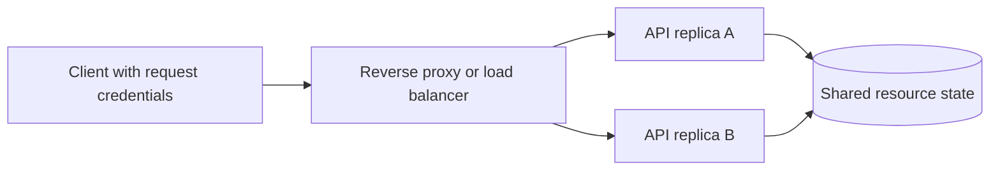
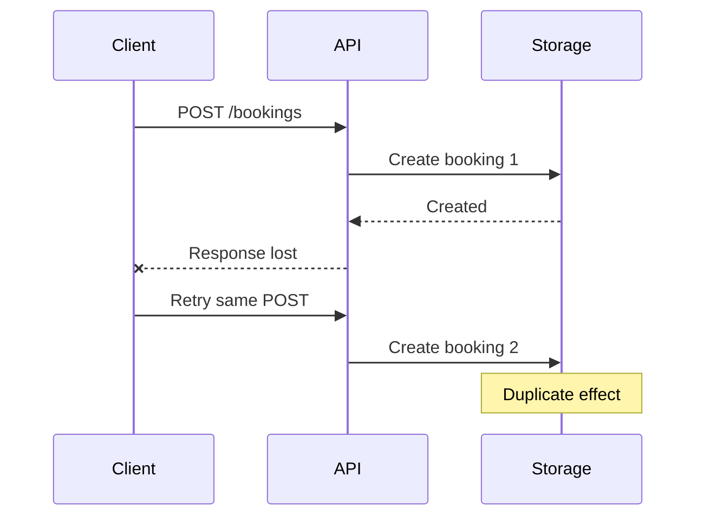
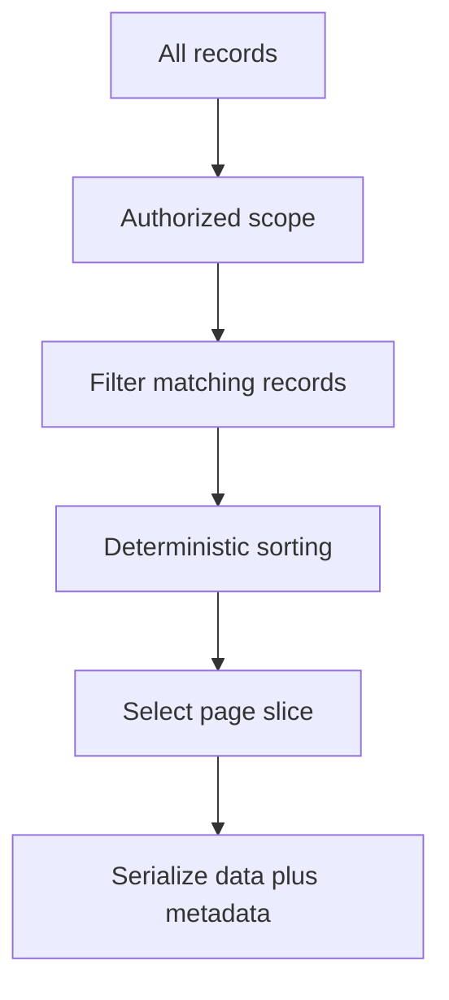

# Video 11 — Complete REST API Design

- Video URL: https://www.youtube.com/watch?v=RG6q57DwV8Y
- Playlist position: 11, corroborated by transcript-derived course notes (123:34).
- Date: 2026-11-20.
- Learning status: complete (owner explicitly requested GitHub update following the lesson).
- Implementation status: not started.
- Sources: third-party copy of YouTube auto-captions and timestamped lecture notes; original video and playlist order were not independently replayed. ASR may contain errors. The examples using EventHub, HTTP specification corrections and production extensions below are supplementary.

## Learning objectives

Explain REST constraints, identify resources from requirements, design predictable HTTP contracts, distinguish safety from idempotency, choose correct methods/statuses, and design collection queries, custom business actions and compatible API evolution before implementation.

## Concepts and internal mechanisms

### Problem first: API as a contract

An API is the interface consumers rely on, not an exposed database schema. Arbitrary paths such as /getAllEvents and /updateEvent make integration unpredictable. Prefer resource identification via paths and operation semantics via HTTP methods. Start with user workflows and wireframes, identify domain nouns and relationships, then design requests, responses, errors, defaults and permissions. The lecture uses organizations, projects and tasks in a project-management SaaS and demonstrates the first two with Insomnia. Design the interface before coding. Resources may be computed representations or reports, not just database tables.

### REST and the web

Representational State Transfer is the architectural style described by Roy Fielding in 2000. A resource is a conceptual target (event 42); its state is its current attributes; a representation is JSON, HTML or another format communicating that state. HTTP transfers representations, not live objects or database rows.

Six constraints: client/server separation; uniform interface; layered system; cacheability; stateless communication; optional code on demand. Uniform interface includes resource identification, manipulation via representations, self-descriptive messages and hypermedia as the engine of application state (HATEOAS). A response may advertise links/actions available next; many modern JSON APIs are REST-style rather than satisfying all original constraints. Statelessness prohibits relying on retained conversational client context between requests; it does not prohibit storing resource state. A request carries what is needed to understand it. Merely sharing a server-side session store improves replica independence but does not by itself satisfy strict REST statelessness.



This is a conceptual future deployment, not current EventHub infrastructure. Explicit caching rules can reduce load, but private or changing data needs appropriate cache controls.

### URI design and resource hierarchy

Example: https://api.example.com/v1/events/42?expand=organizer. Scheme, host, version prefix, path, and query have distinct roles; a fragment is client-side and not sent as part of the HTTP request target. Plural collection nouns, lowercase hyphenated slugs, consistent naming and shallow nesting are useful conventions, not HTTP mandates. Use /events/42/tickets when listing tickets for an event, and /tickets/100 for a globally identified ticket if supported. Slugs require uniqueness and collision/rename policies. The lecture recommends version prefixes; its local demo omits them. EventHub already introduced /api/v1 routes in earlier lessons.

### Methods, status and semantics

| Method and illustrative path | Intent | Typical success | Safe | Idempotent by HTTP semantics |
| --- | --- | --- | --- | --- |
| GET /api/v1/events | List | 200 | Yes | Yes |
| GET /api/v1/events/42 | Read | 200 | Yes | Yes |
| POST /api/v1/events | Create | 201 | No | Not guaranteed |
| PUT /api/v1/events/42 | Replace writable representation | 200 or 204 (201 if created under contract) | No | Yes |
| PATCH /api/v1/events/42 | Apply partial changes | 200 or 204 | No | Not guaranteed |
| DELETE /api/v1/events/42 | Remove target association | 204 or 200 | No | Yes |

HEAD and OPTIONS are safe and idempotent. Safe means the client does not request a state change, not that logging cannot occur. PUT replaces the writable representation; missing required fields may cause rejection, and server-managed fields need not be resent. PATCH preserves unspecified fields according to the patch format/contract. Set price to 600 twice: same intended effect. Add 100 to price twice: different effect. **Correction to lecture:** PATCH is not inherently idempotent (RFC 5789), although a specific patch can be. POST is not inherently idempotent either. DELETE returning 204 first and 404 second is still idempotent because intended effect is the same. GET results may naturally change because other clients update resources.

### Network ambiguity and retries (supplementary)



A client timeout does not prove an operation failed. A future idempotency-key design can scope the key to actor and operation, associate it with a request fingerprint and durable result, reject mismatched payloads, and atomically prevent concurrent duplicate effects. Do not blindly retry non-idempotent mutations. Full booking/payment idempotency is deferred.

### Collection queries

GET /api/v1/events?category=tech&sortBy=price&sortOrder=asc&page=1&limit=10 is illustrative; reuse actual EventHub field names and allowed filters. Apply authorization scope, filtering/search, deterministic sorting, then pagination, then serialization. Sorting ties need a stable unique secondary key (e.g. id). Pagination reduces payload size, serialization, network and client memory costs; it does not guarantee efficient database execution.



Offset = (page - 1) * limit; totalPages = ceil(total / limit). With 23 matching records and limit 10, pages contain 10, 10 and 3. Response envelope example:

```json
{"data":[{"id":"42"}],"total":23,"page":1,"totalPages":3}
```

Data is illustrative; total is the count of all authorized matching rows before slicing. Provide defaults, validate bounds and allowlist sort/filter fields. Example defaults: page 1, limit 10, max 100, newest first with ID tie-break; preserve any already-established compatible choices or document a deliberate change. Decide how empty results, out-of-range pages and unknown parameters behave. Offset pagination is easy and supports numbered pages but can shift under concurrent inserts/deletes and deep offsets may become costly. Cursor/keyset pagination can help with suitable ordering/indexes; it is not a snapshot guarantee and is deferred.

### Success and error responses

200 successful read/update/action; 201 newly created resource (Location where appropriate); 202 accepted but not completed; 204 no response body; 400 malformed/invalid request; 401 missing/invalid credentials; 403 forbidden; 404 missing or intentionally concealed resource; 405 unsupported method (Allow header); 409 state conflict; 422 understood content whose instructions cannot be processed; 429 rate limit; 500 unexpected server failure. Do not leak stack traces or sensitive data. Reuse established EventHub error envelope rather than inventing a parallel contract; a stable machine-readable error code plus human-readable message is useful. A valid list query with no matches returns 200 and an empty data array; a missing individual resource returns 404. A 204 response has no body. A POST does not automatically mean 201.

### Custom actions and server-owned rules

The lecture demonstrates POST /organizations/:id/archive (200) and POST /projects/:id/clone (201) because these operations can entail hidden domain behavior. A custom action can be more expressive than a generic field update. A resource-oriented alternative is POST /events/:id/cancellations if cancellation is a first-class tracked resource. A simple status update may still be PATCH if the service enforces the same invariants. Example future cancellation may cancel bookings, refund and notify; clients must not orchestrate or bypass server-side rules. Do not use GET for mutations.

Only accept writable fields; derive identity/ownership from the authenticated actor and generate IDs/timestamps server-side. Do not accept privileged status changes simply because a field exists. Use sensible defaults and consistent JSON naming; camelCase is the lecture convention, not a JSON requirement. Avoid cryptic abbreviations and inconsistent field names across endpoints.

### Versioning and documentation

Changing price from a number to an object is a potentially breaking change. A v2 path may preserve v1 consumers while sharing service logic. Do not create a new version for every change; consider compatibility, migration and retirement policy. The lecture recommends interactive OpenAPI/Swagger documentation and design-first use of API clients. Document endpoint expectations before coding; formal OpenAPI tooling is a later milestone unless already present.

## Production behavior and failure scenarios

- Bound pagination and payload sizes; allowlist sort/filter fields, never concatenate untrusted field names into SQL later.
- Count and serialize only authorized data; filtering after pagination produces incorrect results.
- Stable order prevents random tie ordering but offset pagination still shifts when data changes.
- Preserve ownership, validation and resource invariants in services independent of transport.
- Versioning and changes to response envelopes can break consumers; inspect current contracts and test before changing them.
- Concurrent writes, conditional requests and lost updates require further design; preserve existing HTTP caching/ETag behavior and authentication protections.
- Do not perform costly or irreversible side effects on GET; retries and business operations require explicit semantics.

## Discussion and misconceptions

The session covered the PUT/PATCH comparison, idempotency simulator including repeated DELETE and duplicate POST, timeout ambiguity, pagination simulator, query ordering, empty list vs missing item, custom actions and API versioning. An optional quiz posed four scenarios: repeated DELETE with different responses remains idempotent; valid empty list returns 200; a cancellation with side effects can be modeled as POST action; filter and sort before pagination. No learner answers or further conceptual questions were recorded before the owner requested the documentation update.

REST does not mean JSON-only, every resource is not a database table, HTTP status and response bodies need not be identical for idempotency, PATCH is not guaranteed idempotent, and CRUD is not the entirety of domain behavior. Naming conventions and status choices must be applied consistently rather than interpreted as universal mandates.

## Key takeaways and references

Resource = what; method = requested operation; status = outcome; representation = transferred state; idempotency = intended effects of repetition; pagination = bounded slices; versioning = contract evolution. Design contracts before implementation.

- [Video](https://www.youtube.com/watch?v=RG6q57DwV8Y)
- [Transcript-derived notes](https://github.com/shubhamscifi/backend_from_first_principles_notes/blob/main/11_rest_api_design/NOTES.md) and [auto-caption transcript](https://github.com/shubhamscifi/backend_from_first_principles_notes/blob/main/11_rest_api_design/transcript.md) (third-party copies).
- [Fielding dissertation chapter 5](https://ics.uci.edu/~fielding/pubs/dissertation/rest_arch_style.htm)
- [RFC 9110 HTTP semantics](https://www.rfc-editor.org/rfc/rfc9110.html#section-9.2)
- [RFC 5789 PATCH](https://www.rfc-editor.org/rfc/rfc5789.html#section-2)
- Prior lectures: [HTTP](05-http.md), [routing](06-routing.md), [validation](09-validation-transformation.md), [application layers](10-application-layers.md).

## EventHub practical assignment — coding agent handoff

**Problem and goal:** Make the existing event API predictable and bounded using native Node/TypeScript, current controllers/services/repositories and in-memory storage. Inspect main, prior implementation branch integration state, AGENTS.md, PROJECT_SPEC, decisions, current routes, tests and existing response contracts first. Reuse existing GET/search, create/replace/patch/remove functionality instead of duplicating it. Do not assume a price/category/status field exists.

**Scope / expected behavior:** document existing event collection and individual CRUD routes under established version prefix. Review method semantics, status codes, error shape, writable fields and response metadata. Introduce/reuse bounded page/limit, supported domain filters and deterministic sort; preserve auth, request context, ownership and previous behavior where compatible. If introducing a response envelope would break an existing consumer or contract, record and resolve that change with owner before implementation; avoid silently breaking tests. For custom action, propose POST /api/v1/events/:id/publish only if event lifecycle already supports it; otherwise demonstrate a documented hypothetical action or pure service exercise with explicit invariants, not new booking/payment infrastructure.

**Suggested exercise:** inventory API contracts; define sample requests/responses and defaults in a small contract table or API-client collection; baseline tests; implement minimal collection query changes through appropriate layers; review CRUD and authorization; run HTTP and service-level experiments; append evidence.

**Acceptance criteria:**
1. Existing resource paths and method semantics are documented and consistent; no redundant endpoints. New resource creation uses 201; individual read/update use agreed success status; DELETE 204 has no body if that is the chosen contract.
2. Valid empty list returns 200 and empty collection with agreed metadata; missing individual resource returns 404.
3. Seed 23 authorized matching events and test limit=10: lengths 10/10/3, correct total and totalPages, stable IDs and ordering without duplicates in static dataset.
4. Missing parameters get documented defaults; zero, negative, noninteger, oversized or invalid filter/sort values are rejected or capped by explicit contract. Test out-of-range and empty pages; avoid unbounded reads via API.
5. Filtering and sorting run before pagination; total reflects authorized matching records and stable tie-breaks. Verify combined query with tied values and nonmatching records.
6. PATCH of an existing writable field preserves unrelated fields; repeat same fixed-value PATCH and DELETE and verify intended state. Verify PUT replacement semantics if supported; invalid/incomplete replacement follows existing contract without unintended mutation.
7. Unauthenticated/unauthorized or wrong-owner mutations are rejected; identity, server-owned fields, validation, structured errors, request context, CORS, HEAD/OPTIONS, ETag and routing regressions remain intact where applicable.
8. Test supported custom action only if grounded in existing domain; otherwise document design trade-off. No real emails, refunds or new booking lifecycle. Run full existing tests and typecheck; report actual results and scope decisions, not assumed baseline counts.
9. Record implementation evidence and unresolved contract decisions separately; implementation completion requires owner confirmation.

**Experiments and edge cases:** compare response sizes for bounded vs unbounded synthetic lists without asserting performance gains absent measurements; empty filters, repeated query params, invalid limits, tied sort values, missing/unknown resource, repeated mutations, unsupported methods, invalid input and forbidden writes; verify no unauthorized records leak via counts. Document shift under inserts as an offset limitation.

**Deferred:** SQL persistence, indexes, transactions, cursor pagination implementation, real booking/payment/notification flows, durable idempotency keys, front end, full OpenAPI generation and unrelated architecture refactors. No new dependency required just to teach REST.

**Prerequisites / unresolved:** inspect actual main/implementation branch integration and contract shapes. Defaults and query names proposed above are learning recommendations subject to existing API; no extra lifecycle features assumed.

## Learning completion (ChatGPT)

- [x] Owner explicitly requested GitHub update after the lecture on 2026-11-20.
- [x] Conceptual notes, discussion and assignment documented.
- [x] Learning status updated independently in docs/PROGRESS.md.

## Implementation evidence (coding agent; initially pending)

No code changes, tests or experiments executed during this documentation update.

- [ ] Implementation or reproducible experiment.
- [ ] Acceptance criteria demonstrated.
- [ ] Negative cases and regression checks.
- [ ] Implementation progress updated and learner confirmed.
