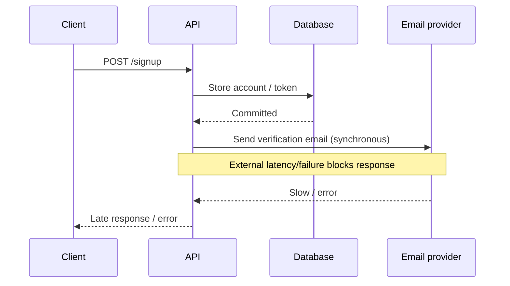
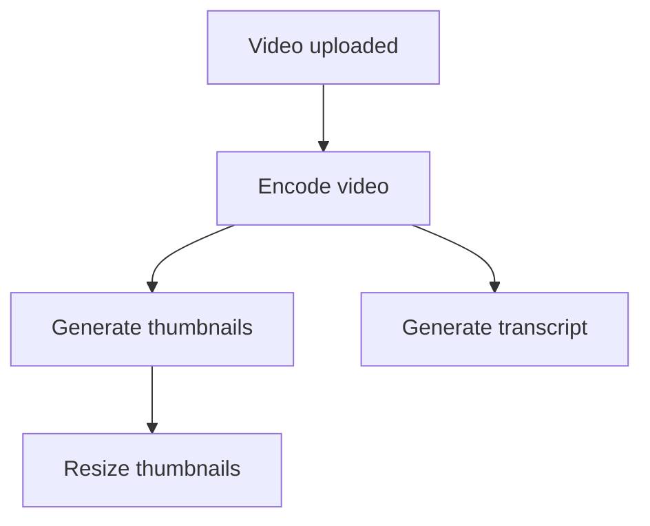

# Video 14 — Task Queues and Background Jobs

- Video URL: https://www.youtube.com/watch?v=r-nQsyguU1Y
- Course: [Backend from First Principles — Sriniously](https://www.youtube.com/playlist?list=PLui3EUkuMTPgZcV0QhQrOcwMPcBCcd_Q1)
- Playlist position: 14, identified by secondary transcript-derived notes.
- Date documented: 2026-11-23.
- Learning status: **Complete — explicit request to upload the lecture discussion**.
- Implementation status: **Not started**. No code/tests were changed or run by this documentation commit.
- Source verification: The lesson was reconstructed from the learner's discussion and [independent timestamped notes and ASR transcript](https://github.com/shubhamscifi/backend_from_first_principles_notes/tree/main/14_task_queues_background_jobs). The recording itself was not independently watched in this documentation pass. ASR contains transcription errors (Celery, BullMQ, Asynq, Redis, etc.); detailed engineering caveats below are labeled supplementary, rather than attributed verbatim to the presenter.

## Learning objectives

After this lecture, explain:
1. Why a slow or unreliable external dependency should not necessarily block an HTTP request.
2. The difference between asynchronous execution, response latency and eventual task completion.
3. The roles of a producer, queue/broker, worker/consumer and handler; enqueue/dequeue, serialization and acknowledgement.
4. Failure recovery using retries, exponential backoff, acknowledgements and visibility timeouts/locks.
5. Why at-least-once delivery can produce duplicate effects and how idempotency reduces the risk.
6. One-off, recurring, chained and batch workflows and their dependencies.
7. Operational trade-offs: monitoring, throughput, ordering, rate limits and worker scaling.
8. Why critical booking/inventory decisions must remain authoritative rather than merely queued.

## 1. Problem first: synchronous verification-email delivery (lecture, ~0:00–9:11)

In a conventional signup endpoint the API validates input, stores the account, creates a verification token and calls an external email provider (examples mentioned: Resend, Brevo, Mailgun). If the provider is slow or unavailable, the HTTP response is delayed, times out, or may fail after the account was actually stored. Catching the provider exception does not make the claim "email sent" true.

A **background job** is executable work performed outside the initiating HTTP request/response lifecycle. The goal is not to magically speed up email transmission; it is to let the HTTP request finish once the durable handoff is accepted, while the email operation continues independently.



**Key distinctions:** request completion is different from job completion. A successful *enqueue* means work was accepted, not that the email has already been delivered. An HTTP 201 may make sense for a resource created synchronously; HTTP 202 can be appropriate when the requested operation itself is pending. The exact contract must communicate which operation actually succeeded.

## 2. Moving work out of the request (~9:11–20:16)

- **Producer:** application code creates a task (type, identifiers and a serializable payload) and **enqueues** it.
- **Broker / queue:** holds pending jobs and coordinates delivery to available consumers. A queue is the logical worklist; the broker/storage implementation supplies its particular delivery and persistence rules.
- **Consumer / worker:** a separately running process (possibly on another machine) claims a job, **deserializes** it, resolves the registered handler and performs the actual external call.
- **Handler:** task-specific code (e.g., calling the email provider). This is often the logic previously executed inside the request.
- **ACK / completion:** after successful processing, the queue's protocol records completion so the job can be retired.

```mermaid
sequenceDiagram
    participant C as Client
    participant API as API / Producer
    participant DB as PostgreSQL
    participant Q as Broker / Queue
    participant W as Worker
    participant P as Mock email provider
    C->>API: POST /signup (illustrative)
    API->>DB: Persist account
    DB-->>API: Commit
    API->>Q: Enqueue verification-email job
    Q-->>API: Accepted
    API-->>C: Account created; email pending
    W->>Q: Claim job
    Q-->>W: Task payload
    W->>P: Send email
    P-->>W: Success
    W->>Q: ACK / mark completed
```

**Illustrative job envelope (not a committed API/schema):**

```json
{
  "jobId": "job-123",
  "type": "send_verification_email",
  "userId": "user-123",
  "correlationId": "request-123",
  "attempt": 1
}
```

Prefer immutable references or explicitly versioned payload fields. Do not serialize live objects, secrets, access tokens, or user-private data unnecessarily. A worker runs outside the request scope; it cannot rely on in-process request context still existing. Keep network calls bounded by timeouts.

### Advantages and limits

A shorter client-visible latency, isolation from external-service outages, bounded retry policy, independent worker scaling and load buffering are benefits. Costs include extra infrastructure, eventual completion, difficult end-to-end status, duplicate execution, ordering ambiguity, and the need to monitor stalled/failed tasks. A queue does not automatically guarantee exactly-once side effects, data consistency, or eventual success.

## 3. Reliability: retries, ACK and recovery (~15:50–34:11)

When the external provider fails transiently, workers can retry instead of failing the original HTTP request. **Exponential backoff** increases delay across retries (lecture example: 1 → 2 → 4 → 8 minutes, with a bounded maximum retry count). In production, add jitter to reduce synchronized retry storms and honor provider rate limits/Retry-After.

```text
Job enqueued
  -> Worker claims job
      -> success: record completion / ACK
      -> temporary failure: delay -> retry (bounded attempts)
      -> permanent failure or attempts exhausted: failed / dead-letter handling
      -> worker crash: lease/timeout expires -> task becomes eligible for recovery
```

Retry only where useful:
- Network timeouts, HTTP 503 and many HTTP 429 responses can be transient.
- Bad email addresses or invalid credentials usually require correction; retrying repeatedly does not fix them.
- If the network times out after sending the request, the provider *may* have accepted it. The result is ambiguous, not proof of failure.

**ACK** confirms completion. Some systems (e.g., Amazon SQS) use a **visibility timeout** during which a received message is hidden from other consumers; if not deleted/acknowledged in time it can become visible again. BullMQ has related **locks and stalled-job recovery**, but does not expose exactly the same semantics as SQS. Ensure lease/lock duration and long-task behavior are configured correctly.

**Critical crash window:** a provider may accept the email, then the worker crashes before completion is recorded. A retry may send the same message again. That is a normal consequence of at-least-once processing, not an exotic bug.

## 4. Common use cases (~20:20–24:34)

| Use case | Why background processing? |
| --- | --- |
| Verification / welcome / reset email | Slow or unavailable third-party email API |
| Image and video processing | CPU-heavy transformations, multiple device resolutions |
| Reports | Expensive work, often scheduled daily or weekly |
| Mobile push notification | Platform-provider API calls and delivery uncertainty |

For push notifications, application servers generally interact with OS/platform push infrastructure (such as FCM/APNs), not a directly reachable phone. Device registration and eventual delivery are separate concerns.

## 5. Four job categories (~34:20–45:44)

1. **One-off:** one event triggers one work item, e.g., send a verification email.
2. **Recurring:** scheduler/cron creates work at configured intervals, e.g., weekly reports or expired-session cleanup. The *scheduler* decides when; the *queue* and workers execute.
3. **Chained/dependent:** downstream work starts only when prerequisite work succeeds. Video encoding precedes thumbnail processing, while transcription can run in parallel with independent thumbnail work after encoding.
4. **Batch/fan-out:** one trigger expands to numerous smaller jobs, e.g., generating individual reports for thousands of accounts or cleaning up a large account's resources.



Avoid treating a long file upload as inherently synchronous with the *encoding*; the upload completion event may create the first processing job. A batch with thousands of child jobs needs fan-out bounds and progress/partial-failure rules.

## 6. At-least-once delivery and idempotency (~45:44–51:22)

**Idempotency:** repeated processing of the *same logical operation* must not create an unwanted additional business effect.

Example: charge/payment operation is accepted, but the worker crashes before ACK. Without a durable idempotency boundary, replaying the job can charge twice. Similarly, duplicate confirmation messages may be sent after uncertain provider responses.

**Supplementary engineering correction to the lecture's transaction illustration:** a SQL transaction only atomically protects *its own database work*. It cannot roll back an email already accepted by a third-party API. Safe approaches depend on the operation:
- Use a stable **logical operation ID** across retries, not a new ID on each attempt.
- Enforce a unique key/constraint for database effects, with atomic state transitions and concurrent-worker tests.
- Use the external provider's idempotency key when supported; the provider contract determines what is actually guaranteed.
- Keep a durable status/outbox record and reconcile uncertain external outcomes where feasible.
- For an email provider with no deduplication/status-query support, *perfect* exactly-once delivery cannot be promised. Choose and document a duplicate-vs-missed-message policy.

**Database-to-queue gap:** committing a signup or booking and then enqueueing the corresponding job are two independent actions. A crash between them can lose the notification intent. A **transactional outbox** solves that particular handoff problem by committing the domain change and an outbox event in one database transaction, then publishing asynchronously. The relay itself may publish more than once, so consumer idempotency still matters. Treat full outbox implementation as a deliberate future increment unless needed for the selected exercise.

## 7. Production design concerns and trade-offs (~45:44–55:11)

| Concern | Practical check |
| --- | --- |
| Idempotency | What if the same job executes twice or workers overlap? |
| Errors | Transient vs permanent; max attempts; timeouts; dead-letter/manual recovery |
| Monitoring | Queue depth, oldest waiting age, processing latency, failed jobs, worker liveness |
| Horizontal scaling | More worker processes until DB/provider/CPU becomes the bottleneck |
| Ordering | Do not assume FIFO means ordered *completion* with concurrency/retries |
| Rate limiting | Respect external quota and avoid retry storms |

The lecturer's practical recommendations: keep jobs small and single-purpose, avoid very long jobs (split safely when appropriate), make error handling and logs useful, and continuously monitor queue length and worker health. Prometheus and Grafana were cited as monitoring examples.

**Technology distinctions (supplementary):**
- Redis **Pub/Sub alone** is not a durable work queue; an offline subscriber can miss a publication.
- **BullMQ** uses Redis-backed job data structures and worker coordination.
- **RabbitMQ** offers queueing and broker delivery/ACK mechanisms.
- **Amazon SQS** offers managed queue semantics including message visibility timeouts.
- Python **Celery**, Node.js **BullMQ**, and Go **Asynq** are job frameworks/libraries referenced in the lecture.

Always test the chosen tool's guarantees instead of inferring them from a generic diagram.

## 8. Discussion and misconceptions

The learning discussion used the EventHub signup and ticket confirmation examples, showed producer/queue/consumer flow, compared synchronous and asynchronous responses, walked through worker crashes/ACK, simulated retry backoff and explained job types, scaling and idempotency.

A closing conceptual scenario was posed, not answered by the learner:

> The worker called the email provider and got success, but crashed before ACK. How can EventHub reduce the chance of sending the confirmation twice?

**Answer:** retry uses a stable logical notification ID; store atomic processing/delivery intent; use provider idempotency or a supported deduplication contract; reconcile ambiguous outcomes where possible. A local "sent" flag alone cannot atomically coordinate with an external send. Document the residual duplicate risk rather than claiming impossible exactly-once guarantees.

| Misconception | Correction |
| --- | --- |
| Async jobs make the external service faster | They reduce request waiting, not necessarily end-to-end work time. |
| A successful enqueue means email sent | It means the task was accepted for later processing. |
| ACK removes every duplicate possibility | A crash before ACK can cause redelivery. |
| A database transaction can undo an email | It cannot roll back side effects outside its transaction. |
| All Redis Pub/Sub messages are queued durably | Pub/Sub alone is not durable task storage. |
| Adding workers scales throughput without limit | Shared resources and provider quotas impose bottlenecks. |
| FIFO queue guarantees ordered execution/completion | Concurrent workers and retries can reorder completion. |
| Every external failure should retry indefinitely | Separate transient/permanent errors and bound attempts. |
| An expired reservation can simply be deleted by a scheduled job | Inventory release must use authoritative atomic state checks. |

## 9. EventHub practical assignment — coding-agent handoff

### Goal and current prerequisites

Build a **small, isolated background notification lab** within the existing Node.js/TypeScript backend. Demonstrate a producer, Redis-backed queue/worker (BullMQ is a reasonable candidate), reliable retry/recovery experiments and duplicate-effect mitigation without pretending that EventHub already has complete bookings, payment processing or real email integration.

**Current repository context, verified before this documentation:** lecture 12 PostgreSQL and lecture 13 Redis public-event caching are marked implementation-complete in PROGRESS.md (owner confirmations 2026-11-22). Lecture 13 evidence reports that POST /bookings is still a 501 stub. The coding agent MUST inspect current main before choosing any integration seam, as this can change.

**Chosen scope:** use a mock ticket-confirmation/notification workload driven through an appropriate existing internal seam, integration test harness or local CLI. If a real confirmed-booking workflow is still absent, do **not** invent a production booking route or assert that an actual booking happened. Real booking-triggered confirmation will follow once that domain lifecycle exists.

### In scope and expected behavior

1. Reuse Node/TypeScript, existing app composition/tests and local Redis *without conflating ephemeral public-event cache data with durable queue data*. Use a separate namespace and explicitly document chosen Redis persistence and recovery limitations; ideally isolate development/test queue infrastructure from caching so eviction/reset cannot silently delete jobs.
2. Introduce a focused **notification job producer** that serializes a versioned payload with stable logical job ID, synthetic recipient reference and correlation ID. Keep credentials, tokens and PII out of logs.
3. Run a dedicated **worker process** with an explicit handler, processing timeout, bounded retry policy and exponential backoff (optional jitter). Allow clean start/stop separate from HTTP.
4. Use a deterministic **mock email provider** for tests: success, temporary failure, permanent failure, slow response, and ambiguous send-result simulation. No real payment, email service account or paid service.
5. Distinguish enqueue acceptance from external send success in API/CLI output and task status. If enqueue fails, do not report "queued" or "email sent."
6. Demonstrate recovery when a worker crashes before completion and confirm that eligible jobs can be retried after the lease/lock recovery period.
7. Implement a narrow **idempotency strategy for the mock effect** (stable logical notification key and atomic deduplication guard); expose and document the remaining external-provider ambiguous-outcome limitation. Never promise globally exactly-once delivery.
8. Add minimal structured task-event logs/counters: job ID, type, state, attempt, duration and sanitized failure reason. Avoid introducing a full observability stack.
9. Keep the lesson incremental and document any ADR/dependency choice. The coding agent should obtain owner approval before writing application code.

### Suggested experiments, in order

1. Inspect AGENTS.md, PROGRESS.md, PROJECT_SPEC.md, ADR-011/012 and actual application code, Redis/PG configuration and tests. Record baseline tests/typecheck; do not assume the old figures are still current.
2. Prototype the conceptual lifecycle with one enqueue and one worker; prove API/producer can finish while handler continues.
3. Force a slow provider and confirm request/producer latency does not include the full provider delay.
4. Force transient failures and record actual retry delays and max attempt behavior; compare permanent failure without runaway retries.
5. Stop/kill worker before ACK, restart, wait for proper recovery, and inspect the *actual* job state and re-execution.
6. Force the mock to perform its side effect and crash before ACK; demonstrate duplicate attempts and the chosen deduplication behavior.
7. Stop Redis before enqueue and during worker processing; report the observed result and the configured persistence limits. Restore and check cleanup/recovery.
8. Try concurrent workers and duplicated logical job IDs; confirm no duplicated mock business effect.
9. Run available regression/typecheck suites; record commands, outputs, environment and any shortcomings.

### Observable acceptance criteria

1. Producer enqueues a valid job in the selected durable queue mechanism and returns without waiting for mock provider completion.
2. Worker runs independently and executes the correct handler from its serialized payload; malformed/unknown jobs fail in a controlled way.
3. Transient failure retries with configured bounded exponential backoff; permanent errors or exhausted attempts end in a diagnosable failed state.
4. Crash before completion produces retry/recovery behavior consistent with the configured broker implementation.
5. Replaying the same **logical notification operation** does not duplicate the **mock recorded business effect** under single-worker and concurrent-worker tests; residual real-provider risks are documented.
6. Enqueue failure is surfaced truthfully, without a false success response. No unverified guarantee about cross-system DB+queue atomicity.
7. Logs capture job transitions and sanitized errors; queue backlog and worker health are inspectable through minimal instrumentation.
8. No unrelated route behavior, authentication guarantees or PostgreSQL/cache invariants regress. Record tests actually executed; avoid invented test counts or latency metrics.
9. No actual email credentials, real end-user data, payment operations, or new frontend.
10. Implementation completion remains **Not started** in PROGRESS until the owner requests coding, experiments are evidenced and owner confirms acceptance.

### Edge cases

- Duplicate enqueue; repeated delivery after missing ACK; concurrent workers and delayed reclaims.
- Provider succeeded but response was lost; provider timeout followed by apparent success; retry after 429.
- Invalid payload/schema version, unknown handler, revoked/deleted user, stale reference data.
- Redis down at publish time, Redis restart, optional persistence disabled, worker process restart; note that a Redis cache eviction policy suitable for caching may be unsafe for pending jobs.
- Retries continuing after business cancellation; avoid emitting a confirmation for a no-longer-valid action.
- Scheduler invokes expiry twice or races confirmation: conditional PostgreSQL state transition would be mandatory if expiry is later implemented.

### Deferred / out of scope

- Real booking confirmation while POST /bookings is not implemented.
- Real outbound email, payment gateway, ticket inventory reservation/expiry/release, ticket asset generation and customer-facing notification UI.
- Full transactional outbox, message broker clusters, distributed scheduling, high-volume benchmarks, formal SLA, global ordering or dedicated observability infrastructure.
- Any claim of production-grade exactly-once external side effects.

### Questions for implementation design

- Use the Redis instance already introduced for public caching, or isolate queues to protect their persistence/eviction and operational guarantees?
- Where should a mock notification be triggered without introducing a fake booking flow?
- Is the chosen idempotency key scoped to one booking/recipient/template version, or to every re-send request?
- Which delivery outcomes are genuinely knowable from the provider contract?
- When the booking domain later exists, is a transactional outbox required to avoid DB-commit/enqueue gaps?

## 10. Key takeaways and references

**Memory aid:** producer **enqueues** → broker **holds/delivers** → worker **handles** → completion **ACKs**; crashes/retries mean **duplicates are possible**, so make effects idempotent and observable.

- [Original lecture — Task queues and background jobs](https://www.youtube.com/watch?v=r-nQsyguU1Y)
- [Independent lesson notes and transcript (secondary, auto-caption based)](https://github.com/shubhamscifi/backend_from_first_principles_notes/tree/main/14_task_queues_background_jobs)
- [BullMQ documentation](https://docs.bullmq.io/), including retries and stalled jobs (supplementary).
- [Amazon SQS visibility timeout](https://docs.aws.amazon.com/AWSSimpleQueueService/latest/SQSDeveloperGuide/sqs-visibility-timeout.html) (supplementary).
- [Transactional outbox pattern](https://microservices.io/patterns/data/transactional-outbox.html) (supplementary).
- [Lecture 07 serialization](07-serialization.md), [Lecture 12 PostgreSQL](12-mastering-databases-postgres.md), [Lecture 13 caching](13-caching.md), [EventHub product spec](../PROJECT_SPEC.md).

## Learning completion (ChatGPT)

- [x] Owner explicitly requested uploading this lecture to GitHub on 2026-11-23.
- [x] Concepts, source caveats, diagrams, discussion scenario, corrections and implementation assignment documented.
- [x] Learning status recorded separately from implementation in docs/PROGRESS.md.

## Implementation evidence (coding agent; pending)

**Status: Not started.** This commit documents the lecture only. No application code, worker runs, tests, benchmark results or production behaviors were implemented or verified here.

- [ ] Code change or reproducible experiment documented with actual outputs.
- [ ] Positive, negative and crash/replay tests demonstrated.
- [ ] Prior functionality regression checks recorded.
- [ ] Owner confirms implementation complete and progress tracker updated independently.
