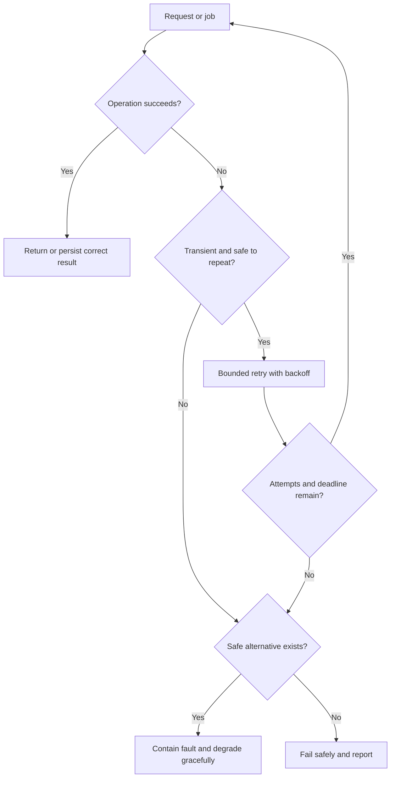
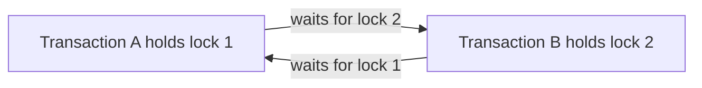
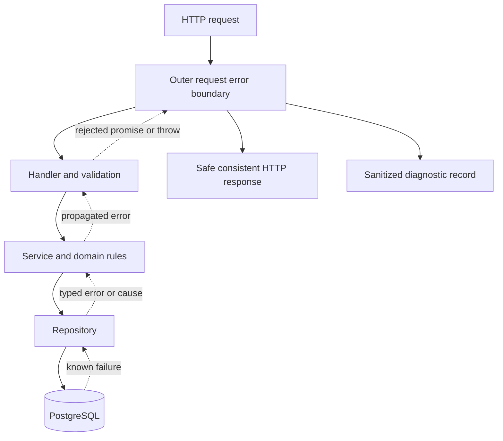

# Video 16 — Error Handling and Building Fault Tolerant Systems

- Video URL: https://www.youtube.com/watch?v=8NaM_9aKS24
- Playlist position: 16, Backend from first principles (Sriniously).
- Duration: 69:25.
- Date: 2026-11-24.
- Learning status: complete (owner explicitly requested GitHub upload).
- Implementation status: not started.
- Source availability: reviewed [secondary transcript-derived notes and whiteboard descriptions](https://github.com/shubhamscifi/backend_from_first_principles_notes/blob/main/16_error_handling_fault_tolerance/NOTES.md); original recording and full transcript were not independently reviewed. The lecture emphasizes mindset rather than framework-specific code. EventHub examples and production refinements below are supplementary explanations, not claims about exact lecture wording.

## Learning objectives

Explain why errors are inevitable; distinguish failure classes and their consequences; detect failures before they spread; decide when to retry, recover, degrade or fail safely; control error propagation across application layers; design a safe, consistent error boundary; protect users and data; demonstrate failure behavior rather than only happy-path success.

## 1. Error handling versus fault tolerance

Error handling is the response to a failure: classification, propagation, logging, recovery or a safe error response. Fault tolerance is the ability to continue providing correct, useful service despite faults. A failed email provider must not invalidate a committed booking. An unavailable authoritative inventory database, however, must not lead to invented availability or unsafe confirmations.



## 2. Five categories of errors (lecture topics)

| Category | Mechanism and example | Engineering response |
| --- | --- | --- |
| Logic | Code executes but violates business rules, e.g. a discount applied twice. HTTP 200 does not prove correctness. Causes include misunderstood requirements, incorrect algorithms and omitted edge cases. | Explicit invariants, domain tests, business metrics and reconciliation. |
| Database | Connection failures, exhausted connection pools, unique/foreign-key constraint violations, malformed or slow queries, deadlocks. | Bound waiting, release connections, preserve constraints and transactions, classify known failures, avoid retrying permanent errors. |
| External service | DNS/network errors, timeouts, bad credentials, expired tokens, rate limits (429), provider outages. | Deadlines, bounded transient retries, provider-specific policy, fallback or isolation. |
| Input validation | Invalid formats, ranges, lengths or absent mandatory fields. | Reject at entry before mutation; validate authorization and business rules separately. |
| Configuration | Missing or wrong environment variables, particularly across dev/staging/production. | Validate required configuration at startup and prevent unready deployments from receiving traffic. |

Illustrative logic error: a ticket costing EGP 500 with a 20% discount should cost EGP 400. Applying it twice gives EGP 320, losing EGP 80 on each order even though every request may return 200. Monitor domain invariants (nonnegative totals, allowed discounts, tickets sold never exceeding capacity), not just exceptions.

### Database internals

A connection pool reuses open database connections and avoids repeated connection establishment overhead. When every connection is occupied, callers queue or fail; unbounded waiting or leaked connections amplify outages. A unique constraint is authoritative even if two requests both pass an application-level existence check. Foreign keys preserve referential integrity. SQL syntax mistakes are not transient; query timeouts require diagnosis.



A database such as PostgreSQL detects deadlocks and aborts one transaction. Retry the entire aborted transaction only when safe, not an individual statement inside an invalid transaction. Keep external side effects outside blindly repeated transaction work.

## 3. Proactive detection and monitoring

The lecture distinguishes basic health, database checks, external dependency checks and core functionality checks. A process can respond to HTTP while failing to perform its primary function. Database connectivity alone does not establish acceptable query latency or integrity. Use representative, inexpensive checks and separate synthetic tests for dependencies; never charge real users as a probe.

Supplementary production distinction:

| Probe | Purpose | Example |
| --- | --- | --- |
| Liveness | Is the process alive and responsive? | GET /health/live |
| Readiness | Can this instance accept its essential traffic? | GET /health/ready; 503 when essential DB is unavailable |

Optional Redis cache or email outages should not automatically make unrelated endpoints unavailable. Bound probe latency, avoid leaking details, and avoid making probes themselves a source of overload or restart loops. Preserve existing /health behavior unless a deliberate contract change is agreed.

Monitor technical signals (error rates, response time, resource usage, throughput, dependency failures) and business signals (successful bookings, successful logins, payment outcomes). A sudden business-metric drop with stable HTTP error rates may indicate a silent logic bug. Rising latency may precede widespread failures. Structured logs and correlation identifiers provide debugging context; full observability is deferred to lecture 18.

Fail fast on missing essential configuration rather than silently starting an unusable deployment. A readiness-gated rollout can leave the old healthy version serving traffic when the new version fails to start. Configuration management is covered next.

## 4. Graceful handling, recovery and containment

### Retry policy

Retry only when a fault is plausibly transient and the operation is safe to repeat. Invalid inputs and bad credentials generally need correction, not repeated requests. A temporary network error, explicitly retryable provider response or rate limit may justify retrying. An outage may require stopping attempts and degrading.

Exponential backoff increases waiting intervals, e.g. 1, 2, 4, 8 seconds. Supplementary production safeguards: define a maximum attempt count including the first attempt, per-attempt timeout, total deadline, maximum delay, jitter to avoid synchronized retry storms, and respect Retry-After within the allowed budget. Prefer cancellation-aware I/O rather than merely racing a timer. Avoid nested retries multiplying load. Do not keep synchronous HTTP requests waiting for long background-job retries.

Example pseudocode (not implementation):

```text
attempt = 1
while within_attempt_and_time_budget:
    outcome = execute_with_deadline(operation_id)
    if outcome is successful: return outcome
    if permanent_error or unsafe_to_repeat: stop
    if next_attempt would exceed budget: stop
    wait bounded_backoff_with_jitter_and_provider_guidance
    attempt += 1
return classified_failure_or_unknown_outcome
```

### A timeout does not mean the operation failed

```mermaid
sequenceDiagram
 participant E as EventHub
 participant P as Mock payment provider
 E->>P: Submit operation with stable idempotency key
 P->>P: Record payment effect
 Note over E,P: Response lost or delayed
 E->>E: Timeout; outcome unknown
 E->>P: Query result or retry same supported key
 P-->>E: Return existing outcome without repeating effect
```

A timeout is uncertainty, not proof of rollback. Blindly resubmitting a payment could charge twice. Use provider-supported idempotency or reconciliation; do not assume local retry logic gives exactly-once effects. The same principle applies to lecture 14's background-job retries after worker failures.

### Graceful degradation and recovery

- If the email provider fails, preserve committed business state and handle notifications separately with a safe retry policy.
- If Redis cache fails, read authoritative PostgreSQL data if capacity permits; never use stale cached inventory as final booking authorization.
- If optional search fails, offer a documented safe browsing alternative if available, maintaining visibility and authorization.
- If authoritative storage fails, reject dependent writes safely rather than claim success.
- Automatic recovery can restart unhealthy processes, clear corrupted disposable caches or switch to a tested fallback. Bad automation can worsen an incident.
- Manual recovery requires tested runbooks and operator judgment.
- Data recovery uses backups, verified restore procedures and, where appropriate, transaction-log replay. Data integrity is more important than blindly maintaining availability.

## 5. Error propagation and global error handling

A layer should handle errors it understands and can recover from; otherwise propagate a typed error with relevant safe context. Repository code should not construct HTTP responses. Application services know the domain meaning of failures; the HTTP boundary knows status codes and serialization. A worker has a separate error boundary, not an HTTP response.



A central boundary reduces duplicate handling and inconsistent or leaking responses. In JavaScript/TypeScript it must await the asynchronous request pipeline to catch rejected promises. Expected operational errors differ from unexpected bugs. Background jobs and detached callbacks require their own boundaries. If response headers have already been sent, do not try to send a second JSON response; record the failure and safely terminate the affected stream as appropriate. A global request handler is not a justification for swallowing fatal process-level errors or continuing after corrupted state.

The lecture uses book creation to demonstrate validation, duplicate-name and missing-resource failures. The following status mappings are engineering examples, not mandatory mappings from SQL error codes.

| Status | Typical meaning |
| --- | --- |
| 400 | Invalid request syntax or input |
| 401 | Missing or invalid authentication |
| 403 | Insufficient permission |
| 404 | Requested resource not found |
| 409 | Conflict with current resource state, e.g. duplicate |
| 422 | Well-formed input that cannot be processed semantically |
| 429 | Client rate limited |
| 500 | Unexpected internal error |
| 503 | Temporarily unavailable essential service |

The lecturer illustrates duplicate constraints with 400 and missing references with 404. 409 and 422 may be more appropriate depending on API semantics. A foreign-key failure is not automatically a 404, nor should every database error map to 500. Preserve established EventHub contracts unless a deliberate compatible change or migration is agreed.

Illustrative response envelope (reuse existing format if adequate):

```json
{
  "error": {
    "code": "EVENT_NOT_FOUND",
    "message": "The requested event was not found.",
    "requestId": "req_example"
  }
}
```

An unexpected failure should return a generic message and request identifier, not SQL, stack traces, secrets, file paths or provider payloads. RFC 9457 Problem Details is an alternative standardized contract, not a required migration.

## 6. Security and production implications

Separate client-facing errors from restricted internal diagnostics. Raw SQL errors disclose schema/constraints and internals. Do not log passwords, tokens, API keys, card details or unnecessary personal information; scrub nested error causes and provider responses as well. Use request IDs and appropriate internal identifiers with access controls and retention limits.

A login endpoint that distinguishes nonexistent email from wrong password enables account enumeration. Use a generic invalid-credentials response; also consider observable status, response timing and rate limits. Do not log raw credentials or rely on a generic message alone.

Contain failures across dependencies and workers through bounded timeouts, separate execution boundaries, and asynchronous queues where appropriate. Trade-offs: fallbacks can overload remaining dependencies, retries consume resources, health checks add load, and centralized mapping must not lose domain context. Protect data integrity before availability.

## Discussion and misconceptions

- HTTP 200 does not guarantee business correctness.
- A timeout does not establish that an operation failed.
- Retrying all errors does not make the system resilient.
- Validation is not a substitute for database constraints or authorization.
- Liveness is not the same as readiness.
- A global error handler does not replace local recovery, worker boundaries or process supervision.
- A conceptual check was posed: the last ticket has been successfully booked, but the email provider returns 503. The appropriate response is to retain the confirmed booking, record the notification failure, and retry notification safely later. The learner did not provide an answer before requesting upload.

## Key takeaways and references

Expect errors, detect them early, classify by cause and safety, contain their blast radius, recover without corrupting state, and expose only safe diagnostic information. Prefer correctness over apparent success.

- [Lecture](https://www.youtube.com/watch?v=8NaM_9aKS24)
- [Secondary transcript-derived notes](https://github.com/shubhamscifi/backend_from_first_principles_notes/blob/main/16_error_handling_fault_tolerance/NOTES.md)
- [AWS Builders' Library: Timeouts, retries and backoff with jitter](https://aws.amazon.com/builders-library/timeouts-retries-and-backoff-with-jitter/)
- [RFC 9457: Problem Details for HTTP APIs](https://datatracker.ietf.org/doc/html/rfc9457)
- [OWASP Error Handling Cheat Sheet](https://cheatsheetseries.owasp.org/cheatsheets/Error_Handling_Cheat_Sheet.html)
- [OWASP Authentication Cheat Sheet](https://cheatsheetseries.owasp.org/cheatsheets/Authentication_Cheat_Sheet.html)
- [OWASP Logging Cheat Sheet](https://cheatsheetseries.owasp.org/cheatsheets/Logging_Cheat_Sheet.html)

## EventHub practical assignment — coding agent handoff

### Problem and learning goal

Extend the existing native Node.js/TypeScript backend, not a new service. At documentation time the current main progress tracker confirms lectures 12–15 implemented: PostgreSQL persistence, Redis event-detail cache, BullMQ notification lab with dedicated queue Redis, and PostgreSQL full-text search. Elasticsearch was not implemented. Inspect current code, tests and ADRs before changes; reuse existing error contracts, middleware, health endpoints and retry mechanisms. Do not assume a complete booking/payment domain already exists.

### In scope and suggested incremental exercise

1. Audit existing request/error paths and tests. Trace a representative validation failure, missing event, unique conflict, database failure and unexpected exception. Identify gaps rather than rewrite working code.
2. Introduce or refine typed application/domain errors and a central async HTTP error boundary. Keep safe machine-readable error codes, status semantics, request identifiers and consistent serialization; preserve existing contracts and headers.
3. Handle essential database unavailability with bounded failure and appropriate safe response. Distinguish expected constraints from unexpected failures. Preserve transactions and authoritative data.
4. Implement an isolated mock external dependency that can delay, fail transiently, fail permanently, or commit an effect before losing its reply. Demonstrate bounded timeout, transient retry/backoff, and safe duplicate-effect prevention. Reuse lecture 14's queue retry lab where applicable; avoid nested retries and real external services. Keep notification failures separate from committed domain state.
5. Compare process liveness with readiness for essential dependencies. Preserve the existing health route; do not mark optional cache failure as global unavailability without a documented reason.
6. Validate sanitized diagnostics and error responses, including login failures. Record evidence and run previous regression checks.

### Acceptance criteria and experiments

| Case | Observable expected behavior |
| --- | --- |
| Invalid input | Existing agreed 400/422 contract; no mutation. |
| Duplicate resource | Meaningful conflict response (409 or existing documented equivalent); authoritative uniqueness preserved, including concurrent attempts where feasible. |
| Unknown event | 404 using safe response contract; no internal details. |
| PostgreSQL unavailable | Bounded failure for dependent routes, safe 503 or documented mapping, no false success or process crash; recovery verified after restore. |
| Temporary mock dependency timeout/failure | Limited attempts with measurable delay, total deadline and successful recovery when possible; no infinite waits. |
| Persistent or permanent failure | Stop at budget for transient failure; no unnecessary retries for permanent failure. |
| Lost reply after mock effect | Reuse stable operation identity or reconcile; demonstrate no duplicate effect for the tested mock scenario; document limits. |
| Optional cache/notification failure | Unaffected functionality stays correct when safe; no stale inventory authorization or repeated committed operation. |
| Unexpected async exception | Generic 500 with request ID where response is still writable; sanitized diagnostics; no unhandled rejection from the request. |
| Health probes | Process alive while DB readiness fails, bounded checks, readiness restored after dependency recovery. |
| Authentication failures | Generic public errors without unnecessary sensitive details; previous auth behavior preserved. |
| Regression checks | Existing routes, auth, validation, cache, search and queue labs retain their documented behavior. |

Use synthetic data, controllable local faults and deterministic tests (fake clock where appropriate). Record actual commands, observed statuses, elapsed time, attempt counts, effect counts and before/after behavior; do not claim measurements or test passes before running them.

### Edge cases and trade-offs

Concurrent uniqueness checks; timeout after commit; expired retry budget; Retry-After larger than remaining budget; unavailable fallback; connection-pool exhaustion; error after response begins; worker retry duplication; error-message/log redaction; health probe overload. A fallback must preserve authorization, visibility and consistency. A mock idempotency lab does not prove production exactly-once delivery.

### Deferred and prerequisites

No real payments or emails, frontend, new microservices, Kubernetes, speculative infrastructure, advanced observability suite, configuration overhaul, graceful shutdown overhaul or full security redesign. Defer to the relevant lectures. No real booking flow solely for this lesson if absent. Confirm exact current implementation before selecting changes; keep the increment small and independently testable. Owner approval is required for implementation progression.

## Learning completion (ChatGPT)

- [x] Owner explicitly requested lecture upload.
- [x] Conceptual notes, discussion and assignment documented.
- [x] Learning status updated independently in docs/PROGRESS.md in the same commit.

## Implementation evidence (coding agent)

Branch `feat/lecture-16-error-handling`, ADR-015. Environment: Linux, Node v24, PostgreSQL 17 / Redis 7 containers from `backend/docker-compose.yml`, local machine with other containers running. All numbers below are from this machine, single runs.

### Audit of the existing code (no rewrite where it already worked)

| Assignment item | State before this lesson | Action |
| --- | --- | --- |
| Central async error boundary, no leaks, headers-already-sent | Existed (`errorBoundary` in server.ts) | Moved to `src/http/error-boundary.ts` so it can be tested in isolation; body now also carries `requestId` |
| Invalid input / unknown event | 400/422 and 404 already documented and tested | Unchanged (regression-tested) |
| Duplicate resource, concurrent | Username: unique index on `lower(username)`, `23505` caught in `PgUserRepository` | New test: two concurrent registers (`race_user`/`RACE_USER`) give exactly one 201 and one 409. Events have no unique name, so no event conflict case exists |
| Login failures | One generic 401, dummy scrypt for unknown users, 429 + Retry-After | Unchanged |
| DB unavailable | Any pg error -> 500 | **Changed**: 503 + `Retry-After: 5`, generic body |
| Mock dependency: timeout / transient / permanent / lost reply, idempotency | Lecture 14 lab (`MockEmailProvider`, BullMQ backoff, `UnrecoverableError`, dedup by key) | Reused, not duplicated; no synchronous external call exists in the HTTP path |
| Liveness vs readiness | Only `/health` | **Added** `/health/live`, `/health/ready`; `/health` unchanged |
| Optional cache failure | Cache-aside falls back to PostgreSQL (lecture 13) | Re-verified |

### Tests
- `npm test`: 266 tests (256 before + 10 new in `test/error-handling.test.ts`). `npm run typecheck` clean.
- Two earlier tests were changed on purpose: `layers.test.ts` (500 body now has `requestId`) and `postgres.test.ts` (database outage now 503, was 500).
- **Flaky test, not caused by this lesson:** `jobs.test.ts` "provider slower than the processing timeout..." failed in 2 of 6 full runs (assertion on `failedReason` being undefined); the other runs were green. It is a lecture-14 race and was not investigated here.

### Negative cases covered by the new tests
Constraint/syntax/programmer errors are not classified as unavailable; unexpected error -> generic 500 (no SQL, password, path in body or log); unreachable database -> 503 without host/port; error after headers sent ends the stream with no second response; refused connection and hung database both give "not ready" within the bound (hung probe measured 100–600 ms window with a 120 ms limit); the real pg-pool connect timeout is recognised; concurrent duplicate registration.

### Live experiment (reproducible)
`PORT=48731 npm start`, then `docker stop eventhub-pg`, curl, `docker start eventhub-pg`, curl (application not restarted):

| Endpoint | DB up | DB stopped | After `docker start` |
| --- | --- | --- | --- |
| `/health` | 200 | 200 | — |
| `/health/live` | 200 | 200 | — |
| `/health/ready` | 200 (18 ms) | **503** (4 ms) | 200 |
| `/api/v1/events` | 200 | **503**, body `{"error":"Service Unavailable","requestId":...}` | 200 |
| `/api/v1/events/1` | 200 | 200 (served from the Redis cache) | 200 |

The process stayed alive and the pool recovered without a restart. Log line for the failure contains only `kind: "db-unavailable"` and the error class.

### Answer to the posed check (last ticket booked, email provider 503)
Keep the booking; record the notification as failed/pending; retry it later through the lecture-14 queue with the same idempotency key. (No real booking flow exists yet, so this is shown only by the lab.)

### Not done / limitations
No pool `statement_timeout`; no connection-pool exhaustion experiment; no deadlock (`40P01`) retry; no HTTP-path external call to wrap with timeout/retry (the lecture-14 lab covers retries/lost replies); readiness does not check Redis by design; the message-text match for pg-pool's connect timeout is version-sensitive; the lecture's nested error envelope and RFC 9457 were not adopted.

- [x] Implementation and reproducible experiment.
- [x] Acceptance criteria demonstrated, except the items listed under "Not done".
- [x] Negative cases and regression checks.
- [x] Owner confirmed implementation completion (2026-11-25).
