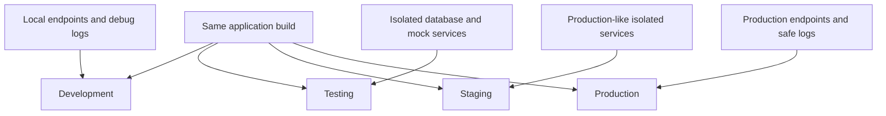
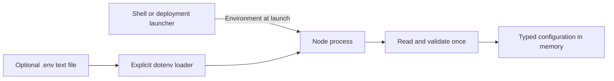
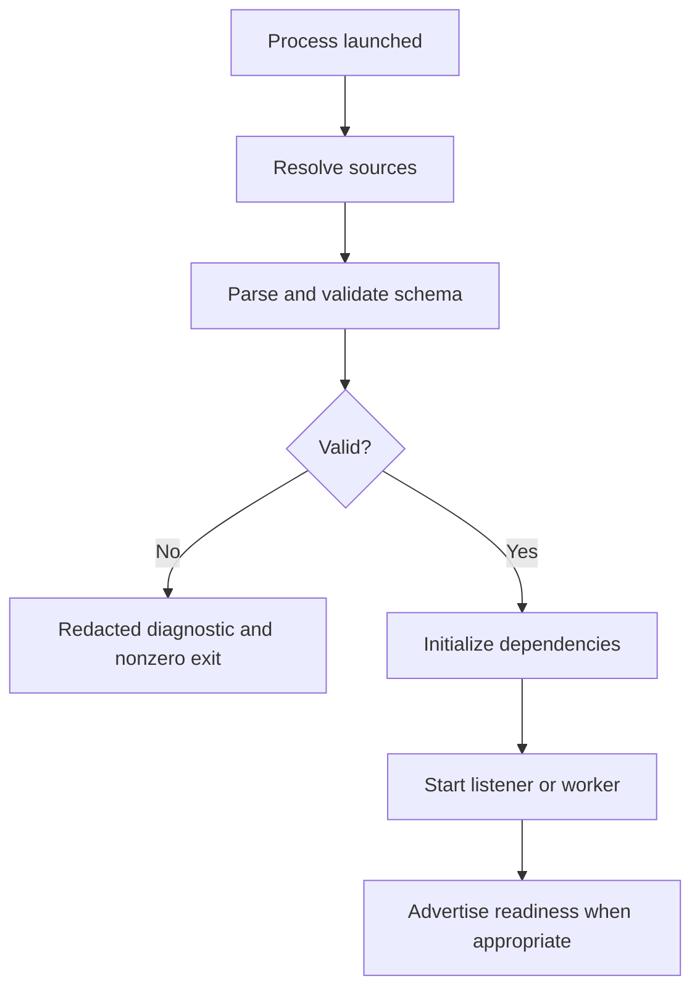
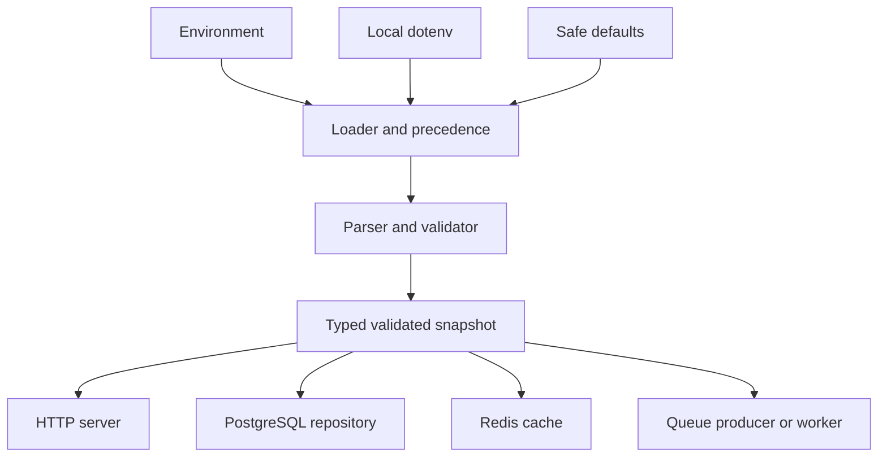
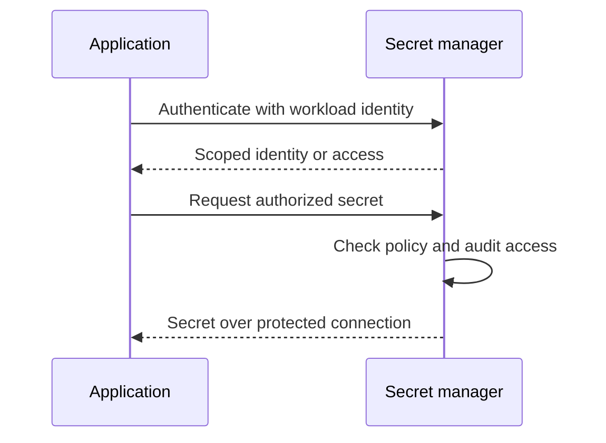

# Video 17 — Production-grade Configuration Management

- Video URL: https://www.youtube.com/watch?v=GR9NtirPXyc
- Playlist position: 17 (identified during the learning session).
- Date: 2026-11-25.
- Learning status: complete (owner explicitly requested GitHub upload).
- Implementation status: complete (owner confirmed 2026-11-25).
- Source availability: the learning session used available transcript excerpts and a secondary time-indexed summary; the complete original recording/transcript was not independently reviewed. The following is a synthesis of the session, not a verbatim transcript. EventHub designs, code samples, failure scenarios and experiments are supplementary teaching material, not claims about exact lecture wording or existing implementation.

## Learning objectives

- Explain why separating deploy-time configuration from application logic enables the same build to run in different environments.
- Trace environment variables from the parent process into a running Node.js process, and distinguish them from dotenv files.
- Classify operational settings, credentials, feature flags and configurable business policy.
- Explain source precedence, parsing, validation, startup failure and the risks of configuration drift.
- Compare static and dynamic configuration, and explain the cost of consistency, availability and secure secret rotation.
- Design a centralized typed configuration boundary for API and worker processes while preserving existing behavior.

## Concepts and internal mechanisms

### 1. The problem: configuration chaos

Hardcoded hostnames, credentials, timeouts and flags tie a build to a particular machine. Changing a setting then requires editing, rebuilding and deploying application code. Scattered configuration access also makes it difficult to know which values are required, where defaults come from, and why replicas behave differently.

Configuration is the data that selects operational behavior; code defines the behavior available. Not every constant needs to be externally configurable: stable implementation invariants can stay in code. Business policy needs an explicit owner and semantics, not arbitrary environment overrides.



Development favors quick feedback; testing favors isolation and repeatability; staging approximates production without touching live data; production favors safety, reliability and predictable resource use. Environment parity means minimizing unnecessary differences, not using identical credentials or live data everywhere.

### 2. Configuration categories

| Category | Examples | Reason to configure |
| --- | --- | --- |
| Application | PORT, APP_ENV, LOG_LEVEL | Runtime environment |
| Database | Connection URL, pool maximum | Deployment topology and capacity |
| External services | Cache and queue Redis endpoints, provider settings | Dependency selection |
| Security | JWT signing material, allowed origins, token expiry | Trust and security policy |
| Performance | Request/dependency timeouts, worker concurrency, cache TTL | Resource allocation and reliability |
| Feature flags | Optional cache or experimental search behavior | Release control |
| Business policy | Booking duration, ticket limits | Explicit policy decisions |

A secret is sensitive configuration, such as a password, signing key or credential-bearing URL. Non-sensitive settings can be versioned when appropriate; real secrets must never enter this public repository. Even non-secret topology information can be sensitive in some environments.

### 3. Process environment and dotenv

On typical POSIX systems a parent process supplies an environment to a new process when it executes a program. The child gets its own environment; changing the parent's environment later does not automatically update the child. Node exposes environment values through process.env as strings (or undefined for absent keys).

```bash
export PORT=8080
export APP_ENV=development
node server.js
```



A .env file is plain text, not a magical operating-system feature. A runtime, library or launcher must parse and load it explicitly. Editing the file on disk does not automatically change the already-running process or any parsed configuration object. Ordinary static configuration changes need a process restart or explicit reconfiguration. Ensure loading occurs before modules that consume settings, especially with ESM imports.

### 4. Sources, precedence and drift

| Source | Strength | Limitation |
| --- | --- | --- |
| Code defaults | Safe defaults for optional settings | Rebuild needed to change a compiled default; never default real secrets |
| Environment variables | Easy deployment injection and per-process isolation | Strings, limited structure, potentially exposed to privileged diagnostics |
| .env files | Convenient local development | Plain text; risk of accidental commit; explicit loading |
| YAML/JSON/TOML | Structured settings, versionable non-secrets | Parsing and deployment coordination |
| Central config store | Shared versioned policy across replicas | Network dependency, outages, propagation lag |
| Secret manager | Access control, auditing and rotation | Bootstrap identity and operational complexity |

An example priority from lowest to highest is defaults, local config file, process environment, remote overrides. This is illustrative, not a universal rule. For the EventHub exercise, prefer explicit process environment over local dotenv values, then documented safe defaults; no remote store required. A supplied invalid value must fail validation rather than silently fall back. Distinguish absent, empty, malformed and valid values such as false or zero.

Configuration drift happens when instances intended to behave identically use different effective settings. If a timeout is changed from 30s to 15s on only three of four replicas, the same request may have different outcomes. A central store reduces manual drift but does not guarantee simultaneous visibility: caching, polling, notification delays and failures matter. Version non-sensitive snapshots and define stale-data and rollback policies before adding live reload.

### 5. Static and dynamic configuration

Static configuration is resolved at startup: server port, environment identity, initial database pool and similar process settings. Dynamic configuration is explicitly designed for runtime changes, such as feature flags, selected rate limits or maintenance settings. Merely storing a setting remotely does not make the application dynamic.

Dynamic systems may poll or subscribe to changes, validate a candidate snapshot, then atomically replace the current snapshot. Consumers should not observe a partially updated set of dependent settings. A failed update needs a deliberate policy (reject and retain last-known-good where safe, or fail closed for security-critical changes), and replica rollout may be gradual. Runtime reconfiguration of a database pool may require draining and rebuilding resources, not simply mutating a number.

### 6. Feature flags: deployment is not release

Deploying code makes it present on the server; releasing a feature makes it available to users. A flag can select a legacy or new behavior, isolate a gradual rollout or serve as a kill switch. A stable hash of user identity is one possible cohort mechanism; random decisions on every request make experience inconsistent. Flags stored in startup environment variables require restart. Dynamic flags require an explicit propagation mechanism.

```ts
if (config.features.newBooking) {
  return newBookingService.book(request);
}
return legacyBookingService.book(request);
```

This is a hypothetical illustration, not a requirement to create a booking implementation. Feature flags are not authorization checks and cannot undo side effects already committed. Remove temporary flags when no longer needed and test both paths. Avoid enabling incompatible writers against shared state.

### 7. Parsing and validation: fail fast

Configuration crosses an input boundary just like HTTP payloads (lecture 09). A type declaration or type assertion alone cannot validate runtime values. In JavaScript the string "false" is truthy, so checking process.env.CACHE_ENABLED directly is wrong. Parse only explicitly accepted values; do not quietly accept typos.

```ts
function parseBoolean(raw: string | undefined, fallback: boolean): boolean {
  if (raw === undefined) return fallback;
  if (raw === "true") return true;
  if (raw === "false") return false;
  throw new Error("CACHE_ENABLED must be true or false");
}
```

Validate required fields, types, numeric ranges and units, URL structure and intended schemes, enumerated modes and cross-field constraints (e.g. enabled cache requires its endpoint; production must not use unsafe development signing defaults). Distinguish configuration validation from dependency connectivity/readiness: a syntactically valid database URL does not prove the database is reachable.



Failing startup on invalid required configuration prevents a new instance from accepting traffic with broken settings. This is not automatically zero downtime: a deployment system must keep healthy old instances available and route traffic only to ready new ones. Connect this to lecture 16 error handling and readiness. An optional dependency outage and a malformed required setting are different failures.

### 8. A centralized configuration boundary

Read raw sources at the composition root, resolve precedence, parse and validate, then supply a typed snapshot to server, repositories, services and workers. A pure parseConfig(input) function is easy to test without mutating global process.env. Separate loading and schema validation where helpful, and prefer dependency injection for components that need only a subset of settings. Avoid introducing an extra abstraction for each key.



Illustrative TypeScript with no new dependency required:

```ts
type Env = Readonly<Record<string, string | undefined>>;
function parsePort(env: Env): number {
  const raw = env.PORT ?? "8080";
  if (!/^\d+$/.test(raw)) throw new Error("PORT must be an integer");
  const port = Number(raw);
  if (!Number.isSafeInteger(port) || port < 1 || port > 65535) {
    throw new Error("PORT must be between 1 and 65535");
  }
  return port;
}
```

A schema library such as Zod can express the same validation concisely, if already present or justified. Do not use boolean coercion that treats nonempty strings as true. Object.freeze is shallow; for nested configuration use a deliberate immutability strategy if needed. Keep credential-bearing fields away from generic object logging and redact errors from parsing and dependency clients. Examples are conceptual, not tested project code.

## Production behavior and failure scenarios

### Secrets management and rotation

Environment variables avoid putting credentials in source code but are not an encrypted vault. Plaintext files, process diagnostics, crash dumps, debug output and privileged access can expose secrets. A secret manager authenticates a workload, checks its access policy and returns only authorized secrets. It improves auditing and centralized lifecycle management but adds a dependency, identity bootstrap, caching and availability considerations.



Rotation means issuing replacement credentials and retiring old ones in a controlled way. Database clients may need to reconnect using new credentials. JWT rotation may require an overlap period or key IDs so existing tokens can still be verified when appropriate; compromise may require immediate revocation instead. Simply deleting a leaked secret from the latest Git commit is insufficient: revoke and replace the credential and address exposure in history. Do not introduce a vault merely to demonstrate local configuration.

### Performance and capacity

For a database pool with maximum P connections per instance and N identical API replicas, the upper bound on their demand is N × P. Four replicas with pool max 20 could request 80 connections, not necessarily hold all 80. Against a 100-connection database that leaves at most 20 theoretical slots before other clients, maintenance and reserved connections. Scaling API replicas without revisiting pool capacity may exhaust the database. Include worker and other process pools, and measure actual utilization before tuning. Increasing timeouts or concurrency is not automatically a performance improvement.

### Typical misconfiguration incidents

| Failure | Consequence | Mitigation |
| --- | --- | --- |
| Staging points to production database | Real data may be changed or deleted | Isolated credentials and infrastructure, explicit environment checks |
| Debug logging in production | Sensitive data exposure | Safe defaults and environment-specific validation |
| Replicas use different JWT keys | Intermittent 401 responses for valid tokens with symmetric signing | Coordinated key distribution and rotation |
| Invalid boolean parsing | Feature unexpectedly enabled | Explicit strict parsing |
| Missing credentials | Failure only when a request reaches dependency | Required startup checks and safe diagnostics |
| Unbounded or mismatched pools/timeouts | Resource exhaustion | Bounds and measured capacity |
| Cache and queue Redis mixed accidentally | Eviction or queue reliability problems | Preserve their distinct configuration and deployment roles |
| Dynamic update arrives partially | Inconsistent decisions | Versioned snapshots, controlled rollout, explicit failure behavior |

## Discussion and misconceptions

No learner follow-up answer was recorded before the upload request. The session ended with an open design question: if a booking hold duration changes from 15 minutes to 5 minutes while users already have active reservations, should the old reservations change, and what happens if five replicas see different config versions?

Supplementary reasoning for future discussion (not a learner-confirmed decision): generally, persist the authoritative expiry timestamp when creating a reservation, so existing promises do not silently change and expiry is not recomputed from the current setting on each request. New reservations can follow the new policy. If all new reservations must switch at the same instant, use a coordinated authoritative/versioned policy and a clear effective time, not eventual per-instance flags. Define migration explicitly if business requirements demand changing old reservations. Booking implementation is deferred.

Other misconceptions:
- .env is not inherently secure, and process.env is not the file.
- A central config store is not automatic strong consistency.
- A valid schema does not guarantee dependency health.
- A feature flag does not grant permission or reverse completed work.
- Every business rule need not become a configuration variable.
- More connections and more replicas do not automatically improve performance.

## Key takeaways and references

Mental model: load → resolve → parse → validate → initialize → use. Keep environment-specific values outside business logic, protect secrets, fail early for invalid required settings and make operational changes reproducible.

- Lecture: https://www.youtube.com/watch?v=GR9NtirPXyc
- Course playlist: https://www.youtube.com/playlist?list=PLui3EUkuMTPgZcV0QhQrOcwMPcBCcd_Q1
- Twelve-Factor App, Config: https://12factor.net/config
- Node.js environment variables: https://nodejs.org/api/environment_variables.html
- OWASP Secrets Management Cheat Sheet: https://cheatsheetseries.owasp.org/cheatsheets/Secrets_Management_Cheat_Sheet.html

The references support further independent study; no full transcript or new runtime experiments were verified while writing this note.

## EventHub practical assignment — coding agent handoff

### Problem and learning goal

EventHub now has documented Node/TypeScript native HTTP, PostgreSQL, public event Redis caching, BullMQ notification experiments on dedicated queue Redis and PostgreSQL FTS. These integrations need predictable startup settings. The actual current code and environment variable names must be inspected before implementation; these milestones are sourced from the progress tracker, not a fresh code audit. Lecture 16 implementation remains unconfirmed/not started in the tracker. Do not skip prerequisite milestones without owner approval.

### In scope / expected behavior

1. Inventory current configuration consumers, entrypoints, scripts, tests, defaults and environment variable names. Include API, worker and any migration/test scripts where applicable. Reuse existing modules and avoid breaking deployed variable names.
2. Define a small typed configuration boundary: application mode, HTTP port, required database settings, existing JWT settings, cache/queue endpoints and tuning only where already applicable. Preserve the cache/queue distinction and current fail-open/fail-closed semantics.
3. Document source priority: explicit process environment overrides local dotenv, then safe documented optional defaults. Ensure local file loading happens before validation. Do not implicitly load a development file in production.
4. Parse and validate before listening or processing jobs. Use per-entrypoint requirements; a process should not be blocked by irrelevant credentials for a disabled or unrelated dependency. Produce actionable key-level diagnostics without raw values, credential-bearing URLs or full environment dumps.
5. Keep .env.example or existing equivalent synchronized, with placeholders only, appropriate ignore rules, and a reproducible development/test setup. Never replace working local values or point tests at production.
6. Introduce or reuse a simple static feature flag for one existing optional non-security behavior (prefer the existing public event cache if appropriate). Preserve normal default behavior; disabled cache uses the existing authoritative PostgreSQL path and does not require cache connectivity. Do not build new business features just to demonstrate flags.
7. Add focused unit tests and startup/behavior regression checks. Inject a config snapshot rather than repeatedly reading process.env in business logic. Avoid a broad unrelated refactor.

### Suggested incremental exercise

Inspect and record a before-state of configuration access. Write failing unit tests for strict parsing, missing required values and precedence, then implement the smallest shared loader/parser. Wire one entrypoint first, migrate existing consumers incrementally, and repeat for worker as needed. Demonstrate the same build with different safe local environment settings and a restart. Document exact commands, exit codes, sanitized logs and observed behavior.

### Acceptance criteria

| Case | Observable expected behavior |
| --- | --- |
| Required database setting absent for DB-backed API | Nonzero startup exit; no HTTP listener; error names missing key without exposing values |
| Required signing material absent or invalid | Startup rejects it when auth enabled; no insecure production fallback |
| PORT=abc, PORT=99999 or empty supplied value | Explicit validation failure; no silent fallback |
| Optional port absent | Documented safe default applied |
| Boolean true/false supplied | Correct typed boolean; arbitrary spelling rejected |
| Explicit environment and local file conflict | Documented environment precedence reproduced |
| Optional cache disabled | Existing event reads still use PostgreSQL; cache endpoint not required if unused |
| Required queue setting invalid for worker | Worker rejects config before consuming jobs |
| Valid settings in isolated development/test | Same application build runs using its selected settings |
| Configuration file changed while process is running | No automatic change for static settings; restart loads updated configuration |
| Sensitive sentinel value used in negative test | Neither validation output nor captured logs expose the sentinel |
| Existing tests and typecheck | Run and record results; no regressions or unverified success claims |

### Experiments and important edge cases

- Reproduce missing versus empty versus false/zero; use per-key range/format validation.
- Test both feature flag states, and the distinction between disabled cache and enabled cache outage. Preserve existing fallback semantics.
- Demonstrate two isolated processes with different ports or a safe flag, and observe independent snapshots. Do not require production infrastructure.
- Verify a valid-looking but unreachable database config is handled by the existing dependency/readiness policy, separately from invalid config.
- Exercise startup validation for API and worker using subprocesses where suitable; avoid port conflicts and shared test state.
- If development/test isolation cannot be verified, stop before destructive database operations and report the blocker.
- Optional thought experiment: calculate total pool capacity for multiple replicas including workers; do not invent measured results.

### Deliberately deferred / prerequisites

No Consul, etcd, Vault, paid secret service, distributed configuration platform, remote dynamic feature flags, real payment or email credentials, reservation-policy redesign, frontend work or deployment rollout infrastructure. Do not implement live reload as part of this assignment. Inspect existing config and dependencies, respect owner approval for implementation sequencing, and use the current stack rather than assuming a new schema library. No application code was changed during learning documentation.

## Learning completion (ChatGPT)

- [x] Owner explicitly requested upload of lecture 17 (treated as learning completion per project convention).
- [x] Conceptual notes, discussion and assignment documented.
- [x] Learning status updated independently in docs/PROGRESS.md.

## Implementation evidence (coding agent)

Environment: Linux, Node v24.22.1, local Docker PostgreSQL/Redis/queue-Redis; branch `main`, uncommitted at the time of writing. Decision: [ADR-016](../decisions/016-central-configuration-boundary.md).

**Before (audit):** `process.env` read directly in `db/pool.ts`, `cache.ts`, `server.ts`, `jobs/worker-main.ts`, `jobs/enqueue-main.ts`; `Number(v)` parsing; empty value treated as unset; no JWT settings exist (in-memory sessions).

**Changes:** new `src/config.ts` (pure parsers + `loadConfig`), wired into the five consumers; `CACHE_ENABLED` flag; `.env.example` updated (placeholders only); `test/setup.ts` clears `CACHE_ENABLED`; new `test/config.test.ts` (15 tests; 7 of them spawn real subprocesses with a minimal clean environment).

**Commands and observed results**
- `npm run typecheck` -> clean. `npm test` -> 281 tests, 281 pass, 0 fail, 0 skipped (0 skipped, so the Redis and queue tests ran; no separate pre-change baseline run was recorded).
- Manual: `DATABASE_URL=` (empty) -> stderr `DATABASE_URL must be a postgres:// or postgresql:// URL`, exit 1, no listener. `DATABASE_URL=postgres://u:SENTINEL@h:abc/db` -> same message, value not echoed, exit 1. `CACHE_ENABLED=maybe` -> `must be exactly true or false`, exit 1. `QUEUE_REDIS_URL=nope npm run jobs:worker` -> exit 1 before any connection.
- Two API processes (`PORT=18091 CACHE_ENABLED=false`, `PORT=18092`) from the same code ran side by side with independent settings; both `/health/ready` returned ready.

**Acceptance criteria**
| Case | Result |
| --- | --- |
| Missing DB setting | exit 1, key named, no listener (test) |
| Signing material | Not applicable: no JWT/signing settings exist yet |
| PORT abc / 99999 / empty | rejected, exit 1 (unit + subprocess) |
| Optional port absent | 8080 (unit) |
| Booleans | exact true/false; `TRUE`, `yes`, `1`, empty, typos rejected (unit) |
| Env vs file conflict | env wins; file used when env absent (subprocess with `--env-file`) |
| Cache disabled | no Redis client, broken `REDIS_URL` ignored (unit). Reads then use the existing noCache/PostgreSQL path already covered by the existing suite; no new HTTP-level test for the flag itself |
| Worker invalid queue setting | exit 1 before connecting (subprocess) |
| Isolated dev/test | existing suite runs unchanged against `_test` DB |
| File edited while running | running process keeps its port; restart picks up the edit (subprocess) |
| Sentinel | not in parse errors nor subprocess output (negative test) |
| Unreachable but valid DB URL | starts; `/health/ready` 503, `/health/live` 200 (separate from config errors) |
| Regression | full suite green (above) |

**Limitations / not verified:** per-module validation order (see ADR); real production deployment, secret-manager rotation and multi-replica drift not exercised; the thought experiment on pool capacity (N x P) was not run. The lecture-16 reservation-expiry design question remains unanswered by the learner.

- [x] Implementation or reproducible experiment.
- [x] Acceptance criteria demonstrated (signing-material row not applicable).
- [x] Negative cases and regression checks.
- [x] Learner confirmed (2026-11-25); implementation progress marked complete.
