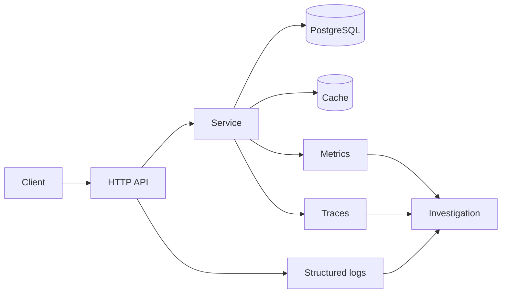
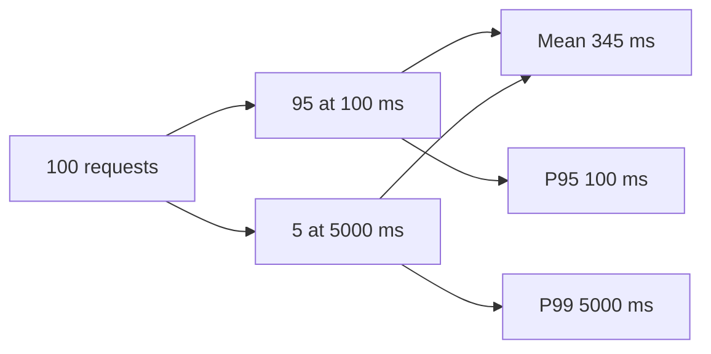
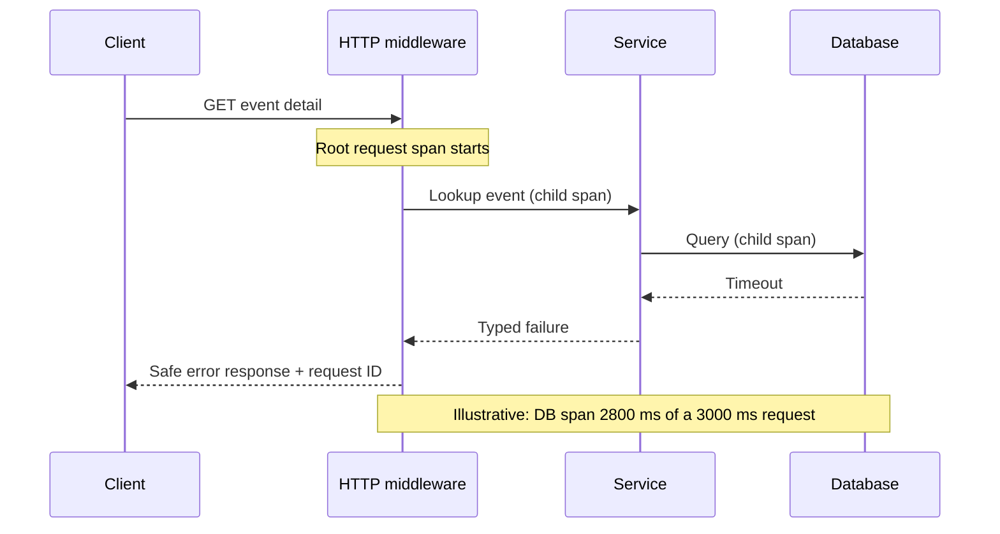
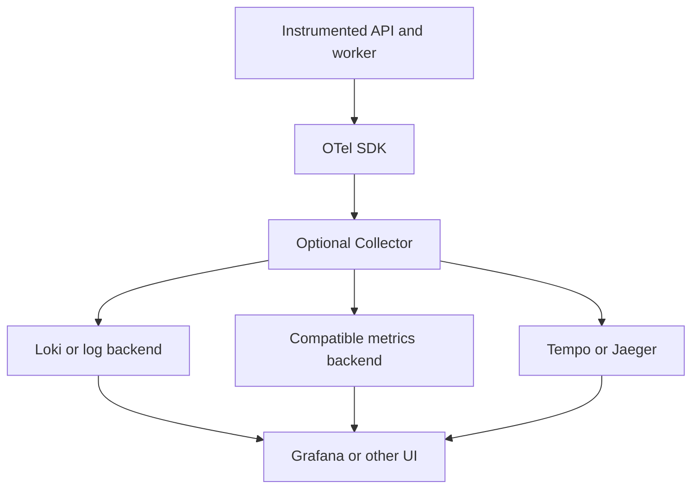

# Video 18 — Logging, Monitoring and Observability

- Video: https://www.youtube.com/watch?v=5PEuwgLOQQM
- Playlist position: 18 (numbered video title confirmed; secondary course index agrees).
- Instructor: Sriniously, Backend from First Principles.
- Date: 2026-11-25.
- Learning status: Complete (owner explicitly requested GitHub upload).
- Implementation status: Not started.
- Source limitations: Video identity and description verified, with third-party transcript excerpts and notes available. The full original recording and official transcript were not independently reviewed during documentation. The EventHub examples, simulations, percentiles, cardinality, alert design and proposed architecture below are supplementary engineering explanations, not a verbatim account of the video. The session described a Go to-do application using New Relic; use that as an illustrative lecture example, not a requirement to adopt that vendor.

## Learning objectives

- Distinguish logging, monitoring, metrics, tracing and observability.
- Explain how instrumentation produces telemetry and how request context connects it.
- Read a latency distribution, interpret counters and gauges, and diagnose a slow or failed request with evidence.
- Understand structured logging, safe data selection, operational costs, and alert fatigue.
- Design a small observability increment for the existing Node/TypeScript API and background worker.

## 1. The problem: a running system is not necessarily understandable

A user reports a failed booking. A 500 response reveals a symptom, not whether authentication, database, cache or an external service failed. A backend engineer needs runtime evidence, particularly when many requests execute concurrently. The booking scenario is illustrative; do not assume booking or payment functionality already exists.



| Concept | Question answered | Example |
| --- | --- | --- |
| Logging | What happened? | A database operation timed out. |
| Metrics | How many, how often, how long? | HTTP 5xx rate and request duration. |
| Monitoring | Is the system behaving acceptably? | A sustained error-rate increase. |
| Tracing | Where did this operation spend time or fail? | Database connection acquisition dominated the request. |
| Observability | Can we infer internal behavior from external signals, even for new questions? | Investigate a latency increase affecting only one route after a deployment. |

Monitoring and observability overlap; the distinction is not an absolute taxonomy. Observability is a property of a system and its instrumentation, not a product that can simply be installed. Logs, metrics and traces are common complementary signals, not a guarantee of observability.

## 2. Logging

A log is a record of an event at runtime. Include useful context such as timestamp, severity, event name, service, request identifier and relevant error classification. Distinguish application, access and security events as useful; avoid confusing diagnostic logs with a durable business audit trail.

Typical severity levels:

| Level | Intended meaning |
| --- | --- |
| TRACE | Very fine-grained execution details |
| DEBUG | Diagnostic details |
| INFO | Significant normal events |
| WARN | Abnormal or degraded conditions, possibly recovered |
| ERROR | Unexpected failure requiring investigation |
| FATAL | Critical condition preventing continued operation |

Exact semantics vary by logging library. FATAL does not automatically terminate every process. Configure severity thresholds centrally (lecture 17), e.g. debug locally and info in production as a starting policy, not a universal rule. A minimum INFO level filters out TRACE and DEBUG, not WARN or ERROR.

### Structured logging

Plain text is readable but difficult to reliably parse at scale. Machine-readable fields support filtering, grouping and correlation without brittle string parsing.

```json
{"timestamp":"2026-11-25T00:00:00Z","level":"error","event":"event.lookup.failed","request_id":"req-891","service":"api","error_code":"DB_TIMEOUT","duration_ms":3000}
```

Use consistent field names, stable event identifiers, UTC timestamps and duration units. Prefer structured JSON to stdout/stderr with a bounded collection pipeline over ad hoc production files. Centralized collection can aggregate multiple processes and hosts, with appropriate access controls, retention and rotation. Avoid logging the same exception repeatedly at every layer; record it at the boundary with enough context to investigate. Expected validation rejections are not necessarily server errors.

Never log passwords, authentication headers, tokens, cookies, API keys, card information, or arbitrary request bodies. Minimize personal data and sanitize untrusted strings. Logs consume CPU, I/O, network and storage; logging every operation at DEBUG indefinitely is not a free choice.

## 3. Monitoring and metrics

Metrics are numeric measurements aggregated over time, useful for trends, dashboards and alerts.

- Counter: cumulative events, e.g. HTTP requests and errors; use rates/deltas over a time window and account for process resets.
- Gauge: value that may rise or fall, e.g. active connections, queue depth or memory use.
- Histogram: distribution of observed values in buckets (plus count and sum in common implementations), e.g. request latency. Supports approximate quantiles and aggregation with compatible buckets.

Use request rate, error rate and duration by normalized route and method, alongside dependency health/saturation and worker metrics as needed. Error rate = failed requests / all relevant requests in the same interval; define the numerator and denominator explicitly. Separate client errors from unexpected server failures.

### Why averages hide slow users

Synthetic example: 95 requests take 100 ms and 5 take 5000 ms. Mean = 345 ms; nearest-rank P95 = 100 ms and P99 = 5000 ms. At least 95% of observed requests completed at or below the P95 threshold. Different quantile algorithms or histogram bucket layouts can yield different estimates. Never average per-instance percentiles to obtain a global percentile; aggregate compatible distributions first.



Cardinality matters: a metric series is defined by its label combination. A bounded route template, status and method are reasonable; raw URLs, user IDs, request IDs and job IDs can create unbounded series. Put those identifiers in appropriately protected logs/traces, not metric labels.

## 4. Tracing and context propagation

A trace represents an operation's execution path; a span represents one timed operation within that trace, with parent relationships, status and selected attributes. Spans may overlap or run in parallel, so their durations should not blindly be summed.



A trace can show *where* time was spent; it does not prove the ultimate root cause. For example, a database span could include waiting for a connection, a lock, slow execution, network delay or a timeout.

- Request ID identifies an individual HTTP request.
- Correlation ID associates events across a logical operation, potentially several requests and jobs.
- Trace ID identifies a trace; span ID identifies a particular operation within it. Naming conventions can differ.

Reuse lecture 10's request context. Node's AsyncLocalStorage can preserve scoped data across supported asynchronous execution within one process. Go commonly uses context.Context. Neither automatically transports context between processes. Propagate standardized trace context (e.g. W3C traceparent) over supported boundaries and explicitly pass safe correlation metadata to background jobs. Do not blindly trust arbitrary externally supplied IDs or baggage; constrain format and length, generate a server ID where necessary and do not propagate secrets.

## 5. Instrumentation and OpenTelemetry

Instrumentation adds observations at meaningful execution boundaries. Manual instrumentation understands business operations; supported auto-instrumentation can cover HTTP clients/servers, database drivers and other common libraries. Combine them where it helps, without duplicating signals.

Illustrative pseudocode (not existing EventHub APIs):

```typescript
async function getEvent(id: string) {
  const start = performance.now();
  try {
    return await repository.findById(id);
  } finally {
    // Conceptual recorder; use a monotonic clock for durations.
    metrics.recordDuration("event.lookup", performance.now() - start);
  }
}
```

A central error boundary can record the classified failure once, while spans can record status and duration. Avoid changing normal application error semantics just to collect telemetry.

OpenTelemetry (OTel) provides vendor-neutral APIs, SDKs, semantic conventions and telemetry processing/export components. OTLP is a telemetry transport protocol. A Collector can receive, batch, filter and export signals; it is optional for simple deployments. OTel is not itself a long-term storage engine or dashboard.



Example tools: Prometheus for metric collection and querying, Loki for logs, Tempo/Jaeger for traces, Grafana for visualization and alerting, and managed platforms such as New Relic or Datadog. Integrations and transports must be configured appropriately; this is a conceptual architecture, not a ready-to-run stack. Self-hosted systems give more control but consume infrastructure and maintenance; managed systems reduce some operational burden but introduce cost and vendor considerations. Open standards reduce, not eliminate, lock-in.

## 6. Alerts and production investigation

Alerts should be actionable, tied to user impact or reliability objectives, and avoid reacting to every transient spike. Example policy (illustrative only): HTTP 5xx rate above 5% for five minutes with a minimum request volume. Select actual thresholds from evidence and reliability requirements. A low-volume route may require a different rule. Repeated noisy notifications cause alert fatigue.

Investigation workflow:

1. Detect degradation through an alert or user report; establish timeframe, affected route and deployment/version.
2. Inspect metrics for error, latency, traffic and saturation patterns.
3. Filter structured logs for stable error codes and relevant request IDs.
4. Inspect traces to locate slow/failed spans.
5. Form a hypothesis (e.g. connection pool saturation), then verify it with pool measurements, query/lock evidence or controlled reproduction.
6. Apply the proven fix, then verify recovery and regression checks.

Low CPU and RAM do not imply a healthy service. A request can wait on external I/O, connection pools, locks, queue backlog, retries, rate limits or network timeouts without consuming much CPU. A healthy HTTP status code also does not guarantee acceptable user latency.

## 7. Production trade-offs and failure scenarios

- Keep telemetry export off the critical request path where feasible; use bounded buffers, timeout/backoff and a defined drop policy. Export failure should not crash or indefinitely block ordinary requests. Security/audit durability, if required, is a separate decision.
- Protect telemetry endpoints and stores; metrics can disclose operational information. Restrict access and redact sensitive attributes.
- Sampling and retention reduce cost but may discard useful data; preserve useful failure information within bounded limits and document limitations.
- Record both successful and failed operations; distinguish recovered cache failures, validation rejections and actual server failures.
- Reuse existing configuration and fault tolerance boundaries; telemetry must not introduce infinite retries or uncontrolled memory growth.
- Metrics aggregate; logs give event detail; traces reconstruct execution. A spike is not proof of causation. Verify hypotheses with evidence.

## Discussion and misconceptions

The session used synthetic booking failures, an interactive severity filter, a latency distribution simulation and an alert threshold simulation. No additional learner answers or clarifications were recorded before the explicit upload request.

Unanswered conceptual check: CPU 15%, RAM 30%, error rate 0%, P99 latency 12 seconds. Is the service healthy? Expected reasoning: not necessarily; judge latency against user needs or SLO, then compare routes, dependency spans, pool/queue saturation and logs to investigate waiting rather than assuming CPU bottlenecks. This is a mentor-provided answer outline, not a learner response.

Common misconceptions: installing a dashboard alone yields observability; all errors require ERROR logging; every trace span identifies a root cause; averages capture tail performance; free software means free operations; request IDs are suitable metric labels; a telemetry outage must fail a business request.

## Revision notes and references

- Logs explain individual events; metrics quantify behavior; traces reveal execution relationships.
- Monitoring detects known patterns; observability supports deeper investigation.
- Instrumentation and correlation connect signals; keep telemetry safe, bounded and meaningful.
- Original lecture: https://www.youtube.com/watch?v=5PEuwgLOQQM
- Third-party transcript/summary (not authoritative): https://www.usetranscribe.io/yt/5PEuwgLOQQM/logging-monitoring
- Secondary course index: https://playbooklibrary.vercel.app/books/backend-from-first-principles
- Further reading: https://opentelemetry.io/docs/concepts/observability-primer/
- Trace context: https://www.w3.org/TR/trace-context/
- Metrics types: https://prometheus.io/docs/concepts/metric_types/
- Node asynchronous context: https://nodejs.org/api/async_context.html
- SRE monitoring: https://sre.google/sre-book/monitoring-distributed-systems/

## EventHub practical assignment — coding agent handoff

### Problem and learning goal

Make an existing API request or worker job diagnosable without attaching a debugger or relying on user reports. Inspect current main, relevant prior notes and code before changing anything. Progress records native Node/TypeScript HTTP, PostgreSQL, Redis event-detail cache, BullMQ notification lab, and PostgreSQL FTS. Lectures 16 and 17 implementation are still pending according to the tracker; do not silently implement their full scope or skip their prerequisites. Resolve ordering with the owner. Use an actual existing event endpoint and mock notification job rather than inventing booking/payment features.

### In scope / suggested incremental exercise

1. Inspect and reuse any existing logger, error handling, request context and configuration. Establish one structured logging boundary with severity configuration, stable event names, safe errors and service identifiers.
2. Reuse or add request ID middleware, return the ID in a consistent response header, and correlate service/repository messages without leaking state between concurrent requests.
3. Measure request count, 5xx count or status grouping, and duration with normalized route templates and bounded labels. Expose or export metrics locally through a protected/test-only mechanism; capture a simple local visualization or query.
4. Instrument one existing database-backed path with a root request span and meaningful child span(s). Record failure and duration; correlate with logs. A local exporter or in-memory test exporter is sufficient to demonstrate mechanism; choose a lightweight supported approach after explaining trade-offs.
5. Add relevant worker telemetry for the existing notification lab: job identifier in logs, attempt number, outcome and duration; carry safe correlation metadata where applicable. Avoid high-cardinality metric labels.
6. Run controlled slow/failure experiments in local/test environments and diagnose using the correlated signals. Preserve existing HTTP contracts and business behavior.

### Acceptance criteria and experiments

| Experiment | Observable acceptance criterion |
| --- | --- |
| Successful event request | Structured request completion record has ID, normalized route, status and duration; response ID matches logs; metrics update. |
| Invalid or unauthorized request | Correct existing 4xx response and appropriate severity; no sensitive request data. |
| Database failure | Controlled local injected failure or isolated test database fault; safe existing error response, classified log and failed child span connected to root trace. |
| Slow dependency | Controlled delay appears in duration distribution and trace; demonstrate which dependency is slow, not just an average. |
| Concurrent requests | Distinct IDs and context; no mixing of logs/spans across simultaneous requests. |
| Cache fallback | If supported in the existing implementation, distinguish recovered cache failure from failed HTTP request; verify unchanged behavior. |
| Background job retry/failure | Existing mock worker records attempt, outcome, duration and correlation; prior retry and duplicate-effect behavior remains intact. |
| Secret redaction | Synthetic password, token and cookie values absent from emitted telemetry; no raw request body or authorization header. |
| Cardinality | Distinct resource/request IDs do not create separate metric series for the same bounded route/status/method combination. |
| Exporter unavailable | Simulate a failed or stalled sink; ordinary request completes within defined bounded behavior, no unbounded buffer growth or process crash. |
| Regression | Run applicable existing tests and typecheck, record commands and actual outputs. |

### Important edge cases

Unknown routes and 404s should use bounded fallback labels. Cover early middleware rejection and error paths; measure duration once even on failure. Handle response termination/aborted requests explicitly if relevant. Distinguish queue enqueue from actual job completion. Treat external trace context and request ID input as untrusted. Do not introduce production faults to demonstrate failure. Do not expose unauthenticated operational metrics publicly. No real customer identifiers or credentials in evidence.

### Deferred / decisions

No full paid APM stack, elaborate self-hosted monitoring cluster, microservices migration, advanced sampling, production SLO program or real payments/bookings. OTel SDK/collector adoption and specific backend choices are implementation decisions requiring an explained rationale; a small local lab is sufficient. Preserve lecture sequencing and get owner approval for any additional infrastructure. Later, connect telemetry to actual booking flows when they exist.

## Learning completion (ChatGPT)

- [x] Owner explicitly requested GitHub upload, treated as confirmation of lecture learning completion.
- [x] Conceptual notes, discussion and scoped assignment documented.
- [x] Learning status updated independently in docs/PROGRESS.md in the same commit.

## Implementation evidence (coding agent; pending)

No implementation, tests, metrics collection or benchmarks were run by the mentor. Record actual changes, commands, outputs, environment, negative cases, regression checks, decisions and links here after implementation.

- [ ] Implementation or reproducible experiment.
- [ ] Acceptance criteria demonstrated.
- [ ] Negative and regression checks completed.
- [ ] Implementation progress updated and learner confirmed.
