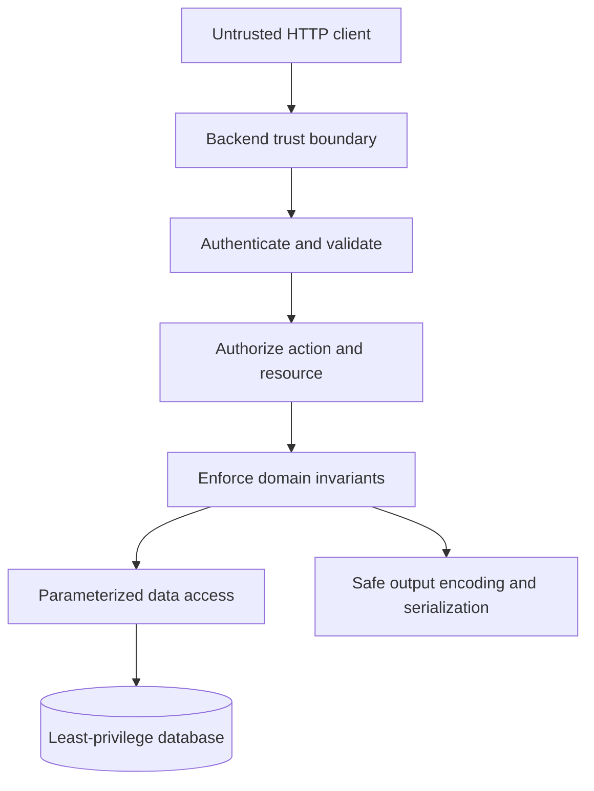
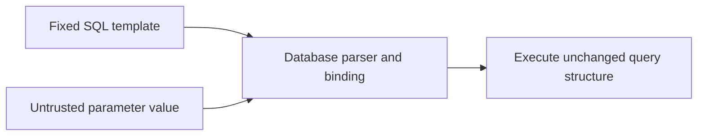
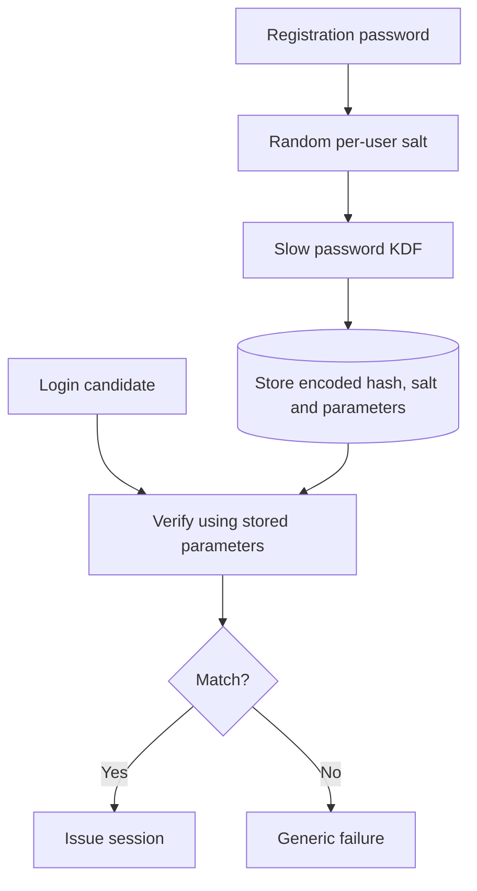
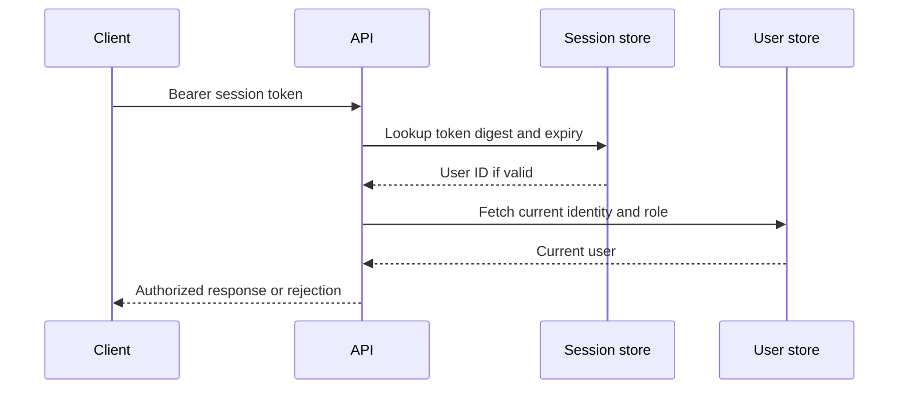
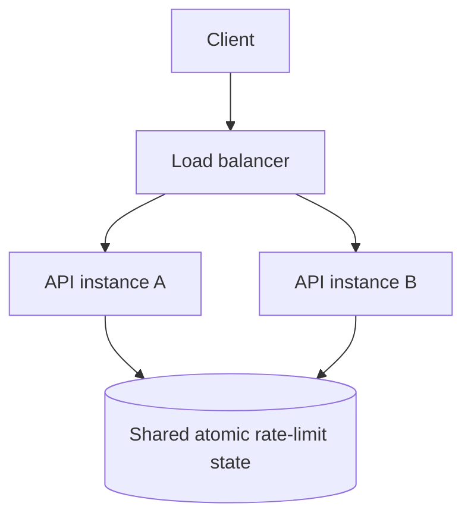
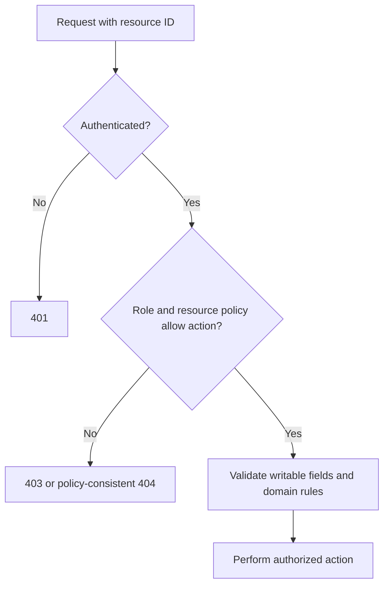
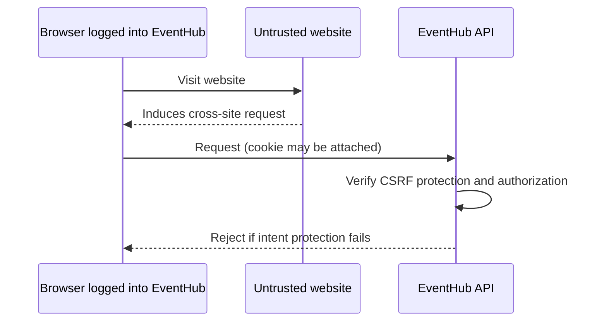

# Video 20 — Backend Security: Everything You Need to Know

- Video: [20. Backend Security: Everything You Need to Know](https://www.youtube.com/watch?v=xB1C1xZZW4k)
- Course: [Backend from First Principles — Sriniously](https://www.youtube.com/playlist?list=PLui3EUkuMTPgZcV0QhQrOcwMPcBCcd_Q1)
- Playlist position: 20; duration: 2:50:03.
- Date documented: 2026-11-25.
- Learning status: Complete (owner explicitly requested GitHub upload following the explanation).
- Implementation status: Complete (owner confirmed 2026-11-25); see implementation evidence below.
- Source verification: The video title and position were rechecked against YouTube and the duration against the course listing and secondary notes. Third-party transcript excerpts ([Heuristica](https://www.heuristi.ca/videos/20-backend-security-everything-you-need-to-know-yt-xB1C1xZZW4k), [Transcribe](https://www.usetranscribe.io/yt/xB1C1xZZW4k/backend-security-tips)) support the broad lecture themes. The full original recording/transcript was not independently reviewed during documentation. This is the learning-session record, not a verbatim or exhaustive transcript. EventHub examples, algorithm comparisons and production recommendations below are supplementary engineering explanations.

## Learning objectives

- Recognize trust boundaries and think about assumptions an untrusted caller can violate.
- Explain how injection changes the meaning of instructions, and why separating data from code works.
- Distinguish encryption, hashing, salts, peppers and password work factors.
- Understand session theft, fixation, expiration, revocation, cookie attributes and signed JWT verification.
- Differentiate identity, object-level, function-level and property-level permissions.
- Compare rate-limiting algorithms and reason about shared state and outages.
- Explain XSS, CSRF and CORS without confusing browser policies with server authorization.
- Apply least privilege, safe configuration and defense in depth; prove negative cases with tests.

## 1. Security mindset and trust boundaries

A legitimate user follows the UI; an adversarial caller can bypass it and construct requests directly. A hidden button, a client-side validator or an unpredictable URL is not an authorization control. Every externally influenced field, header, identifier, file or message crosses a boundary. Internal dependencies also have distinct trust assumptions. Validation checks shape and bounds; authentication establishes identity; authorization checks the action and resource; business invariants constrain even authorized operations.



Security is an ongoing design property, not a final middleware installation. Ask: where does data cross a boundary, what assumptions am I making, and what happens when those assumptions are wrong?

## 2. Injection: data interpreted as instructions

An interpreter (SQL, shell, document-query engine or browser) has a grammar. Concatenating untrusted text into a program can make the interpreter treat data as syntax. SQL injection can expose or alter records within the database principal's permissions. Validation helps enforce the business contract but is not a substitute for parameterization.

```ts
// Illustrative only: unsafe interpolation, never use.
const unsafe = "SELECT * FROM events WHERE name = '" + name + "'";
// PostgreSQL: fixed structure, separate parameter values.
await pool.query("SELECT * FROM events WHERE name = $1", [name]);
```



PostgreSQL can bind values separately from the SQL text. Dynamic identifiers, sort directions and query fragments generally cannot be bound as ordinary values: map them to a finite allowlist of server-defined fragments. ORMs typically bind values for normal query builders but raw interpolation can reintroduce the problem. For document databases, validate exact types and shapes rather than pass arbitrary objects as query operators.

Command injection is the same boundary error with an OS command interpreter. Prefer native libraries; otherwise invoke a fixed executable with separately passed arguments, no shell where practical, allowlisted inputs, timeouts and least privilege. Argument separation does not prevent all unsafe option or path handling.

## 3. Password security

Plain text exposes every password if storage is stolen. Encryption is reversible with a key, whereas a password hash supports verification without recovering the original password. Attackers can still guess passwords offline and compare computed results; fast general-purpose hashes such as SHA-256 alone make those guesses cheap. Use a vetted password hashing/KDF implementation (Argon2id preferred for new systems; properly configured scrypt is a valid alternative; bcrypt has legacy use and input-length considerations). Do not invent cryptography.



A random unique salt prevents equal passwords from normally producing equal stored hashes and prevents easy reuse of precomputation across users. It is not secret and does not make weak passwords unguessable. A pepper is an optional separate secret, stored outside the password database; it adds key-management and rotation complexity. Tune CPU/memory work factors using actual server measurements: higher costs impede offline guessing but also increase login resource demand. Bound inputs and request rates, avoid account enumeration, and never log passwords or hashes. Use library-supported verification rather than custom string comparison.

EventHub already uses native scrypt with per-user salts. Review its parameters and bounds rather than replacing it merely to follow a trend.

## 4. Session management and JWT security

An opaque session token is a bearer credential; anyone holding it may impersonate its owner until it is invalidated or expires. Generate tokens with a cryptographically secure RNG, protect transport with HTTPS, rotate sessions after authentication/privilege elevation as appropriate, invalidate on logout, and enforce server-side expiry. An opaque token can be stored as a digest on the server; a fast digest of a high-entropy random token serves a different purpose from password hashing.



Cookie transport, when used, needs deliberate attributes:

| Attribute | Purpose and limitation |
| --- | --- |
| HttpOnly | Prevents script from directly reading the cookie; does not stop XSS from acting as the user. |
| Secure | Restricts cookie transmission to secure transport under normal browser rules. |
| SameSite | Restricts cross-site cookie inclusion; not a universal CSRF solution. |
| Max-Age / Expires | Controls client lifetime; server expiry still required. |
| Domain / Path | Scope cookie sending; avoid unnecessarily broad domain scope. |

A typical signed JWT is header.payload.signature. Header and payload are encoded, not encrypted. Verifying the signature protects integrity, not confidentiality. Decoding is not verification. Pin the allowed algorithms and trusted keys, validate expiration and the appropriate issuer/audience and other claims, and reject malformed tokens. Never trust claims before verification. A valid signature does not prove current permissions: roles may have changed since issuance.

Trade-offs: server-side sessions require a lookup and shared state for multiple instances but simplify revocation; locally verified JWTs can reduce lookups but immediate revocation or updated permissions may require short-lived access tokens, refresh rotation, a denylist or current-state checks. A JWT is not inherently safer or more scalable in every design.

## 5. Rate limiting and resource abuse

Even valid requests can exhaust CPU, database connections, queues or paid dependencies. Password hashing itself is intentionally expensive. Apply limits to authentication and other costly operations, with meaningful keys and bounded state. Return 429 with a suitable Retry-After when the limit is exceeded.

| Algorithm | Mechanism | Trade-off |
| --- | --- | --- |
| Fixed window | Count requests in a fixed time interval. | Simple, but bursts at interval boundaries. |
| Sliding window | Count or approximate requests over a moving interval. | Smoother enforcement; additional state/complexity. |
| Token bucket | Refill at a fixed rate, cap capacity, consume per request. | Allows bounded bursts and controls sustained rate. |

Illustrative token bucket: capacity 5, refill 1 token/second, each request consumes one token. Five immediate requests may pass; the sixth is rejected until a token is available. This is a conceptual example, not measured EventHub behavior.



Independent per-instance counters do not enforce a global limit. Shared Redis can coordinate atomic decisions but adds network and availability dependencies. Choose fail-open or fail-closed per operation and document the trade-off. Behind a proxy, trust forwarded IP headers only from explicitly trusted proxies. Use additional account/IP/global limits as appropriate, avoid unlimited limiter-key growth, and avoid locking out victims indiscriminately. Rate limiting is not complete DDoS protection.

## 6. Broken authorization

Authentication asks who the caller is; authorization asks whether that caller may perform the exact operation on the exact object and fields. Recheck authorization server-side rather than trust the UI or request body.

| Category | Example | Defense |
| --- | --- | --- |
| BOLA / IDOR | An attendee reads another attendee's private booking. | Scope lookup/action to the authenticated actor and allowed resource. |
| BFLA | Attendee calls an admin-only function. | Enforce permission on each protected operation. |
| BOPLA / mass assignment | User submits a role or owner ID in a profile update. | Explicit writable fields and safe response projections. |

Illustrative private booking lookup (future domain flow, not a claim that this endpoint exists):
```sql
SELECT id, event_id, status
FROM bookings
WHERE id = $1 AND user_id = $2;
```
The second parameter comes from verified identity, not from a caller-controlled user ID. UUIDs can reduce easy enumeration but do not establish permission. Public event reads must remain public where intended. Organizer updates must respect ownership; admin privileges must follow the actual policy. Multi-tenant systems additionally enforce tenant isolation.



For concurrent writes, an authorization check separated from mutation can become stale. Use an atomic scoped update/transaction if ownership or relevant authorization state can change concurrently. Choose 403 versus concealment via 404 consistently with the API contract; test that denied operations do not mutate state.

## 7. XSS, CSRF and CORS

**Cross-site scripting (XSS)** occurs when untrusted content is interpreted as executable browser code. Stored XSS persists the input (e.g. an event description); reflected XSS returns request data in a response; DOM-based XSS involves unsafe client-side processing. Categories can overlap. Use context-sensitive output encoding, vetted HTML sanitization only when HTML is actually allowed, safe DOM APIs and CSP as a second layer. React text interpolation normally escapes text; raw HTML insertion requires special care. JSON APIs should emit correct content types and not embed untrusted values into HTML or scripts unsafely.

**Cross-site request forgery (CSRF)** exploits automatically attached credentials, especially cookies. A valid session does not establish that the user intended the requested action. Use anti-CSRF tokens and/or suitable origin checks and SameSite settings, avoid state changes through GET, and consider browser credential rules. An explicitly attached bearer Authorization header normally avoids classic cookie-based CSRF; if a JWT is transported in an automatically sent cookie, the risk remains. XSS can defeat many CSRF defenses.



**CORS** is a browser policy controlling cross-origin JavaScript access to responses and preflights for certain requests. It does not stop non-browser HTTP clients and does not replace authentication, authorization or CSRF protection. Some cross-origin requests are sent without preflight, even if the response is unreadable by the initiating script. Use explicit allowed origins and correct credential settings; do not treat Origin as proof of user identity.

## 8. Security misconfiguration and defense in depth

| Risk | Mitigation |
| --- | --- |
| Debug traces in production | Generic client-facing errors and sanitized internal diagnostics. |
| Excessive DB or process privileges | Separate migration/runtime roles where appropriate; least privilege. |
| Public DB/Redis ports or default credentials | Restrict network access, authenticate services, validate configuration. |
| Secrets in Git, URLs, logs or traces | Environment/secret store, redaction, rotation if exposed. |
| Vulnerable dependencies | Review lockfile and audit results, prioritize verified exposure; avoid blind upgrades. |
| Unsafe browser headers | Correct content type, nosniff; CSP/frame-ancestors for HTML, HSTS when HTTPS deployment is appropriate, Referrer-Policy as relevant. |

Security layers reduce blast radius: TLS protects communication, gateway limits resource usage, authentication identifies callers, authorization protects resources, validation/parameterization constrain data, and least privilege limits the impact if an earlier layer fails. No single layer makes the service secure. Observability must avoid collecting secrets or high-cardinality untrusted data. A compromised dependency or configuration can bypass otherwise correct application code.

## Production behavior and failure scenarios

- Credential theft remains possible even with correct password hashing: protect bearer tokens, transport, logs and expiry.
- Session expiry, logout, role changes and concurrent requests must respect documented semantics. In-memory session/limiter state resets at process restart and is not shared across replicas.
- Cached public resources must not expose private fields or unauthorized content; never cache private data under a public key.
- Authentication/limiting dependencies can fail; distinguish service failure from invalid credentials and retain the safe error contract.
- Avoid spending expensive CPU/DB resources on malformed or oversized requests. Bound request bodies, query complexity and limiter state.
- Security checks are not substitutes for booking invariants, transactional integrity or idempotency.
- Never perform real attack experiments on third-party services. Use synthetic accounts, local/staging test environments and authorized resources.

## Discussion and misconceptions

No additional learner questions were recorded after the explanation; the owner requested upload. Key clarifications in the lesson:

- An ORM, UUID, hidden frontend button, or CORS policy is not a guarantee of authorization or injection safety.
- Hashing is not encryption; salting does not make weak passwords unguessable; signed JWT payloads are normally readable.
- A valid token does not automatically mean the user's privileges are current.
- HttpOnly protects cookie confidentiality from ordinary script reads, not all consequences of XSS.
- A 200 response in a happy-path test cannot prove that forbidden requests fail.
- A rate limiter using local counters does not establish a global limit across processes.

## Key takeaways and references

Start with threats and boundaries, preserve code/data separation, verify identity and authorize every sensitive action, minimize privileges and exposed fields, bound resource use, and test rejection plus lack of side effects.

- [OWASP Cheat Sheet Series](https://cheatsheetseries.owasp.org/)
- [SQL Injection Prevention](https://cheatsheetseries.owasp.org/cheatsheets/SQL_Injection_Prevention_Cheat_Sheet.html)
- [Password Storage](https://cheatsheetseries.owasp.org/cheatsheets/Password_Storage_Cheat_Sheet.html)
- [Session Management](https://cheatsheetseries.owasp.org/cheatsheets/Session_Management_Cheat_Sheet.html)
- [OWASP API Security Top 10](https://owasp.org/API-Security/)
- [XSS Prevention](https://cheatsheetseries.owasp.org/cheatsheets/Cross_Site_Scripting_Prevention_Cheat_Sheet.html)
- [CSRF Prevention](https://cheatsheetseries.owasp.org/cheatsheets/Cross-Site_Request_Forgery_Prevention_Cheat_Sheet.html)
- [PortSwigger Web Security Academy](https://portswigger.net/web-security)

## EventHub practical assignment — coding agent handoff

**Objective:** security hardening and evidence for the existing backend, not a new product feature or speculative rewrite. Inspect existing code and tests first, identify real gaps, and preserve working controls.

### Current baseline (limited repository inspection, main at af22301b19a38053caa782078f79d71a573a72e3)

- Node/TypeScript native HTTP API and PostgreSQL. Earlier milestones cover validation, authentication, caching, queues, error handling, configuration, observability and graceful shutdown.
- `backend/src/auth.ts` already implements scrypt, per-user salt, opaque in-memory bearer sessions keyed by token digest, expiry, a fixed-window login limiter and current-role lookup. JWT is a learning lab, not necessarily the production authentication path.
- `backend/src/modules/auth/service.ts` bounds credentials, uses generic invalid-credentials outcomes, and forces public registrations to attendee role.
- `backend/src/modules/events/repository.ts` contains parameterized PostgreSQL operations; event service already has organizer/admin and owner checks.
- `backend/test/` contains auth, JWT lab, event mutation, validation, CORS, errors, caching and observability regression tests.
- This was a targeted source inspection, not a complete security audit. No vulnerability or test result is asserted from it. Full booking domain is not assumed implemented; inspect existing ticket/booking lab and routes before choosing tests.

### In scope and incremental exercise

1. Write a compact threat model covering actors, trust boundaries, protected data, credentials and resource abuse. Inventory existing HTTP routes and classify public/protected, object ownership, allowed fields and relevant browser credential transport.
2. Audit SQL and dynamic search/sort fragments, inputs and safe response projections; preserve existing parameterized operations. Check shell execution only if it actually exists.
3. Review scrypt settings, session generation/digest/expiry/logout and current role checks, generic failures and credential redaction. Verify signed JWT lab rejects invalid signature/claims. Do not migrate working session auth to JWT or cookies merely for this lesson.
4. Verify role/ownership policies with two organizers/attendees and an admin. Reuse existing policy and validation layers; fix confirmed gaps minimally. Apply private-resource checks to actual implemented resources, not imaginary bookings.
5. Review existing login rate limiter and bounded state; test limits with controlled time. Add narrowly scoped limiting for existing costly public or sensitive routes only where justified, and document key, window, status, retry and restart behavior. Shared Redis limiter is an optional isolated experiment if useful and approved, not required to deploy new infrastructure.
6. Review CORS, safe error responses, content types, applicable security headers, config, logs/traces, runtime privilege and dependency audit. Cookie/CSRF and HTML/XSS protections are conditional on actual transport/rendering; document future requirements rather than implement a frontend.
7. Write targeted regression tests for verified gaps, run full suite/typecheck, report actual findings and commands. Use synthetic test data only.

### Acceptance criteria

| Test / review | Expected result |
| --- | --- |
| Unauthenticated protected request | 401; no protected data or mutation. |
| Organizer B modifies Organizer A's event; attendee uses privileged operation | Denied with existing 403/404 contract; no state change. |
| Caller supplies role/owner or other non-writable fields | Rejected or safely ignored per existing contract; effective identity/permissions unchanged. |
| SQL syntax-like event name/search input | Bound as data; no query structure change or unauthorized rows; invalid input rejected where required. |
| Invalid/expired opaque session and altered/expired JWT lab token | Rejected under the relevant mechanism; current-role checks and logout behavior verified. |
| Registration/login password edge cases | Bounded validation; no plaintext credentials in storage, logs or responses; existing KDF behavior preserved. |
| Login rate exceeds configured limit | 429 and appropriate Retry-After; allowed request resumes after window; test boundary and key isolation. |
| Untrusted Origin / CORS preflight | Existing approved-origin contract enforced; direct clients still subject to auth/policy. |
| Forced internal failure | Safe generic client response; no stack trace, full token or secret leakage in logs/traces. |
| Public event and protected field serialization/cache | Only intended public fields returned; no accidental private data via cached reads. |
| Private bookings/tickets, if actually implemented | Wrong-owner access denied; otherwise record deferred domain-specific check. |
| Previous behavior | Existing tests plus new negative cases and typecheck pass, or failures explicitly reported with evidence. |

### Experiments and edge cases

- Baseline two distinct authenticated users and one admin; compare legitimate and unauthorized requests; read persisted state after rejected mutations.
- Exercise quotes and other syntax-like benign strings against search/creation; verify literal treatment and pagination/filter allowlists.
- Test missing/malformed/expired token, logout and role changes; distinguish the JWT lab from opaque sessions.
- Use fake time or bounded local requests for the limiter; document fixed-window boundary bursts and restart limitations; test unknown-user versus wrong-password response contract.
- Simulate dependency errors using existing test helpers; ensure observability redacts secrets, including nested fields and headers.
- If a real HTML or cookie flow exists, demonstrate XSS/CSRF protection in an authorized local lab; otherwise explain why those tests are not applicable yet.
- Capture actual environment, commands, expected/observed outcomes, and relevant ADR/commit references. Do not invent benchmark numbers or mark the milestone complete without owner confirmation.

### Out of scope / deferred

Frontend development, real payments, speculative booking endpoints, replacing the existing password KDF/auth mechanism without evidence, centralized identity providers, new WAF or paid services, multi-region infrastructure and broad refactors. Distributed enforcement and TLS deployment experiments may be revisited in scaling/deployment milestones if not justified now. Future tenant isolation, cookie-auth and rich-text rendering are requirements only when the corresponding features exist.

### Prerequisites / unresolved decisions

Inspect route inventory and actual tests before deciding changes. Preserve existing 403/404 and response contracts. Choose limiter keys and thresholds from the local workload, trusted-proxy configuration and actual abuse risk; document any fail-open/closed choice. No implementation completion or security certification follows from these notes.

## Learning completion (ChatGPT)

- [x] Owner explicitly requested documentation upload after the lesson.
- [x] Conceptual notes, source limitations, discussion and assignment documented.
- [x] Learning progress updated independently in docs/PROGRESS.md.

## Implementation evidence (coding agent)

Environment: Linux, Node/TypeScript native `node:http`, PostgreSQL 17 and Redis 7 via `npm run db:up`, branch `feat/lecture-20-security`. Synthetic users only. This is a targeted hardening review of the existing backend, **not** a complete security audit or certification. Decision record: [ADR-019](../decisions/019-security-hardening.md).

### Threat model (compact)

| Item | EventHub today |
| --- | --- |
| Actors | Anonymous caller; attendee; organizer; admin; an attacker with direct HTTP access (not the UI); operator. |
| Trust boundary | Every HTTP request (method, path, query, headers, JSON body). Internal dependencies (PostgreSQL, Redis) are trusted but may fail. |
| Protected data | Password hashes, session tokens, other users' tickets, event ownership, metrics. |
| Credentials | Opaque Bearer session (random 32 bytes, SHA-256 digest stored in memory, 15 min TTL); scrypt N=16384 r=8 p=1 with random 16-byte salt; JWT only in the lecture 08 lab. |
| Resource abuse | scrypt per login/registration (CPU), DB INSERT per registration, request bodies (bounded in `json.ts`), search/list queries (allowlisted sort, bounded pagination). |
| Browser transport | Explicit `Authorization: Bearer` header, JSON responses only. No cookies and no HTML are served. |

### Route inventory (v1; the unversioned legacy event routes mirror the event rows)

| Route | Access | Object / field rules |
| --- | --- | --- |
| `GET /health`, `/health/live`, `/health/ready` | public | no data beyond status |
| `GET /internal/metrics` | admin only (401/403) | not public: reveals routes and volume |
| `GET /events`, `/events/search`, `/events/:id`, `/events/:id/tickets` | public | public event fields only (`validation.ts` projection); sort/filter allowlisted |
| `POST /events` | organizer or admin | `ownerId` is the verified caller; body owner/role fields ignored |
| `PUT/PATCH /events/:id` | admin, or organizer who owns it | 403 for another organizer; 404 first for a missing event |
| `DELETE /events/:id` | admin only | 404 for missing, 403 otherwise |
| `POST /auth/register` | public, **rate limited (new)** | role always `attendee`; body role ignored |
| `POST /auth/login` | public, rate limited (extended) | same 401 for unknown user and wrong password |
| `POST /auth/logout`, `GET /auth/me` | any authenticated | server-side revocation |
| `GET /me/tickets`, `GET /tickets/:id` | authenticated | caller's own tickets only; someone else's id is 404 |
| `POST /bookings` | **public 501 stub** | see owner decision below |

### Findings and changes

| # | Finding (verified in code) | Change |
| --- | --- | --- |
| 1 | Login limiter key was `address\|username`; one address could try unlimited usernames, each costing a scrypt run. | New per-address failure limit (20/min), checked before scrypt; a successful login does not reset it. |
| 2 | On overflow the limiter called `hits.clear()`, erasing every existing lockout; junk keys could therefore unlock a brute-force target. | `FixedWindowLimiter`: evict expired entries, then the oldest; never clear all. Residual risk in the ADR. |
| 3 | `POST /auth/register` ran scrypt + INSERT with no limit. | 20 attempts/address/minute (validated attempts only), 429 + `Retry-After`. |
| 4 | No `nosniff`/CSP on responses. | Set at the top of the `createServer` callback so every response has them (also 503 drain, 204, metrics). No HSTS (plain HTTP on loopback). |
| 5 | Expired sessions were removed only when their token was presented again. | Sweep at most once a minute in `createSession`. |

Files: `src/auth.ts`, `src/modules/auth/service.ts`, `src/modules/auth/controller.ts`, `src/server.ts`, new `test/security.test.ts`.

### Acceptance criteria evidence

Rows already covered by earlier tests were re-run unchanged in the full suite; they were **not** rewritten.

| Criterion | Evidence |
| --- | --- |
| Unauthenticated protected request -> 401, no mutation | `test/auth.test.ts` "missing, malformed, tampered and unknown tokens are 401..."; legacy routes "no bypass" |
| Organizer B / attendee denied, no state change | `test/auth.test.ts` "attendee cannot create...", "organizer owns what they create..."; new `security.test.ts` "a refused cross-owner mutation leaves the stored event byte-for-byte unchanged" (PUT, PATCH, DELETE) |
| Non-writable role/owner fields | `test/auth.test.ts` "client-supplied owner/role fields...", "register: ... role from body ignored" |
| SQL-like input is data | `test/postgres.test.ts` (`DROP TABLE`, `' OR 1=1 --`, sort/minSeats injection), `test/search.test.ts` |
| Invalid/expired session, JWT tampering, logout, role changes | `test/auth.test.ts` (expiry, logout, demotion), `test/jwt-lab.test.ts` (alg none, wrong key/issuer/audience, expiry, stale role) |
| Password edge cases, no plaintext | `test/auth.test.ts` (distinct salted hashes, 422 bounds); new log test: password, wrong password and token never appear in debug-level logs |
| Login limit 429 + Retry-After, resume, key isolation | `test/auth.test.ts` (5 failures); new: boundary, key isolation, address spray, success does not reset the address counter, overflow keeps lockout |
| CORS / untrusted Origin | `test/head-options-cors.test.ts` |
| Forced internal failure is generic | `test/error-handling.test.ts` "unexpected error -> generic 500...nothing leaked"; `test/observability.test.ts` redaction |
| Public/protected serialization and cache | `test/caching.test.ts`, `test/serialization.test.ts` (unchanged, passing) |
| Private bookings/tickets | Bookings are a 501 stub (deferred); tickets IDOR covered by `test/auth.test.ts` "tickets: only the caller's own..." |
| Response hardening | New: nosniff + CSP on 200, 201, 204, 401, 404, 405, 422 |
| Previous behavior | Full suite below |

### Commands and results

| Command (in `backend/`) | Result |
| --- | --- |
| `npm test` (baseline, before changes) | 325/325 pass |
| `npx tsx --env-file-if-exists=.env --import ./test/setup.ts --test --test-concurrency=1 test/security.test.ts` | 12/12 pass |
| `npm test` (after changes) | 337/337 pass, 0 fail (one run; the known flaky jobs test did not fail in this run) |
| `npm run typecheck` | clean |
| `npm audit --omit=dev` | found 0 vulnerabilities |

I did not run the new limiter tests against the old code to watch them fail; the overflow test is written to fail under the previous `clear()` behaviour by construction.

### Reviewed, no change needed (documented)

- SQL: every value is bound (`$n`); the only interpolated fragments are `COLUMNS`, the `ORDER BY` text from the `SORT_SQL` allowlist, and direction. No shell execution exists in `src/`.
- Ports: `docker-compose.yml` binds PostgreSQL and both Redis instances to `127.0.0.1` only; passwords come from `backend/.env` (gitignored), `.env.example` contains a placeholder. `npm audit --omit=dev`: 0 vulnerabilities (run 2026-11-25).
- Runtime DB privilege: one `eventhub` role does migrations and runtime in local dev. A separate least-privilege runtime role is a deployment-time step, not done here.
- Cookies, CSRF, XSS: not applicable now (Bearer header, JSON only, no HTML). Required when cookie auth or a rendered frontend is introduced: `HttpOnly; Secure; SameSite` cookies, CSRF tokens, output encoding and CSP for HTML.

### Honest limits

- Not run: a shared (Redis) limiter experiment, TLS/HSTS, proxy-trust configuration, a real HTML/cookie flow, load or brute-force timing. Limiter thresholds are reasoned, not measured.
- Limiter state is per process; the sweep and limiter tests use an injected clock, not wall-clock waiting.
- **Owner decision:** `POST /bookings` is an unauthenticated 501 stub. It was left unchanged because protecting it changes the contract; it should require auth when booking is implemented.
- Owner confirmed the implementation on 2026-11-25 (PR #18 merged).

- [x] Implementation or reproducible experiment.
- [x] Acceptance criteria demonstrated (see table; limits above).
- [x] Negative cases and regression checks completed (see results).
- [x] Implementation progress updated and learner confirmed (2026-11-25).
