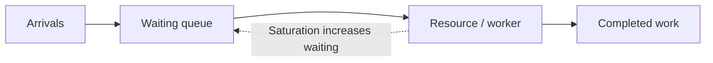
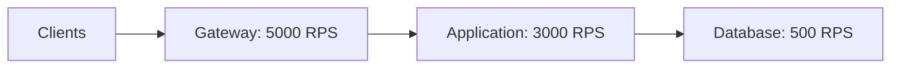
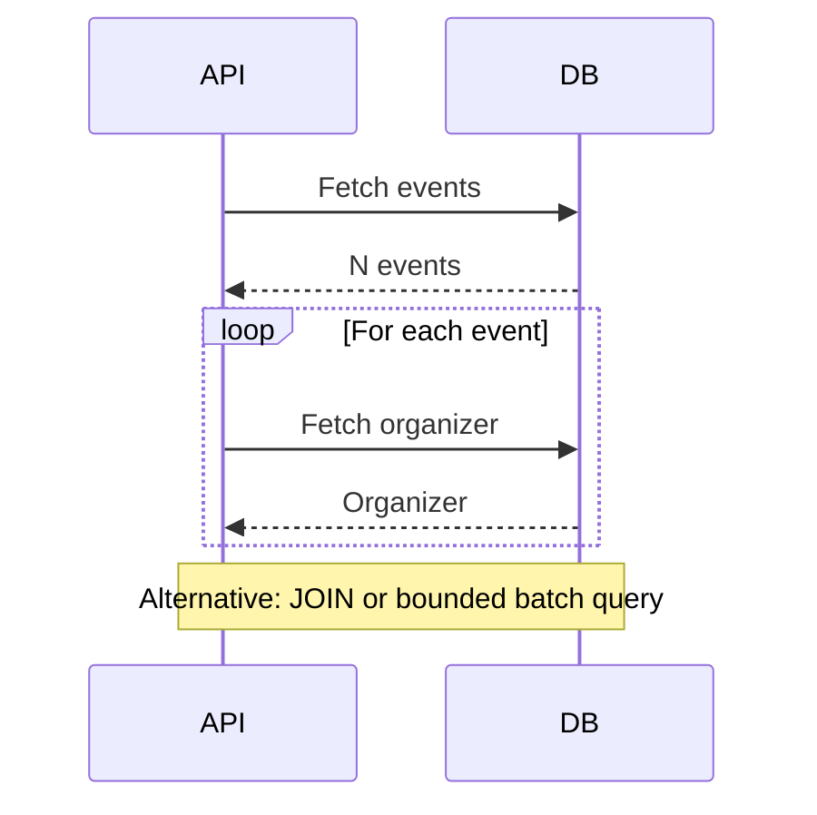
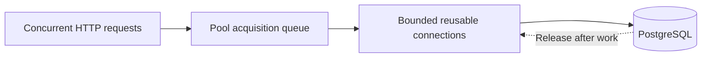
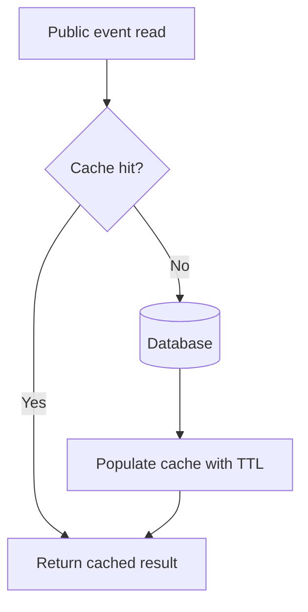

# Video 21.1 — Backend Scaling & Performance Engineering (Part 1)

- Video URL: https://www.youtube.com/watch?v=z7kt_p44rjs
- Playlist position: 21 (course label 21.1; Part 2 is a separate subsequent learning milestone).
- Learning session: 2026-11-25; documentation authorized 2026-11-26.
- Learning status: Complete (explicit GitHub upload request).
- Implementation status: Not started.
- Source availability: the learning session identified the video and used chapter headings and available transcript excerpts; the full original transcript/recording was not accessible or independently reviewed. The explanations, diagrams, numerical examples and assignment below are supplementary teaching material, not a verbatim transcript or claim of exact coverage.

## Learning objectives

- Distinguish latency, throughput, utilization, saturation, performance and scalability.
- Interpret latency percentiles and identify a bottleneck using measurements rather than guesses.
- Explain N+1 queries, indexes, query plans, database connection pooling and caching as performance techniques with costs.
- Compare vertical and horizontal scaling and explain why shared dependencies can limit both.
- Design a controlled, reproducible benchmark and verify correctness before and after optimization.

## Concepts and internal mechanisms

### Performance versus scalability

Performance describes how efficiently a system handles a specified workload; scalability describes its ability to accommodate increased workload as resources grow while maintaining acceptable service objectives. A fast single request does not prove the system can handle thousands of concurrent requests. Define the workload and target before optimizing.

### Latency, throughput and tail latency

End-to-end latency includes network travel, waiting, application work, dependency calls and serialization. An illustrative 200 ms request spends 20 ms on incoming network, 30 ms waiting, 15 ms in application logic, 120 ms in the database, 5 ms serializing and 10 ms returning the response. Even eliminating application logic cannot save more than 15 ms on that example; reducing the database span to 10 ms saves 110 ms if other components are unchanged. These are hypothetical numbers.

Throughput is work completed per unit time (e.g. successful requests per second). Distinguish offered arrival rate from achieved throughput and report errors separately. Ten independent workers with 100 ms service time can ideally complete 100 requests/s, compared with 10 requests/s for one worker; this assumes sufficient resources and no contention. Concurrency is work in flight, not a synonym for throughput.

Percentiles describe a distribution, not its average. For 990 requests at 100 ms and 10 at 10 seconds, the mean is 199 ms. With the nearest-rank convention p50, p90, p95 and p99 are 100 ms while p99.9 is 10 seconds; other quantile estimators can interpolate differently at the boundary. Report the sample count and percentile calculation method. Tail latency matters to affected users and can compound across fan-out dependencies. Do not average percentiles across instances; aggregate compatible histograms or raw samples.

### Utilization, queues and saturation

Utilization measures the fraction of available resource capacity being used. A nearly saturated resource has little headroom to absorb bursts. Requests queue behind work already in service. In the illustrative M/M/1 queue, mean response time is S/(1-rho), with mean service time S and utilization rho below 1; at S=10 ms, 50%, 90%, 99% utilization implies 20, 100 and 1000 ms mean response respectively. This is a single-server steady-state model with Poisson arrivals and exponential service times, not a benchmark or a universal threshold.



CPU, disk I/O, memory pressure, event-loop delay, connection pools and locks may each be limiting resources. A low CPU reading does not mean a service is healthy if requests wait on I/O or locks. Above sustainable capacity, queues grow or bounded admission rejects requests; timeouts and retries can amplify overload.

### Find the bottleneck before scaling

A serial request path with illustrative capacities of 5,000, 3,000 and 500 requests/s cannot sustainably exceed 500 requests/s if every request visits each component once under the same workload. Adding application replicas does not automatically increase database capacity.



Use the existing observability milestone: metrics identify saturation/error trends, traces identify time spent in spans, profiling locates expensive functions, database plans show execution choices, and load tests expose behavior as demand increases. A 420 ms database span in a 500 ms trace suggests investigating the dependency, not automatically adding an index: pool wait, network, lock wait, SQL execution and result transfer can all contribute.

### Database optimization: N+1

Fetching N events, then fetching each organizer independently, creates 1+N queries. Each can incur network, parsing/execution and result overhead. A SQL JOIN or batch loading may reduce round trips. Batch loading typically uses one event query and one query for distinct organizer IDs; map results back in memory. ORM eager loading can help but inspect actual emitted queries. JOINs may multiply rows for one-to-many relationships; preserve pagination, result shape and authorization.



Illustrative SQL, not a verified EventHub schema:
```sql
SELECT e.*, u.name AS organizer_name
FROM events e JOIN users u ON e.organizer_id = u.id;
```

### Indexes and query plans

Without a suitable index the database may scan the table and evaluate the predicate row by row. A B-tree index organizes keys and references so the engine can navigate to matching key ranges. It may still need heap accesses. A sequential scan can be optimal for small tables or predicates matching many rows. Indexes cost disk, memory, write maintenance and migration time.

```sql
-- Illustrative only: inspect actual schema and predicates first.
CREATE INDEX idx_events_city ON events (city);
CREATE INDEX idx_events_city_date ON events (city, start_date);
EXPLAIN (ANALYZE, BUFFERS)
SELECT * FROM events WHERE city = 'Alexandria';
```

Composite index column order matters for common predicates and sorting. A covering index includes columns needed by a query; PostgreSQL index-only scans still depend on visibility information. Do not index every column. Compare plans, estimated versus actual rows, buffer activity and execution time on representative data. EXPLAIN ANALYZE executes its statement; use safe local read queries and avoid accidental mutations. Keep any index change only when evidence supports it.

### Connection pooling

Opening a new database connection can involve TCP, optional TLS, authentication and server session setup. A bounded pool reuses connections. Requests acquire a connection, execute, release it (including error paths); if all are busy they wait or hit an acquisition timeout. Transactions must use the same connection until commit/rollback. Long transactions and leaked connections can exhaust the pool.



The potential connection count across replicas is instance count times maximum pool size, plus worker/admin/other clients. Four instances with pools of 20 can open 80 connections; six can open 120, exceeding a hypothetical 100-connection budget. Leave headroom and tune with observed acquisition wait, DB load and throughput, not maximum connections alone. An external pooler such as PgBouncer can centralize connection management but introduces operational complexity and pooling-mode compatibility constraints.

### Caching as load reduction

Cache-aside checks Redis, returns a valid hit or loads from the authoritative database on a miss and populates the cache. At 1,000 read requests/s and exactly one DB query per miss, 90% hit rate means 100 DB queries/s; 99% means 10. This excludes refreshes, writes and other queries.



Cache only suitable data; TTL/invalidation, key scope, stale values, hot-key stampedes, eviction and Redis outage affect behavior. Public event details may tolerate bounded staleness; ticket inventory and booking authorization cannot rely on a stale cache. Verify authoritative state during any implemented reservation/booking mutation. Preserve existing fallback and security behavior rather than changing consistency semantics for speed.

### Vertical and horizontal scaling

Vertical scaling adds CPU/RAM or faster storage to an existing instance; it is often simpler but has hardware/cost limits and does not alone provide high availability. Horizontal scaling adds replicas and typically a load balancer; stateless request processing and shared durable persistence make distribution easier, but coordination, shared dependencies, connection budgets and failure handling become more complex. Local sessions on one replica can break requests routed to another; shared session state or appropriate token design is an alternative. Neither technique removes a bottleneck automatically. Detailed multi-instance scaling is deferred to Part 2.

## Production behavior and failure scenarios

- Choose explicit performance objectives for representative workloads; monitor successful throughput, latency distributions, errors and resource saturation together.
- Increasing load may trigger existing rate limits; classify 429 separately from 5xx/timeouts and do not disable production security to inflate benchmark results.
- A cache stampede, slow database query, pool exhaustion, lock contention or retry storm may turn a local issue into cascading overload.
- A faster but incorrect response is not an improvement; preserve access control, visibility and authoritative state. Never run destructive or unapproved load tests on production.
- Benchmark results depend on hardware, dataset size/distribution, warm-up, cache state, arrival model and load-generator capacity.

## Discussion and misconceptions

No follow-up technical questions or learner answers were recorded before upload. The closing design question was: application CPU 25%, database CPU 95%, cache hit ratio 20%, p99 latency 3 seconds; should the manager increase backend replicas from two to eight? Suggested reasoning (mentor supplement, not a recorded learner answer): not without evidence. Inspect DB query timings/plans, locks, pool waits, cache eligibility/hit rate and workload; adding replicas may increase DB connections and pressure. Establish baseline, change one evidenced bottleneck, repeat under identical conditions. This remains an optional revision question.

Common misconceptions: average latency represents everyone; higher concurrency always improves throughput; more connections or indexes always help; all cache hits are safe; a language rewrite or horizontal scaling is the first response to slow requests. Each is workload- and bottleneck-dependent.

## Key takeaways and references

Measure before optimizing: define target -> baseline -> diagnose -> change one limiting factor -> repeat -> document trade-offs and shifted bottlenecks. Correctness is a prerequisite.

- [Lecture video](https://www.youtube.com/watch?v=z7kt_p44rjs)
- [PostgreSQL indexes](https://www.postgresql.org/docs/current/indexes.html)
- [PostgreSQL EXPLAIN](https://www.postgresql.org/docs/current/using-explain.html)
- [k6 documentation](https://grafana.com/docs/k6/latest/)
- [Previous observability lecture](18-logging-monitoring-observability.md)
- [Previous database and cache lectures](12-mastering-databases-postgres.md), [Caching](13-caching.md)

## EventHub practical assignment — coding agent handoff

**Problem and goal:** establish the current performance envelope of existing EventHub APIs, identify at least one measurable bottleneck and improve it (or document evidence that a proposed change is not justified). Learn to measure, diagnose and verify, rather than adding infrastructure speculatively. The current tracker records PostgreSQL, public event-detail Redis cache, security controls and OpenTelemetry metrics/traces as completed earlier milestones; inspect the actual code and configuration before changing anything.

**Scope and expected behavior:** use local/test environment and synthetic data; prefer k6 as a proposed load tool (equivalent repeatable tool acceptable with rationale). Pick an existing public event-list/search or event-detail read path; optionally compare cache hit versus miss. Preserve response contract, publication/authorization rules, existing rate limits and cache semantics. Do not assume organizer joins or a particular schema exist. Use existing observability rather than adding a new stack.

**Incremental exercise**
1. Record environment (commit, hardware/CPU/RAM, Node/PostgreSQL/Redis versions, config with secrets redacted, seed/dataset size and distribution, endpoints, pool bounds, cache state and load-generator setup). Verify functional baseline.
2. Create repeatable benchmark scripts with bounded workload and warm-up. Ramp load gradually (e.g. 10/50/100 virtual users, only increase if safe); report arrival model and offered versus achieved load. Keep parameters identical for comparisons and repeat runs. Stop on unacceptable error/saturation.
3. Collect p50/p95/p99, sample count, throughput, errors by status, timeouts, CPU/memory, DB indicators and cache hit/miss where available. Note unavailable measurements and limitations. Check load generator itself is not the bottleneck.
4. Investigate with traces, query counts and EXPLAIN (ANALYZE, BUFFERS) on safe representative reads; inspect N+1 only where relevant, pool waits and cache behavior. Select a minimal measured optimization, such as batching, a justified index, query refinement or pool configuration. Avoid artificial regressions to manufacture wins; controlled lab comparisons must be labeled.
5. Rerun identical tests with comparable cache conditions, show actual before/after results, trade-offs and any remaining bottleneck. If no change helps, document why and avoid retaining unnecessary changes.

**Acceptance criteria**
- [ ] Repeatable local benchmark scripts and instructions exist with safe defaults and recorded environment/workload.
- [ ] Baseline and follow-up report latency percentiles, successful throughput and error rate, sample count and resource observations; distinguish 429, 5xx and timeouts.
- [ ] At least one bottleneck or limiting resource is investigated with concrete evidence; N+1/query plans checked where applicable.
- [ ] A minimal justified change is compared under the same conditions, or a no-change decision is supported by measured evidence; no invented speedup.
- [ ] Existing tests and typecheck run, and relevant visibility/authorization/cache/booking invariants (where already implemented) remain intact. Add regression tests for changed behavior.
- [ ] Document capacity limits, actual commands/results, negative cases, caveats and remaining issues in evidence; owner confirms before implementation is marked complete.

**Experiments and edge cases:** cold versus warm cache (label separately), representative selective versus broad query, gradual load near saturation, bounded pool wait/timeout or controlled dependency degradation in isolated environment if feasible, rate-limit response classification, empty results and unpublished event access. Never use real attendee data. If a booking write endpoint exists, regression-check authoritative inventory and duplicate effects; do not implement missing booking functionality in this lesson.

**Deferred:** multi-instance routing/load balancing and failure drills (Part 2), new distributed infrastructure, Kubernetes, sharding, new concurrency/booking features, production stress tests, frontend. No fixed numerical speedup target is asserted before baseline.

## Learning completion (ChatGPT)

- [x] Owner explicitly requested GitHub upload following the explanation.
- [x] Conceptual notes, discussion and assignment documented.
- [x] Learning status updated independently in docs/PROGRESS.md.

## Implementation evidence (coding agent; initially pending)

No code, tests or benchmarks were executed as part of this documentation session. Append actual evidence here, preserving the teaching material.

- [ ] Implementation or reproducible experiment.
- [ ] Acceptance criteria demonstrated.
- [ ] Negative cases and regression checks as applicable.
- [ ] Implementation progress updated and learner confirmed.
