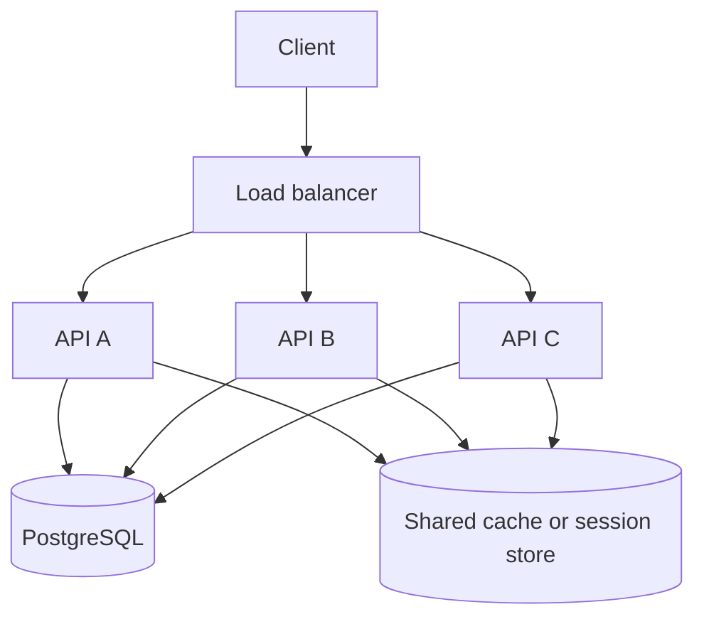
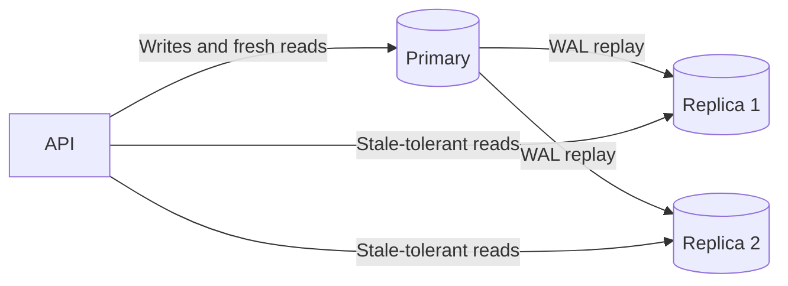
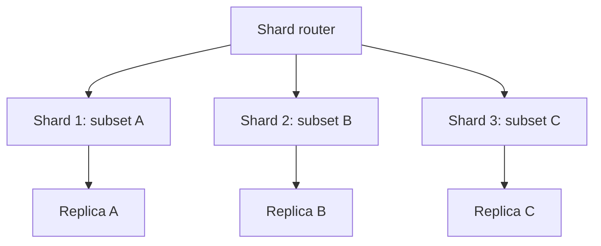
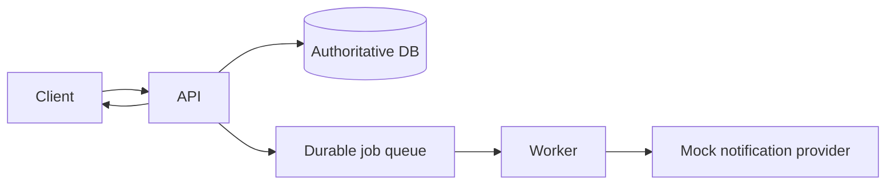
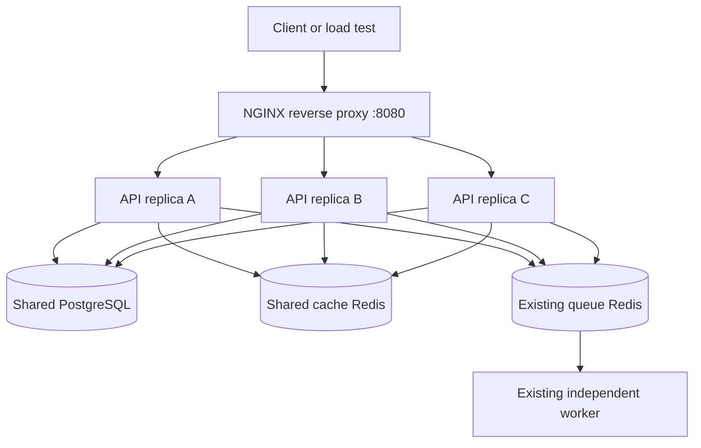

# Video 22 — 21.2. Backend Scaling and Performance Engineering: Part-2

- Video: https://www.youtube.com/watch?v=sOhAopEwjH4
- Playlist position: 22 (course numbering 21.2, following 21.1).
- Date: 2026-11-26.
- Learning status: complete by the owner's explicit GitHub upload request.
- Implementation status: not started.
- Source limitations: video title and chapter outline reverified against the public YouTube description and secondary playlist indexes. The learning session reported partial third-party transcript access; the full original transcript and recording were not independently reviewed during documentation. The explanations and EventHub examples below are teaching synthesis, not verbatim lecture content.

## Learning objectives

Explain why a stateless application tier permits horizontal scaling; how load balancers select and remove upstreams; why scaling the application may shift pressure to the database; distinguish replication, sharding, CDN caching and edge execution; identify asynchronous work, service boundaries and serverless trade-offs; select scaling changes based on measured bottlenecks rather than fashionable architecture.

## Concepts and internal mechanisms

### 1. Horizontal scaling and statelessness (00:43)

Vertical scaling increases resources of a machine; horizontal scaling adds instances. Vertical scaling is operationally simpler but bounded by machine capacity and failure domain. Horizontal scaling adds routing, coordination and dependency pressure; it only helps if the workload can be distributed.

A session stored exclusively in instance A's memory is invisible to B: login on A succeeds, then a request routed to B may return 401. Move authoritative state to appropriate shared storage. Use shared persistent data, a shared session store where applicable, or independently verifiable credentials with consistent keys and authorization/revocation policy. Local temporary state and disposable caches are fine if correctness does not depend on a particular process. Sticky sessions can mitigate affinity issues but undermine easy replacement and failover; they do not make state durable.

### 2. Load balancing (09:11)

An HTTP reverse proxy receives requests, chooses an upstream, forwards requests and returns responses. Layer 4 balancing routes transport connections; layer 7 can inspect HTTP attributes. Connections and requests are not interchangeable, particularly with HTTP/2 multiplexing or long-lived connections.

| Algorithm | Selection | Trade-off |
| --- | --- | --- |
| Round robin | Next available upstream | Equal request count does not imply equal work |
| Weighted round robin | Configured relative weights, e.g. 4:2:1 | Static weights may not reflect dynamic capacity |
| Least connections | Fewest active connections | Connection count is an imperfect load proxy |
| Least response time / resource-aware | Observed latency/load | Requires reliable signals; may oscillate |

Active health checks probe upstreams periodically; passive checks infer failure from actual traffic. Readiness signals eligibility for new work, not just process existence. NGINX Open Source commonly uses passive upstream failure detection; do not imply its standard configuration includes active HTTP readiness probes. Choose a supported local approach and document detection delays. During graceful shutdown, stop admitting work, withdraw the instance from routing, drain accepted work within a deadline, then close dependencies. A sudden crash may lose in-flight requests before detection. Do not indiscriminately replay non-idempotent writes. The load balancer itself can be a single point of failure.

### 3. Database scaling (27:47)

Adding API replicas can shift the bottleneck to shared PostgreSQL. Each process typically owns a pool, so aggregate connection demand increases. Measure query plans, latency, CPU, I/O, connection waits and saturation before adding infrastructure.

**Replication:** maintain copies of the same data. A common primary/standby design accepts writes on the primary and sends WAL records to standbys, which replay them; read replicas can serve suitable SELECT queries. This distributes reads, not arbitrary write throughput.

Asynchronous replication allows lag. Example: primary commits inventory from 100 to 99 at time zero, replica still returns 100 at 50 ms and catches up at 200 ms (illustrative only). Read-your-writes requirements can use primary routing, appropriate replay-position barriers, or a suitable synchronous policy. A synchronous standby acknowledging receipt or flush is not necessarily ready to serve a fresh query; applied-state guarantees depend on configuration. Synchronous replication adds write latency and can affect availability. Monitor lag, failover behavior, and recovery point objectives. Backups remain necessary: replicas can replay accidental deletion.

For EventHub, public event browsing may tolerate stale display data; booking allocation, current authorization and payment confirmation require authoritative correctness. A primary read alone is not enough to prevent races: enforce invariants atomically within the database.

**Sharding:** split distinct subsets of data across independent storage nodes. A toy integer routing rule is `shard = userId % 3`; changing the divisor redistributes many records. Production designs may use range partitioning, consistent hashing or directory/virtual-shard routing. Choose a key based on query locality, data distribution and transaction boundaries. Partitioning inside one database instance is not necessarily distributed sharding.

Sharding introduces scatter-gather queries, cross-shard transactions, hot keys, resharding, migration and operational complexity. Sharding bookings by user may make event-wide queries and inventory coordination expensive; sharding by event could create a hot shard for a popular event. Replication and sharding can coexist. Neither is justified for the current project without evidence.

### 4. CDNs and edge computing (51:22; 1:05:03)

A CDN caches eligible content at distributed points of presence closer to users, reducing origin work and network latency. On a cache miss, the edge obtains a response from the origin; a later hit may avoid origin traffic. At 10,000 eligible requests/s and 90% hits, an idealized model gives 1,000 origin requests/s (not measured; revalidation, non-cacheable traffic and miss coalescing affect reality).

Cache keys, TTL, invalidation, Cache-Control, Vary and authorization govern correctness. Never share personalized or sensitive responses without proven isolation. Public event images and static assets are plausible candidates. Edge computing is broader than caching: lightweight request processing near users can support redirects, routing or other suitable logic; remote database access and platform restrictions can offset latency gains. This is supplementary clarification of the separately listed edge-computing chapter, not a claim of full transcript coverage.

### 5. Asynchronous processing (1:13:25)

Keep essential correctness on the request's critical path; defer slow independent effects such as confirmation email or ticket PDF creation. An illustrative booking flow returns after the booking is durably accepted; independent workers process later jobs. A pending response must not claim confirmation before confirmation exists.

Queues decouple response latency from completion latency; they do not eliminate work. Scale workers independently and monitor queue depth, oldest-job age, retries and failure rates. Database commit and queue publish are separate failure domains unless an explicit atomic handoff strategy exists; a transactional outbox is a possible later design. Retries require idempotent effects and bounded policies. Reuse lecture 14's mock worker lab rather than creating real booking or payment flows prematurely.

### 6. Monolith versus microservices (1:30:43)

A modular monolith deploys as one application with clear internal boundaries. Microservices have independently deployable boundaries, often independent data ownership, enabling targeted scaling, technology selection and team autonomy. They also change local calls into network interactions with partial failures, latency, service discovery, distributed tracing and consistency challenges. Cross-service transactions are more complex than local transactions. Independently scalable workers may address a bottleneck without splitting the entire domain.

Keep EventHub a modular monolith for now; only separate services with demonstrated workload or ownership needs.

### 7. Serverless computing (1:44:09)

The provider manages execution infrastructure and scaling within platform limits; servers still exist. Function environments may be reused (warm) or initialized for new demand (cold), creating additional latency. Event-driven tasks and bursty traffic can fit this model, while constant high utilization, long jobs, platform limits, database connection fan-out, and provider-specific pricing can make other deployment models preferable. Never depend on local function memory for durable correctness. Serverless is not infinite capacity or automatic reliability.

### 8. Engineering mental model (2:10:47)

Measure → identify bottleneck → choose the simplest relevant intervention → repeat under matched conditions. Slow query: query plan/index; repeated reads: cache; saturated app: optimize or add instances; read-heavy database: replicas; write/storage saturation: consider sharding only after simpler options; geographical latency: CDN/edge; slow side effects: jobs. Record successful throughput, p50/p95/p99, errors, saturation and workload. Averages can hide tail latency; adding instances is not automatically a speedup.

## Production behavior and failure scenarios

- A proxy and shared database/Redis may still be single points of failure. Three containers on one host demonstrate process-level distribution, not host-level high availability.
- Health checks have detection thresholds and delays. Record transient failures rather than promise zero downtime.
- Keep proxy timeouts, request limits and graceful shutdown deadlines consistent. Do not enable unsafe retries for non-idempotent operations.
- Preserve security from lecture 20: trust forwarded headers only from configured proxies; prevent spoofed client identity; inspect local rate limiter and cache/session state for replica-dependent behavior. Do not weaken authentication or rate limiting to make the demo pass.
- Budget total database connections across API replicas and workers; run schema migrations once through a deliberate step, not concurrently on every replica.
- Shared cache failures and stale data must not compromise authorization or authoritative writes. Read replicas are not substitutes for transactions.
- Avoid sharing secrets in logs, config examples or the public repository.

## Discussion and misconceptions

No additional learner questions or answers were recorded after the explanation; the upload request confirms learning documentation. The final question was left unanswered by the learner: if two users request the last ticket concurrently on different stateless API instances using the same PostgreSQL database, does sharing the database prevent overselling? No. A naive read-then-write sequence can race. Database constraints plus an atomic conditional update or appropriate locking/transaction strategy are needed; the full concurrency exercise belongs to lecture 23. Statelessness, availability, and consistency are separate properties.

Other misconceptions addressed: equal request counts do not mean equal workload; replication and sharding are different and complementary; caching and asynchronous jobs reduce specific bottlenecks, not all work; microservices are not mandatory for scale; serverless still uses servers.

## Key takeaways and references

- [Original video and chapter outline](https://www.youtube.com/watch?v=sOhAopEwjH4)
- [Course playlist](https://www.youtube.com/playlist?list=PLui3EUkuMTPgZcV0QhQrOcwMPcBCcd_Q1)
- [Secondary transcript-derived material](https://www.usetranscribe.io/yt/sOhAopEwjH4/backend-scaling)
- [Part 1](21-backend-scaling-performance.md)
- Supplementary technical references: [NGINX load balancing](https://nginx.org/en/docs/http/load_balancing.html), [PostgreSQL warm standby](https://www.postgresql.org/docs/current/warm-standby.html), [HTTP caching](https://developer.mozilla.org/en-US/docs/Web/HTTP/Guides/Caching), [AWS Lambda execution environment](https://docs.aws.amazon.com/lambda/latest/dg/lambda-runtime-environment.html).

## EventHub practical assignment — coding agent handoff

**Problem and learning goal:** the single API process is a capacity and availability limit. Demonstrate interchangeable API instances, shared authoritative state, load distribution and bounded recovery while preserving existing endpoints and security. This is a proposed local exercise, not an implemented feature.

**Prerequisites:** inspect current code, tests, configuration, decisions and lecture 21 assignment. Lecture 21 implementation is not started according to the tracker; complete/obtain owner approval for required baseline work before claiming a comparative scaling result. Reuse native Node HTTP, PostgreSQL, existing cache Redis, dedicated queue Redis/BullMQ worker, readiness, telemetry and graceful shutdown as applicable; do not assume new booking endpoints exist.

**In scope / expected behavior:**
1. Inspect state and configuration for process-local sessions, token keys, rate limits, cache and durable writes; document what must be shared and what may remain local. Preserve the existing auth design, don't introduce Redis sessions if unnecessary.
2. Provide a reproducible local Docker Compose topology with three API instances of the same build and an NGINX entry point. Reuse existing dependency containers/volumes and distinct Redis roles; avoid duplicating workers accidentally. Use unique instance IDs in development logs or a safe test-only response header, no secret disclosure. Expose only required ports.
3. Compare round robin with least connections using a mixed-duration workload. Document passive/active health behavior supported by the chosen proxy, timeout settings and shutdown coordination.
4. Use the existing APIs and mock jobs. A write accepted through A must be visible through B under the existing consistency contract. Auth credentials must remain usable across replicas and authorization must stay correct.
5. Document configuration, commands, observations and limitations; record actual results in implementation evidence only.

**Observable acceptance criteria and experiments:**
- Send repeated requests through proxy; demonstrate all healthy replicas serve traffic using logs or test-only IDs. Do not require exact distribution under concurrency.
- Create an authorized event via one instance, read it via another; ensure state survives an API restart. Verify login/auth across replicas plus unauthorized and wrong-owner negative cases.
- Stop or kill one API process, measure time to exclusion and observe requests reaching surviving instances; record failures during detection. Restart and demonstrate return to service. All unavailable should return a bounded proxy error; no infinite retries.
- Trigger graceful SIGTERM with an existing controlled slow request; observe draining and no unsafe replay. Respect existing shutdown semantics.
- Compare algorithms with identical controlled workloads (mix of short/slow requests). Record active connections/request counts, successful throughput, p50/p95/p99 latency, errors, CPU/RAM and database connection usage for one versus three replicas. Keep workload, data, machine and duration fixed; document warm-up and repeats. No required speedup on one host.
- Check aggregate DB pool limits and dependency failure behavior; verify migrations are not raced. Review distributed rate-limit semantics and forwarded-header spoofing; demonstrate existing security expectations or report gaps rather than claim success.
- Run previous tests and typecheck; report actual commands/results and any failures. Use synthetic data and mock providers.

**Edge cases:** unavailable proxy/upstream, brief detection windows, long requests, multiple shutdown signals, stale cache, shared dependency outage, pool exhaustion, retry duplication, replica-local counters and logs. Document process-level versus host-level availability.

**Deferred:** database read replicas, sharding, CDN deployment, edge execution, microservices, serverless, Kubernetes, production multi-host HA, real bookings/payments, and lecture 23 contention implementation. No paid services or frontend work.

## Learning completion (ChatGPT)

- [x] Owner explicitly requested GitHub upload, treated as learning completion.
- [x] Conceptual notes, discussion and assignment documented.
- [x] Learning status updated independently in docs/PROGRESS.md.

## Implementation evidence (coding agent; pending)

No implementation, tests, load experiments or benchmark measurements were performed as part of this documentation.

- [ ] Implementation or reproducible experiment.
- [ ] Acceptance criteria demonstrated.
- [ ] Negative cases and regression checks as applicable.
- [ ] Implementation progress updated and learner confirmed.
