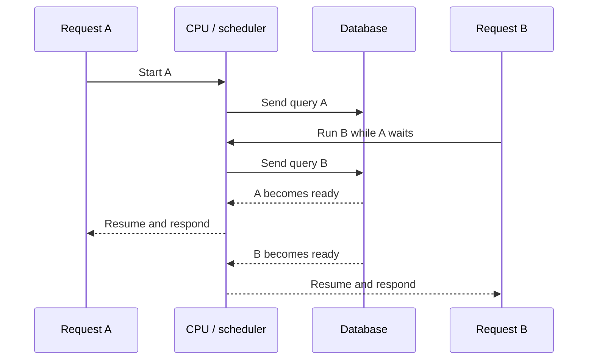
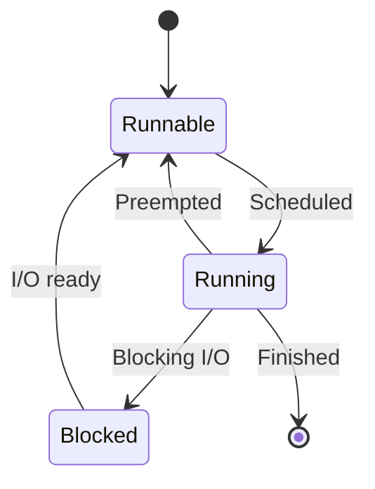
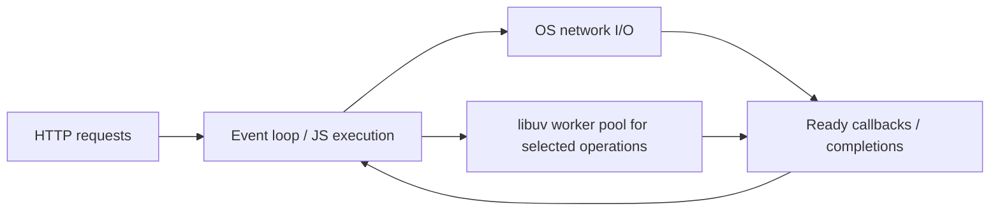
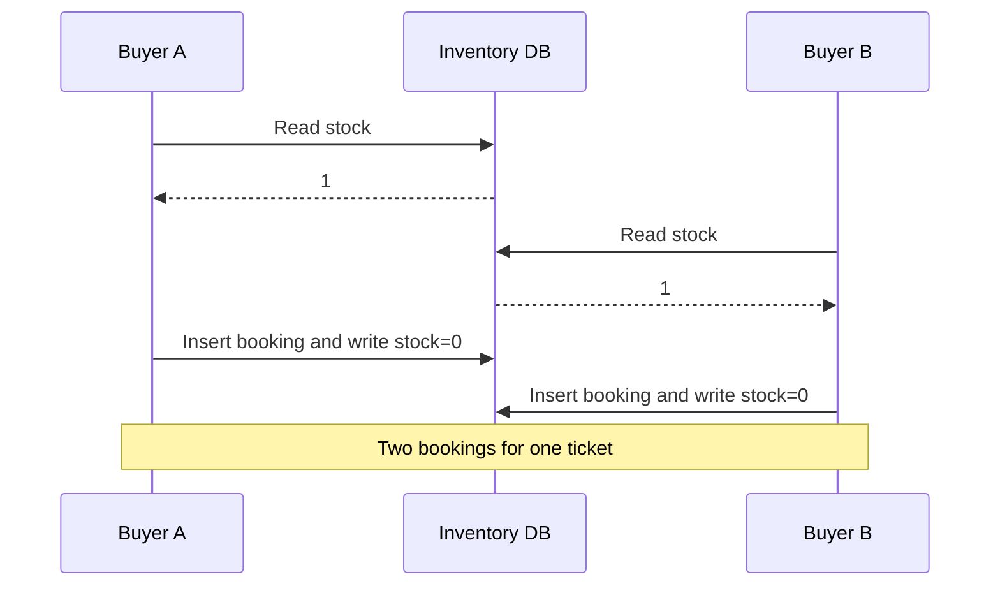

# Video 23 — 22. Concurrency & Parallelism: IO Bound vs CPU Bound

- Video URL: https://www.youtube.com/watch?v=bs9MEYRTA30&list=PLui3EUkuMTPgZcV0QhQrOcwMPcBCcd_Q1&index=23
- Playlist position: 23 (course video number 22; follows both scaling parts).
- Date: 2026-11-28 (documentation).
- Learning status: Complete (explicit GitHub upload request).
- Implementation status: Complete (owner confirmed 2026-11-28; see the evidence section).
- Source availability: title and ID rechecked against third-party transcript-derived material. The full recording and full transcript were not independently reviewed for this commit. This is a record of the learning discussion, not a verbatim transcript. The Node.js and PostgreSQL exercises, production guidance and booking design below are supplementary applications.

## Learning objectives

Explain concurrency versus parallel execution, identify the limiting resource of a task, trace blocking threads and asynchronous I/O, compare runtime scheduling models, reproduce a race and protect a business invariant across requests and processes. Choose a bounded execution strategy and measure both correctness and performance.

## Concepts and internal mechanisms

### 1. Why concurrency exists

A server that completes one whole request before accepting another can leave its CPU idle while waiting for a database or network response. Other requests unnecessarily wait. Concurrency means overlapping lifetimes and progress of tasks; parallelism means executing multiple tasks simultaneously on distinct execution resources. Concurrency is possible on one core; CPU parallelism requires multiple execution resources. Modern hardware details are abstracted here.

Illustrative workload: 10 ms CPU, 80 ms database wait, 10 ms CPU per request. Sequentially, three requests take 300 ms; independent I/O waits can overlap if the downstream service has capacity. Actual time depends on scheduling and contention, not just a formula.



### 2. I/O-bound versus CPU-bound

I/O-bound work is primarily limited by waiting for an external resource (database, network, disk). CPU-bound work is limited by computation (compression, image processing, password hashing, expensive report generation). The same operation can be I/O-bound for an API waiting on PostgreSQL and CPU-bound inside the database. Profile the component under investigation rather than assuming every backend is I/O-bound.

Overlapping independent waits improves utilization and throughput. CPU parallelism can improve throughput for independent computations or latency for divisible work, but scheduling, communication and serial portions limit speedup. Extra concurrency alone cannot create CPU capacity.

### 3. Processes, OS threads and scheduling

A process owns an address space and resources. Threads in a process share its heap, code and other resources but have their own stack, registers and execution context. The OS scheduler chooses runnable threads; it can preempt a running thread, save its context and restore another. Blocking I/O can put a thread to sleep until the operation can progress; it need not consume CPU during the wait, but still retains resources. A woken thread becomes runnable, not necessarily immediately running.



A thread-per-request or thread-per-connection design permits straightforward blocking code but large thread counts incur memory and scheduling costs. A bounded thread pool reuses workers; excess work queues, and blocking I/O can occupy every worker. Pool size, queue limits and overload behavior matter.

### 4. Event loop and Node.js

An event-driven server multiplexes many outstanding operations without dedicating an OS thread to every I/O wait. In Node.js, JavaScript normally executes on one main thread per isolate. Network readiness/completion is coordinated with the OS through libuv; some operations (including many filesystem and crypto operations) use libuv's worker pool. Node is not entirely single-threaded. The OS may schedule other threads and processes while JS waits.



An asynchronous database driver sends a query and returns a promise. Await suspends the async function; its needed local state and continuation are retained. Other work can run; once the promise settles, the continuation is scheduled as a microtask. This is conceptually a state machine, not a claim about the literal implementation of every engine. Await does not make synchronous computation non-blocking. An async function executes synchronously until it yields.

```ts
// Independent operations: sequential start vs overlapping I/O.
const events = await getEvents();
const users = await getUsers();

// Alternative, when neither depends on the other:
const [eventList, userList] = await Promise.all([getEvents(), getUsers()]);
```

Promise.all observes concurrently initiated operations; it does not provide CPU parallelism, limit concurrency or automatically cancel remaining work when one rejects. Preserve sequential order for dependencies. For large collections use bounded batches or a semaphore/worker queue, not unbounded fan-out.

### 5. CPU blocking and parallel workers

A long synchronous calculation on the main JS thread delays callbacks, timers, promise continuations and other request handlers, including /health. Merely adding async does not move the calculation. Use a bounded worker_threads pool, separate process, or the existing background-worker architecture where appropriate. Worker startup, serialization/transfer, memory and scheduling have costs; avoid creating an unbounded thread per request. Worker threads are distinct from libuv's internal pool.

A controlled local demonstration can compare a fixed CPU calculation on the main thread versus in a worker, sending health probes during the calculation. Keep the blocking example outside normal production routes and cap resources/time.

### 6. Goroutines and runtime scheduling (comparison, not a stack change)

Go uses lightweight goroutines with growable stacks, multiplexed over OS threads by its runtime. The GMP model describes G (goroutine), M (OS thread), and P (logical resource needed to execute Go code). The runtime can suspend a goroutine waiting on network I/O and schedule another. GOMAXPROCS controls available parallel execution of Go code, not a hard limit on all OS threads. Blocking syscalls and runtime scheduling require additional handling. Goroutines are cheaper than dedicating OS threads in typical use but not free; too many can exhaust memory, sockets or downstream capacity.

| Model | Scheduling | I/O wait | CPU parallelism |
| --- | --- | --- | --- |
| OS thread pool | OS | Blocking calls can occupy workers | Multiple runnable threads on cores |
| Node event loop | Runtime + OS | Many outstanding async operations | Additional workers/processes for JS |
| Go goroutines | Runtime + OS | Runtime can park waiting goroutines | Multiple P/M execution contexts |

Go example of protecting shared state:

```go
var mu sync.Mutex
var counter int
func increment() {
    mu.Lock()
    defer mu.Unlock()
    counter++
}
```

A mutex serializes entry into a critical section; all relevant accesses must follow the same synchronization protocol. Keep critical sections small. Incorrect lock ordering can deadlock; contention reduces throughput. A channel can communicate work to one state-owning goroutine rather than allowing arbitrary concurrent mutations. Channels do not automatically prevent all races, deadlocks or unbounded work.

### 7. Race conditions and shared state

A race condition arises when correctness depends on an uncontrolled execution order. A data race is a narrower concept involving conflicting unsynchronized memory accesses. A logical race can occur even with single-threaded JS: await creates an opportunity for another request to observe or change state between a read and a write.



An in-process mutex can protect shared memory inside one process but cannot protect shared PostgreSQL inventory across independently running API instances. For the EventHub extension, make the database the synchronization boundary. Use an atomic conditional decrement and insert the booking in the same transaction, using the same checked-out connection. Illustrative SQL (adapt to actual schema and quantity; this is not implemented code):

```sql
UPDATE events
SET available_tickets = available_tickets - 1
WHERE id = $1 AND available_tickets > 0
RETURNING id, available_tickets;
```

At PostgreSQL Read Committed, competing updates to the same row wait and re-evaluate the predicate against the updated row. A zero-row result requires a controlled domain outcome (distinguish missing/ineligible events from sold out). The winning update and booking insertion must commit or roll back together; otherwise a failure can lose inventory. For quantities greater than one, validate a positive quantity and require available stock >= quantity. Enforce nonnegative inventory with a database constraint where applicable. Other isolation levels may require retry on serialization failure. Alternatives include SELECT FOR UPDATE with a transaction, optimistic version checks, and serializable transactions with bounded retries; they have contention/retry trade-offs. No distributed lock is needed for this local PostgreSQL-backed invariant.

## Production behavior and failure scenarios

- Concurrency has a saturation point: queued work increases latency when CPU, connections or a downstream service is exhausted. Bound both active work and waiting queues; use backpressure, deadlines and controlled overload responses.
- Observe CPU, memory, event-loop lag, active/pending DB connections, queue depth, p50/p95/p99 latency, successful throughput and unexpected errors. Distinguish expected sold-out responses from infrastructure failures.
- Reuse existing telemetry, error contracts, authorization and graceful shutdown. Worker failures and database transaction errors must be observable, not silently treated as successful bookings.
- A timeout or lost response does not establish that a transaction rolled back; retry/idempotency policy must be considered. Distinct buyers in this lab isolate the inventory race from repeated-request semantics.
- No benchmark values were observed in the lesson; diagrams and timings are hypothetical.

## Discussion and misconceptions

The session explained why a single JavaScript thread does not prevent logical races, why await does not parallelize CPU work, why independent awaits can be overlapped, and why process-local locks fail across API instances. A final design question was posed: with eight CPU cores and a 10-second synchronous /reports calculation on the main JS thread, will /health reply promptly? Expected reasoning: on that isolate, it can be delayed until JS yields despite other cores being available. A bounded worker pool or independent processing service can free the main thread. No learner answer or other follow-up question was recorded before the upload request.

## Key takeaways and references

Concurrency is about coordinating outstanding work; parallelism is simultaneous execution. Identify the actual bottleneck, bound resource use, and protect invariants at their authoritative storage boundary. Correctness comes before throughput.

- [Course video](https://www.youtube.com/watch?v=bs9MEYRTA30)
- [Third-party transcript-derived material](https://www.usetranscribe.io/yt/bs9MEYRTA30/concurrency-parallelism)
- [Node.js: Don't block the event loop](https://nodejs.org/en/learn/asynchronous-work/dont-block-the-event-loop)
- [Node.js worker threads](https://nodejs.org/api/worker_threads.html)
- [Go runtime scheduler internals](https://go.dev/src/runtime/HACKING)
- [PostgreSQL transaction isolation](https://www.postgresql.org/docs/current/transaction-iso.html)

## EventHub practical assignment — coding agent handoff

**Problem and learning goal:** prevent overselling under concurrent booking attempts, including across API processes, and demonstrate the effect of I/O overlap versus CPU blocking in the existing native Node/TypeScript backend.

**Scope:** inspect current code, database schema, existing atomic allocation experiment from lecture 12, and milestone 21/22 status before implementation. Reuse existing abstractions, migrations, pool, auth, error contracts and telemetry. If the actual booking domain is not yet present, propose a minimal isolated transaction-backed booking lab or explicitly approved minimal domain slice; do not silently introduce the entire eventual reservation/payment system. Prior implementations remain unchanged unless approved.

Suggested incremental exercise:

1. Compare two independent I/O operations sequentially and concurrently with a fixed workload; show a bounded-concurrency version and record actual timing and pool observations.
2. In an isolated local lab, compare a bounded CPU workload on the event loop and in a reusable worker; probe health concurrently and record latency and event-loop lag.
3. Reproduce the last-ticket race in isolated synthetic data using an intentionally unsafe read/check/write path with a deterministic synchronization barrier; do not expose unsafe logic in production.
4. Replace it with a transaction-backed conditional decrement and booking insert, or reuse an equivalent verified existing implementation. Keep the database authoritative across all processes.
5. Run matched load and failure experiments and regressions; document commands, environment, results and limitations. If the multi-instance prerequisite from lecture 22 is not implemented, use two local API processes sharing the same test DB or document the blocked check with owner approval.

### Acceptance criteria

- In a controlled test, 100 distinct valid buyers attempt one ticket each against 10 available tickets, with no injected failures, auth/rate-limit conflicts or competing workloads: exactly 10 bookings succeed and the other 90 receive the controlled sold-out outcome. Unexpected failures fail the test.
- Persisted stock equals zero, never becomes negative, and exactly 10 corresponding booking records exist. No successful booking without its inventory deduction, and no decrement without a corresponding committed booking.
- Inject failure after decrement and before insert/commit; the transaction rolls back and stock remains available. A subsequent valid booking succeeds.
- Run the same invariant check through at least two independent API processes sharing PostgreSQL; local mutexes must not be the sole guard.
- Validate invalid quantity, unavailable/missing/unpublished event, auth and ownership rules as applicable. Reject invalid inputs without mutation. Preserve existing routes and security tests.
- Repeated runs use isolated/reset fixtures. Check no duplicate booking confirmations for the distinct requests; do not claim full retry idempotency unless separately implemented and tested.
- Bound fan-out and worker/pool capacity; demonstrate I/O overlap and health responsiveness with CPU offloading. Record actual p50/p95/p99, throughput, errors, CPU, memory and available event-loop/connection metrics. No universal speedup threshold is assumed.

**Deferred:** real payments, ticket issuance, reservation expiry, refund policy, full webhook idempotency, distributed locks, new service architecture, frontend, switching to Go. Any prerequisite or scope expansion requires owner approval.

## Learning completion (ChatGPT)

- [x] Owner explicitly requested GitHub upload of the completed lecture.
- [x] Conceptual notes, discussion and assignment documented.
- [x] Learning status updated independently in docs/PROGRESS.md as part of this documentation change.

## Implementation evidence (coding agent)

Branch `feat/lecture-23-concurrency`; decision record [ADR-022](../decisions/022-booking-atomic-decrement.md) (proposed). Owner approved the minimal route slice (booking endpoint plus `bookings` table) on 2026-11-28. Environment: Linux, 12 CPUs, Node/`tsx`, PostgreSQL in Docker on 127.0.0.1:56432, shared developer machine (numbers are noisy, single runs unless stated).

### What was built
- `migrations/007_bookings.sql`; `src/modules/bookings/{repository,service,controller}.ts`; route `POST /api/v1/events/:id/bookings` in `src/server.ts`.
- Core (repository): one transaction on one checked-out connection: `UPDATE events SET seats = seats - $q WHERE id = $1 AND seats >= $q RETURNING seats`, then `INSERT INTO bookings`. Zero rows updated means 404 or sold out (a second `SELECT` tells them apart).
- `experiments/concurrency.ts` (`npm run experiment:concurrency`): I/O overlap and CPU blocking.
- The unsafe read-then-write race was NOT re-implemented: the lecture 12 negative control (`bookNaive`, `test/postgres.test.ts`) already reproduces the lost update and still passes. No deterministic barrier was added.

### Acceptance criteria
| Criterion | Result |
| --- | --- |
| 100 distinct buyers, 10 seats, one API process | 10 x 201, 90 x 409, stock 0, 10 booking rows with 10 distinct users (`test/bookings.test.ts`, passed) |
| Same through two independent API processes (ports 48231/48232, shared PostgreSQL, 50 requests each) | exactly 10 bookings, 90 x 409, stock 0 (passed) |
| Failure after decrement, before insert | rollback: stock back to 5, no row, connection released; next booking succeeds (via the repository hook, not over HTTP) |
| Negative cases | 401 (bad and missing token), 404 unknown event, 422 for quantity 0, -1, 11, 1.5, "2", null, 1e9 and a non-object body, 400 malformed JSON; stock and rows unchanged; a `userId` in the body is ignored |
| Quantities | 40 buyers asking 1-4 seats against 25: never oversold, stock = 25 - booked; a request for more than remains is refused whole |
| Cache | public `GET /events/1` shows the new seat count right after a booking |
| Regressions | legacy `POST /bookings` still 501; lecture 12 lab tests pass |

### Experiment output (`npm run experiment:concurrency`, one representative run; three runs of part 1 agreed within ~5%)
| I/O: 20 queries of `pg_sleep(0.08)` | Wall time |
| --- | --- |
| sequential | 1650 ms |
| `Promise.all` (pool max 10, so two waves) | 214-229 ms |
| bounded, 2 in flight | 830 ms |
| bounded, 5 in flight | 335 ms |

| CPU: 100M-iteration loop, `/health`-like probe every 20 ms | Work | Probes answered during the work | Probe latency |
| --- | --- | --- | --- |
| on the main thread | 557-982 ms (3 runs) | 1 | the single probe waited for the whole calculation (608-1033 ms) |
| in a `worker_threads` worker (one fresh worker per run) | 998-1350 ms | 44-61 | p50 2 ms, max 8-13 ms |

Answer to the lecture question: a 10 s synchronous calculation on the main thread delays `/health` until it finishes, on any number of cores; a worker keeps the loop free (worker start-up and transfer cost made the same calculation take about as long or longer here).

### Tests
`npm run typecheck` clean. `npm test`: 360/360 on one run; another run of the whole suite had 359/360 with `data written before an app restart is readable after it` failing (it passed in isolation twice; cause not investigated). The jobs test "provider slower than the processing timeout" also failed once in an earlier full run (flaky before this lecture). Two existing tests had to change because of migration 007 (the migration file list and table list in `postgres.test.ts`; `TRUNCATE events` became `... CASCADE` in `events.test.ts` and the bench seed because `bookings` references `events`).

### Limitations
- Only `pg_sleep` and a synthetic loop were used; no p95/p99 or CPU/memory numbers were collected for the booking endpoint under load, and no event-loop-lag metric (my first attempt with `monitorEventLoopDelay` did not record the blocked interval, so it was removed).
- The CPU experiment uses a new worker per run, not a bounded reusable pool, and is not wired into any route.
- No idempotency key, payments, reservation expiry or cancellation (deferred by the assignment).
- The rollback test injects the failure at the repository, not over HTTP.

- [x] Implementation or reproducible experiment.
- [x] Acceptance criteria demonstrated (except the performance metrics listed under limitations).
- [x] Negative cases and regression checks.
- [x] Learner confirmation (owner confirmed 2026-11-28).
